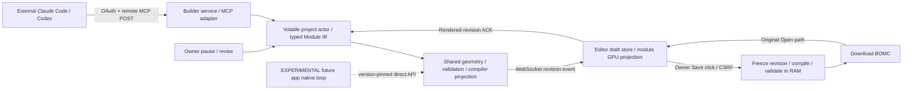

# MASTER IMPLEMENTATION PLAN — Sibambo Stable Editor and Experimental Builder

ID: **SIB-TWO-PHASE-001** · Version: **1.2** · Date: **2026-11-08, Asia/Jakarta** · Investigation/authoring started 09:35 WIB; publication receipt records final verification time.

Author: primary Codex architect in this session. Requested author setting: **GPT-6.1 Sol MAX**. The runtime exposes the GPT-6/Codex family but does not independently attest the precise deployment variant or reasoning setting; precise model provenance is **unverified**, not fabricated. Eligibility is established by the user's explicit authorization of this primary planner for this scope. No subagents used.

Status: **ARCHITECTURE DECISIONS RECORDED; EXECUTION CONTRACT FROZEN subject to SE-00 baseline/environment gate. Product implementation NOT STARTED by this planning session.** Implementation, paid model trials, production deployment, releases and merging existing implementation PRs require their separate authority. Documentation publication and project-management changes are authorized now.

Scope: `KaisAbiyyi/sibambo-editor` (private) and `KaisAbiyyi/sibambo-bomc-builder` (public), plus their actual Notion workstreams. Supersedes: [v1.1](MASTER_IMPLEMENTATION_PLAN_2026-11-08_SIB-TWO-PHASE-001_v1.1.md) for this contract; v1.0 remains historical; old BMB32 roadmap **as a product-delivery schedule only**, and old Editor On Hold designation **for this newly authorized Stable planning scope only**. Historical artifacts, completed component statuses, author provenance, licensing restrictions and unrelated Editor backlog are retained. Revision history: v1.0 first two-product execution contract, preserved; v1.1 locks Python/browser canonical byte representation, project digest, credential-principal identity and restart restoration. v1.2 corrects a source-proven reciprocity constraint: bounded multi-module atomic transactions, corresponding atomic render swap, canonical revisions/tombstones and coordinate projection are now explicit. No product implementation occurred between versions.

## Intent

**Phase 1 / Stable has absolute implementation priority.** An owner opens Editor, uses Extensions → MCP Extension to sign in/select a project/approve an agent, and sees each accepted remote construction operation rendered while a real external Claude Code or Codex agent works. The owner can inspect, pause, revoke access, and request revisions. Only the owner's Save action produces a persisted BOMC design file. That exact file must reopen through the original Editor importer. “Stable” is the delivery workstream name; readiness remains NOT_RUN until its product gate passes.

**Phase 2 / EXPERIMENTAL** is a separate future application, brand and repository name TBD. It collects exact site selection with uncertainty, room requirements, and client lifestyle/desired feeling, then uses native internal orchestration to research, plan, build, evaluate and revise. It calls shared Builder APIs directly, not MCP for its internal agent loop. Every intelligence capability has a separate experiment and go/no-go. It cannot block Stable or change Stable schemas without a new approved contract.

## Repository-first audit and evidence limits

Inspected actual source, repository instructions, dependency manifests, tests, issues, PR metadata and Notion task schemas/rows. Main source pins at inspection:

| Surface | Verified state | Consequence |
|---|---|---|
| Builder main | `7cd6ca7771e7ad64418cb1808edf9460e9f6cc19` | Python headless core, Module IR, geometry, compiler, stdio MCP, context sessions and deterministic experiments exist. No remote product service. |
| Editor main | `04e4c1d1656e7c65b093d1667f556c3fdb4b5130` | SvelteKit/Three/Bun workspace; browser import and bounded local authoring. No hosted project/auth/collaboration APIs. |
| Builder BMB-026 #62 | Draft, open, `8fc6ebbeb1996889983bd6fff0958d1f9a7aaf00` | Accepted bounded house evidence does not mean its code is integrated in main. Preserve localized-window revision and compiler-budget workaround evidence. |
| Editor #12 / #13 | Open/unmerged predecessors; #12 `b5f46a761d1763241b60375cbb5f7110d62d99d2`; current #13 branch `98b01dc16ae11f6712dd86de38541a1b889f699d` | Original consumer fixes/proof are distinct from main readiness. |
| Editor BMB-027 #14 | Merged **into #13 feature branch**, merge `98b01dc...`; original head `7d03a40e19df3a8ee19ced02d0fcac8bec3a2944` | File picker read-only preview disables Save BOMC and Move; no live MCP bridge. Not merged into main. |
| Builder BMB-031 #69 | Draft open `253725b8143f08aa6e5fc0718e10235392e861f5` | Packaging Ready cloud PASS; Release Approved BLOCKED. Release is not a prerequisite for building the Stable slice from an authorized source pin. |
| Notion BMB registry | 31 Done, 031 Review; historical Last Done 027/028/029/030/032 | Preserve task-specific acceptance. Remove 96.9% as product-readiness proxy. |
| BMB-025/028 | `agentguide/controller.py::MCPClient.batch` uses scripted subprocess stdio batches; benchmark native provider tokens null | Real tools/compiler are used, but no autonomous real-model remote-live browser proof. |
| BMB-032 | `integration/generator/brief.py::lower`, `handoff.py::submit` | Deterministic single-row room proof; journal and IR produced separately; no site intelligence/native autonomous planning system. |

BMB-021 native synthetic Exact/visual acceptance was accepted by the owner on its recorded source/consumer pins. Keep that bounded receipt; do not request the same visual check again or generalize it to remote Save, arbitrary authoring, release, or complex round-trip. The local `BMB021-NATIVE-LOCAL-ACCEPTANCE.md` was re-read. Source/branch installation identities may since have changed; no new native check occurred here.

### Why the 32-task plan missed the product

1. It measured component completion, not a top-level end-to-end remote product invariant. A valid file compiler and a read-only file-picker preview could both be Done while the intended experience did not exist.
2. Journal generic JSON blocks, typed Module IR, and compiled geometry are separate sources. Current MCP exposes journal operations and supplied-IR validation, not an authoritative typed geometry-authoring transaction or compiler tool. A bridge cannot infer their equivalence.
3. Stdio launcher identity/private filesystem assumptions do not establish internet OAuth, pairing, tenant isolation, revocation or reconnect semantics.
4. File preview reload is not a live operation feed. There is no revision/frame acknowledgment path, draft owner, or explicit owner-only remote Save boundary.
5. Scripted controller/estimated tokens and a one-row deterministic survey adapter do not prove an autonomous architectural planner, a live model's reliability, or a client interview's validity.
6. Stacked merges and accepted evidence can leave default branches missing essential code. Baseline integration must precede new features; green component CI cannot fill that gap.

The remedy is **new product gates**, not reopening every accepted component task. Remote gates and Experimental research are a new ledger, SE-00…11 and XB-00…11. All inherited gates remain scoped.

## Mechanism and ownership

Builder exclusively owns Module IR, typed geometry operation lowering, stable IDs, project CAS and validation, pure face/mesh projection, BOMC compiler and interoperability schemas. Editor owns onboarding, owner intent, browser synchronization, draft projection/navigation, downloaded-file acknowledgment, and original consumer proof. Remote service code lives in Builder; same-origin BFF code lives in Editor. Experimental future app owns site/brief/interview/research/planning/provider loop, and consumes shared Python APIs. Do not copy the private Editor kernel into public Builder. Retain GPL-3.0, owner-attested/clean-room restrictions and synthetic-only public fixtures; records of private client data remain private. A public protocol schema is allowed; source reuse is not inferred from matching licenses.

Current traced flows, not inferred from filenames:

| Existing path/symbol | Current flow and ownership | Planned boundary |
|---|---|---|
| `agent/bmb_mcp.py::SCHEMAS, _command, _perform, Server.handle` | request bounds→CLI dispatcher→filesystem journals; launcher owns root; per-process stdio | Unchanged stdio adapter; new HTTP adapter calls actor directly. Protocol and authentication are separate adapters. |
| `core/identity/store.py::ModuleStore.apply`; `core/storage/journal.py::JournalStore.apply` | generic block CAS/idempotency; JournalStore adds disk write/recovery | Reuse in-memory ModuleStore in staged actor; do not use disk journal for unsaved model. Existing disk workflows remain unchanged. |
| `core/assembly/merge.py::assemble`; `core/validator/validation.py` | IR→seam ownership/placements→typed diagnostics | Actor consumes canonical validated IR, never guesses IR from generic journal blocks. |
| `bomc/compiler/graph_to_bomc.py::compile_document, compile_assembly`; `semantic_v12.py::_shape_faces, _mesh, encode_semantic` | supplied IR→assembly validation→existing geometry builders→face triangles→BOMC bytes | Extract shared pure projection intermediate. Compiler and live view use identical face/triangle/material semantics; golden bytes unchanged. |
| `apps/editor/src/routes/+page.svelte::openModel` | file→admitE4File→loadE4InWorker→EditorSession/viewport; conditional editable-subset inspection | Reopen remains unchanged. Add distinct builder-draft mode rather than convert arbitrary Builder output to local editable subset. |
| `+page.svelte::saveBomc, cancelSave, requestTransition, snapshotLoadedState, restoreLoadedState, unload, onDestroy` | worker write→Blob download→acknowledgeDownload; generation fences, dirty transition guard and disposal | Route Save by explicit mode; local authoring worker flow unchanged; remote draft path freezes server r and saves exact bytes. Every exit handles unsaved warning and socket/resource disposal. |
| `PreparedSceneViewport::setDomainOverlay, setAuthoringBounds, dispose, observe` | caller-built objects transferred to viewport for disposal; renderOnce on change | New external-draft wrapper uses module keys, source-face metadata/picking and frame receipt. Unchanged module objects retained. Overlay disposal stays viewport-owned. |
| `authoring/scene.ts::boundsForSnapshot, geometryForFace` | private local-authoring graph→GPU projection | Read-only reference. Do not make Builder dependent on this private implementation. |

## Locked Architecture Decisions / ADR ledger

| ADR | Decision and alternatives rejected | Consequence / owner |
|---|---|---|
| TP-001 | Two products, Stable first; future Experimental repo/brand TBD. Reject embedding an autonomous planner in Editor. | Separate budgets/backlogs/processes; Builder shared core owner. |
| TP-002 | Remote MCP Streamable HTTP over TLS; fixed researched protocol 2026-07-28, compatibility probe for actual clients. Reject stdio tunnelling/localhost listener/browser extension as primary product transport. | MCP clients do not need access to owner filesystem. No deploy occurs in this planning session. |
| TP-003 | Browser live feed is application WebSocket, independent of MCP notifications/sessions. Reject full BOMC reload each edit and assuming MCP GET/SSE session semantics persist in 2026. | Browser sees exact ordered revisions even when agent client has no subscription support. |
| TP-004 | Volatile drafts only before Save. Reject default automatic journal/IndexedDB/server model persistence. | Unsaved draft lost if both service and page disappear. RAM state/revisions/replay retained within TTL; recovery is explicit. |
| TP-005 | Typed canonical Module IR plus in-memory ModuleStore CAS, one fenced project writer at a time with bounded multi-module atomic transactions. Reject CRDT/OT and simultaneous independent per-module writers for v1. | Simpler deterministic seam/revision correctness; multiple agents read and take turns; disjoint parallel writers require a future plan. |
| TP-006 | Auth0 Auth for MCP + Universal Login is the managed authorization server recommendation, OAuth PKCE S256; Editor BFF opaque cookie, grant bound to tenant/project/subject/client. Reject self-built passwords, bearer URLs or pairing-code-as-auth. | SE-00 needs actual tenant/audience/client registration/environment receipt; missing configuration blocks dependent implementation, not architecture improvisation. Auth0 access/cost not assumed purchased. |
| TP-007 | One shared Python face/mesh projection and compiler, Editor consumes public typed view schema. Reject separate TS geometry generation and GPU-as-document. | No duplicate geometry math, loss of fidelity or private source transfer. |
| TP-008 | Owner-only Save freezes r, compiles/validates in RAM, downloads exact BOMC. Reject agent export/save capability or auto-export on operations. | Browser dispatch is acknowledged, actual file retention is owner evidence. Cloud saved-project storage is out of initial Stable scope. |
| TP-009 | Native Experimental coordinator/state machine calls direct Builder API. Reject reusing BMB-032 MCP orchestration as internal architecture or a swarm framework. | Existing legacy handoff remains a compatibility adapter; new app can optionally expose an external MCP adapter later only by new plan. |
| TP-010 | Constraint solver+deterministic geometry, with LLM reasoning restricted to typed briefs/zoning/critique. Reject unconstrained mesh/code generation as foundation. | CP-SAT experiment versus deterministic baseline; learned layouts only candidates, not accepted geometry. |
| TP-011 | Evidence provenance and user-confirmed needs, no psychological diagnosis/personality score. Reject false precision from map pin/weather grids and unsupported psychometrics. | Site/needs/interview research independently qualified. Architecture outputs remain schematic EXPERIMENTAL. |
| TP-012 | Configurable BYOK providers; Qwen ~27B notebook experiments, Claude API candidate after measured comparison. Reject hard-coded provider/hidden fallback or Colab production service. | Per-run spend/usage/cancellation and credential retention boundaries mandatory. |

### Protocol and state contract (normative)

Stable v1 new project starts empty at `projectRevision=0`, with `projectId` UUID, `tenantId`, `epoch` random UUID, canonical `modules` map, `moduleRevisions` map, `savedRevision=null`, grant map and `writerFence=0`. Existing BOMC files can be opened for inspection. Importing arbitrary saved BOMC back into editable Module IR is **not** part of the first slice; never fabricate a reverse compiler or section241 compatibility. An optional IR sidecar project format needs a separate approved plan.

`DraftOperationV1={schemaVersion:1, projectId, epoch, operationId:UUID, expectedProjectRevision:uint53, leaseFence:uint53, expectedModuleRevisions:{id:uint53|null}, action:{kind:'transaction',changes:[{kind:'replace_module',module:ModuleIR1}|{kind:'remove_module',moduleId}]}}`. Authentication supplies principal/tenant; those are never trusted from payload. Helper add_floor/add_wall/add_opening/update_operation tools validate arguments and lower deterministically into this same transaction; full-module raw IR is schema-validated. Module ID/operation IDs retain existing schema rules. One construction transaction changes 1–8 distinct modules atomically, including both participants of a reciprocal seam. Private-window revisions normally change one module. Shared-seam creation/revision includes every directly affected participant in the same transaction; a missing peer update is rejected `DEPENDENCY_UPDATE_REQUIRED`, never accepted as a dangling intermediate. Splitting a physically atomic seam update across separately accepted operations is forbidden.

Source correction for v1.2: `core/assembly/merge.py::_world_port` requires peer and seamId together; `_check_seams` requires the peer port to exist and point back, exactly one owner and coincident opposing world frames. These cannot be introduced by two individually valid single-module commits. The project layer therefore stages **all transaction changes** before invoking `assemble`/validation once. Existing assembly/validator rules remain unchanged.

Transaction normalization and revision rules: changes length1–8; derive moduleId from each replacement/remove, reject duplicate IDs, sort changes lexicographically by ASCII moduleId before request hashing and staging. Existing targets require their exact current revision; new targets require expectedModuleRevisions[id]=null and must never have been created/tombstoned in this epoch. New canonical module revision is1; replacing an existing module requires module.revision=expected+1, with uint53 overflow rejection. Each targeted existing/new module increments once, project revision increments once for the whole transaction; untargeted modules retain their revisions/hashes. Compute and require expected revisions for every existing touched seam peer and dependency outside the target set; missing or stale entries reject. Global project CAS remains mandatory.

Reuse `ModuleStore` only in an isolated staged clone. Each live module stores exactly one block `canonical-module` whose data is the canonical Module IR dictionary; its serialized block data must fit the existing65,536-byte core cap (strictly enforce it, do not raise it). New module: create in the clone at revision0 then one apply to revision1. Per-module core idempotency key is `tx-` + SHA256(UTF8(operationId + newline + moduleId)). Removal replaces that block with `{deleted:true,moduleId,revision:expected+1}` in the clone and records a tombstone; no same-epoch ID resurrection. Typed live-module map excludes tombstones. Stage all changes, validate the final assembly/geometry/ports/compiler budgets, then swap cloned ModuleStore, typed map, tombstones, module revisions, project revision, event and project idempotency outcome together. No clone write is observable through reads. Any failure discards the entire clone, including newly created modules, core idempotency entries and tombstones.

Render transaction: every event includes all changed/removed modules and must be staged completely before attaching new scene objects. `setExternalDraftProjection` accepts the complete transaction list and performs one scene swap and one render; do not call the existing immediate-render `setDomainOverlay` separately for each target. Retain previous dedicated groups and pick/bounds records detached but undisposed until the new render succeeds. On success dispose retired groups exactly once; on failure detach/dispose new groups, reattach all previous groups/metadata/bounds, render the previous scene and pause writes. New dedicated module groups own their geometry/materials; do not share disposable materials between changed and retained groups. Unchanged groups keep object identity. ACK once after the completed render/next animation frame, naming the single project revision. Never expose a half-seam frame as an accepted construction operation.

Coordinate projection: shared Python projection contains **module-local** Float64 positions/normals/face indices and one **row-major canonical world transform** from `Assembly.world_transforms`. Editor flattens module groups and applies `R * M_world`, where R is the -PI/2 rotation about X mapping (x,y,z)→(x,z,-y). Construct Matrix4 from row-major values with `Matrix4.set(...values)`, not untransposed fromArray; do not also apply parent/local transforms or bake world coordinates a second time. Three normal matrices handle nonuniform/mirrored placements; distinct front/back materials use explicit FrontSide/BackSide face passes with correct winding. IR remains unmodified. Test nested/mirrored/sheared fixtures against original importer world-space geometry.

Snapshot/restore includes tombstone ID/revision rows and the same active/null manifest, so deleted IDs cannot silently resurrect after recovery. Empty new/all-deleted project Save returns typed EMPTY_PROJECT with no bytes or saved marker; current compiler's nonempty-assembly constraint is retained. Existing saved BOMC files still reopen for inspection.

Actor transaction order, under one mutex:

1. Validate token+project grant+role+epoch, owner presence and live fenced writer. Reject before expensive work.
2. If operationId exists: equal canonical request digest returns prior result; unequal digest → IDEMPOTENCY_CONFLICT. Then check project CAS and touched/neighbor module revisions.
3. Clone complete candidate module state and stage every transaction target in ModuleStore; validate schema, assemble and all affected geometry/ports/seams, project faces/triangles. Enforce existing compiler support/budgets before acceptance; a later Save cannot discover unsupported geometry hidden by preview.
4. Compute canonical IR SHA256/draft digest and replace actor state, revision, module counters and idempotency outcome **in one swap**. No disk I/O. Produce event r+1.
5. Deliver event to owner. Until its render ACK or timeout, next write gets RENDER_PENDING. Tool may return `{status:'applied',revision,rendered:false}` after2s; polling operation_status returns known outcome. Do not roll back an already accepted operation because client disconnects.

`DraftEventV1={schemaVersion:1,projectId,epoch,revision,previousRevision,operationId,changed:[{moduleId,moduleRevision,canonicalIrJson,contentSha256,projectionJson,projectionSha256}],removed:[moduleId],draftSha256}`. Server SHA hashes the exact UTF-8 bytes of canonicalIrJson, not GPU buffers or a JavaScript reserialization. Projection contains indexed triangles, face IDs/loops/normals/solid front/back materials, module transform; JSON is finite-number-only; signed numeric matrix semantics from Module IR. Binary typed buffers may be added only in a later version, not guessed during this implementation.

Byte contract: Python serializes each validated module with `json.dumps(module, sort_keys=True, ensure_ascii=False, separators=(",",":"), allow_nan=False)` and encodes UTF-8. `canonicalIrJson` carries that exact JSON text as a string; its UTF-8 SHA256 is `contentSha256`. Browser hashes `TextEncoder.encode(canonicalIrJson)` **before** parsing; it must never regenerate bytes with JSON.stringify. Parsed IR is read-only projection/context state, while the original canonical string is retained for restore. Reject duplicate keys/nonfinite JSON and re-canonicalization mismatch on server restore. Project digest is SHA256 of UTF-8 compact JSON for `[[moduleId,moduleRevision,contentSha256_or_null],...]`, sorted lexicographically by ASCII moduleId, with separators comma/colon and no whitespace. Active rows have a content hash; deleted/tombstone rows use null. This manifest uses only ASCII strings, uint53 integers and null, avoiding cross-language float spellings. Event draftSha256 is verified by the browser from its updated manifest. A projection carries its own payload SHA over an exact `projectionJson` string under the same rule; parse only after hashing and validate face/index/count limits. Snapshot has the same module records and manifest, never an independently reserialized numerical digest.

Restart restore: owner reauthenticates and explicitly approves restore of the browser-held canonical strings; new actor gets a **new epoch**, retains supplied revision counters only after validating every module/hash/manifest/geometry/compiler budget, and publishes a full snapshot before any write grant. Old epoch requests/tickets/leases are rejected. Old operation outcomes are not silently recreated or automatically replayed; operator reconciles final canonical state and grants new writer authority. If browser and service both lose state, unsaved changes are unavailable; a retained BOMC file still opens for inspection. No automatic reverse compiler or new unsaved disk state.

Agent identity is `(issuer,subject,client_id)` plus owner-approved application grant. It is a credential principal, not proof of a particular AI process or clientInfo display name. Two sessions sharing the same credential principal share its grant and revocation; UI must label that scope honestly. The required multi-agent contention proof uses distinct Claude Code and Codex client principals. Per-process cryptographic identities or simultaneous module leases are outside v1; do not imply isolation between credential-sharing processes.

Browser stage event only when epoch/project/generation match and `previousRevision==appliedRevision`. Verify content/hash/schema off main thread, replace affected projection atomically, render, then emit ACK `{revision,draftSha256}`; distinct accepted operations receive distinct render receipts. If duplicate identical event, acknowledge existing state without reapplying; if hash mismatch/gap, pause and request snapshot. A resync snapshot is bounded current canonical state plus projection and revision, not infinite events. Camera and selection are browser-local, not revisions.

Resource constants: request ≤256KiB per tool/operation, canonical project JSON≤2MiB, compiled file≤2MiB, existing stricter MAX_MODULES/operations/strings/materials/triangles/geometry caps remain in force. One in-flight transaction/project, max8 queued requests then BUSY; max20 active projects/service worker; worker CPU/wall deadline30s and RSS512MiB. Single service instance/actor owner for first staging slice; no multi-worker routing to duplicate actors. Memory event ring128 entries/8MiB, TTL30min after disconnect; heartbeat5s/expiry15s; writer lease30s/refresh10s, transfer increments fence. Rates: writes≤5/s/project; reads≤60/min/principal with burst10, pairing5 attempts/5min. Quota excess explicit typed error. No model/credential content in logs, service swap/core dumps/model backups disabled; inability to configure those retention boundaries blocks nonproduction deployment qualification.

Save contract: `POST /projects/{id}/save-intents` only through authenticated owner browser BFF/CSRF, requires exact epoch/revision/digest. Freeze actor at r, return intent ID and binary after independent validation; intent is owner/project bound, one use, expires60s. Agent OAuth grants never include save capability. Browser verifies file/hash before download; `POST /save-intents/{id}/ack` marks only savedRevision r and retains dirty if draft advanced after freeze release. Compile failure/cancel means no saved marker, old file intact, dirty preserved. Save cannot encode unsupported IR by dropping data. Bytes and intents discarded after ACK/expiry. File download is sole durable model output in Stable v1; no automatic project database. Closing/discard never saves silently.

### Auth, UX and operational boundaries

Editor requires same-origin BFF endpoints under `apps/editor/src/routes/api/mcp/` (login/callback/logout/session/ticket/grants/pause/save proxies), with allowlisted service URL in server configuration, no caller URL. New server module `apps/editor/src/lib/server/mcp-bff.ts` owns OAuth state/PKCE/opaque sessions and CSRF. The actual IdP tenant, redirect URI allowlist, service endpoint and secret store are deployment inputs recorded by SE-00, never committed credentials. Use Auth0 supported standards-based registration; pre-register supported client IDs when necessary. Test actual Claude Code/Codex versions; unsupported SDK/protocol/IdP combination is **blocked→REVIEW/PLAN**, not a custom insecure fallback.

The Extension explains “Unsaved draft: retained in this open session; use Save for a BOMC file.” Initial connection is read-only until owner grants write and a lease. Pairing compares real subject/client and code; a display name is not identity. Agent list shows scopes/current writer/last seen/last rendered revision/pause/revoke/remove. Errors offer retry/reconnect/re-pair with no content loss while page remains. Browser background/owner absent pauses writes so the live-view promise stays honest. User intervention supports pause, revoke, typed parameter revision through actor and supply a typed parameter revision through the same fenced actor; free-form arbitrary local mesh editing of Builder drafts is outside v1. A seam-wide edit must include all reciprocal participants within the 8-module/256KiB transaction ceiling; larger edits return a clear supported-scope error without partial state change.

Infrastructure recommendation: existing SvelteKit Editor remains frontend/BFF; Python ASGI Builder service runs long-lived process in isolated nonproduction container with TLS reverse proxy capable of WebSocket and request-streaming, no CDN buffering. Do not place actor state in short-lived Vercel functions. Production hosting/vendor purchase is not authorized here. Auth sessions/grants are volatile for staging (IdP owns account data), so restart requires login/pairing; no hidden durable design state. A later hosted-save/collaborative durability design needs separate approval.

## Invariants

1. Every accepted geometry revision is attributable to one authenticated principal/project/epoch/operation and one visible frame or explicit renderPending recovery state. No skipped revision marketed as live.
2. No BOMC design file or durable model snapshot is written before owner Save; auth metadata and non-content timing counters are not model storage. Draft and saved revision remain separate.
3. One project writer lease and monotonic fence; stale/unauthorized/conflicting writes cannot change canonical or visible geometry.
4. Rejected operations leave IR/revisions/digest/GPU content unchanged. Render failures preserve the last good frame and prevent new agent writes.
5. Canonical geometry uses metres/right-handed+Z; GPU coordinates are disposable and never compile source. One conversion into Editor coordinate space.
6. Save and live projection use the same canonical revision/geometry. Saved BOMC passes independent reader and original Editor; no private flat-subset reserialization that loses Builder geometry.
7. Existing stdio/journal APIs, compiler support ceilings and historical receipts retain their semantics. No E5, producer/RBZ changes, certification promotion or native-host automation in this plan.
8. Experimental has no dependency edge into Stable delivery. Provider keys and sensitive briefs never reach public traces or Stable credentials.
9. No accepted old task/owner UX receipt is erased; replacement product gates start NOT_RUN. Notion task state is PM truth; exact GitHub source/tests/artifacts are technical truth.

## Change surface / expected diff shape

**This session MUST change documentation/navigation only inside tracked repos**, through `docs/two-phase-architecture-20261108` draft PRs. New `docs/two-phase/{MASTER_IMPLEMENTATION_PLAN_...v1.0.md,ADR-LEDGER.md,GAP-AUDIT.md,TASK-CONTRACTS.md,RESOURCE-MAP.md}`; Builder `README.md`, `docs/ROADMAP.md`, `docs/ARCHITECTURE.md`, `docs/TASK-INDEX.md`; Editor `README.md`, `docs/architecture.md`, `docs/TASK-INDEX.md`. Existing docs receive a dated supersession notice/link, not rewritten evidence. Workspace canonical plan and summary use dated/versioned directories and indexes. No dependency lock/package/source/test/workflow implementation changes now. Public docs include public contracts and synthetic technical evidence only.

**Future implementation MUST change** only the paths/symbols listed in each work package, plus their prescribed tests/docs. New files have explicit responsibility in the package. **MAY change** imports/manifests/dependency locks when needed for the frozen MCP SDK/ASGI/Auth0 integration, and existing tests strictly when extending coverage without altering old assertion meaning. SE-06 new viewport methods use `setDomainOverlay` for ownership/disposal and source-face picking; no speculative scene rewrite. A syntax-level adaptation is allowed only if behavior/ownership/test meaning is unchanged and recorded.

**READ ONLY references:** existing geometry builders, public Module IR schema, original E4 reader, private local authoring worker/writer, immutable fixtures/receipts. **MUST NOT change:** producer/SketchUp/runtime/RBZ/lineup, unrelated Rooms/Benchmark/Model-Eval source, old E1 guards, unapproved compiler limits, private-to-public source transfers, production deployment settings or release/merge state. Unexpected source diff or changed compiler golden hash is a stop condition even when builds pass.

## Execution order, milestones and resource ownership

Stable critical path: **SE-00 → SE-01 → SE-02 → SE-03 → SE-05 → SE-06 → SE-07 → SE-08 → SE-10 → SE-11**; SE-04 follows SE-00 and joins SE-05; SE-09 follows03/04/05/07 and joins10. No backend-first “complete” label until user Save/reopen/live-agent gate.

| Milestone | Gate / tangible outcome | Planning estimate, not promise |
|---|---|---|
| Stable0 | Baselines authorized and typed actor/projection contract proven | 5–8 engineer-days plus owner decisions |
| Stable1 | Remote agent can feed visible draft and owner can Save/reopen in staging; hardening still outstanding | 10–18 incremental engineer-days |
| Stable2 | Recovery/security/performance and both real-client owner sessions pass; no release implied | 7–12 incremental engineer-days + owner time |
| Experimental0 | Licensed evidence/program/interview/provider datasets+pilots | 10–17 research-days + recruitment/compute |
| Experimental1 | Native loop and measured solver/geometry experiments | 10–18 incremental research-days |
| Experimental2 | Separate app prototype/pilot; brand TBD and entire product EXPERIMENTAL | 11–20 incremental research/engineering-days + participants |

Dependency table and exact patch/test contract follow in WORK PACKAGES. Estimates exclude procurement/live environment/approval queues and do not authorize spending. Stable gets first capacity; Experimental research may use disjoint research owners only after its gate. No percentage estimates.

One task/one writer, branch isolation and explicit owner/session/base SHA/resource lease. Resource locks listed per task cover logical IR/compiler/auth/actor ownership, not just files. SE-01 and SE-07 both touch shared compiler lock: serialize. SE-03 and SE-09 auth edits serialize. SE-05/08 cross-repo sync edits serialize. Owner pause/revoke actions may happen concurrently with requests but actor fence defines order. GitHub labels are not locks. This PLAN author used no delegates; a later IMPLEMENT requires explicit delegation authorization and only Luna max if delegated. Direct implementor self-review is required; independent reviewer is optional under current repository policy. A critical failure goes to REVIEW/PLAN regardless.

## Experimental program: fixed architecture, research choices under controlled trials

Three-stage onboarding captures (1) pin+confirmed polygon/CRS/terrain/climate/orientation/access/surroundings/evidence quality, (2) room counts/floors/dimensions/areas/relationships/priorities, (3) routines/privacy/sensory/comfort/atmosphere/family-use needs, with optional sensitive answers and user confirmation. Each field is source-tagged and changeable. Map precision is not survey accuracy; no inferred psychological traits. Experiment XB-03 derives questions from architectural briefing/post-occupancy/user-needs research, then tests understandability and paraphrase agreement rather than asserting questionnaire validity.

Native loop is a bounded coordinator of typed functions with immutable candidate records and deterministic validators. Stages research→reconcile constraints→zoning→layout→3D→evaluate→human revision each have independent inputs/outputs/budgets and failure records. No direct production integration of model-generated code. Begin single-storey orthogonal schematic plans, then evaluate irregular site/concavity, sloped terrain, multi-floor circulation, accessibility, daylight/environment and complex roofs as **explicit subsequent research contracts**, not hidden initial capability. Capturing a multi-floor requirement does not claim a multi-floor solver.

Research methods compare baseline versus solver versus LLM-assisted zoning with a held-out set and all failed trials in denominator. Architecture intelligence, spatial planning, deterministic geometry, independent evaluation and UX are separately qualified. Site research cannot certify title/boundary/access or regulatory compliance; missing critical data returns unknown/needs-confirmation. Provider trials record exact model/revision/quantization/runtime/context/schema/prompt versions, actual tokens or null, cost dated source, retries, time, completion rate and geometry validity. Colab is interactive research compute with variable allocation; model loading may legitimately be NOT_RUN/OOM. Claude is a candidate future primary, not a pre-decided quality claim.

## Proof, checkpoints and failure rules

STATIC confirms source boundaries/protocol/schema/links. UNIT confirms CAS/geometry/error invariants. INTEGRATION confirms real SDK/network/auth/compiler behavior. BROWSER confirms actual rendering, lifecycle, Save/download/original reopen. PERFORMANCE measures defined corpus/hardware/network. LIVE records real external model tool calls. MANUAL records owner/architect usability/fidelity and actual retained file. No category substitutes for a stronger required outcome.

**CHECKPOINT CP0 after SE-00:** exact baseline/IdP/client/service inputs, source disposition and scope authority exist; no new production remote source yet. Required original-consumer regressions pass on selected combined baseline. If owner disposition/environment absent or patches contradict current pins, STOP dependent work with evidence. Independent research documents may continue.

**CHECKPOINT CP1 after SE-01/02:** typed actor, shared projection/compiler goldens and transaction race/no-disk tests pass; no internet endpoint or new saved project claims. Diff limited to project/projection extraction and tests. Golden/coordinate/ownership mismatch → STOP; no cap increase or duplicate geometry workaround.

**CHECKPOINT CP2 after SE-03…07:** real protocol client can mutate scoped draft, browser renders ordered frames, owner Save creates exact valid downloaded file reopened by original importer. OAuth actual-client qualification may remain pending but blocks readiness. Full live-model readiness cannot be claimed. Scope limited service/BFF/onboarding/draft UI/tests. Save auto-write or dropped geometry → STOP dependent qualification.

**CHECKPOINT CP3 after SE-08…11:** exact-source security/recovery/performance receipts, both live client runs and owner acceptance. All mandatory gate states PASS, or Stable remains PARTIAL/NOT_RUN/FAIL. No auto-deploy/release/merge. Return full SHA/receipt links and manual result to primary reviewer if REVIEW invoked.

**CHECKPOINT X0 after XB-00…04:** provenance, licensing, participant confirmation and actual model/hardware feasibility known; no architectural-quality claims. Missing credentials, consent or data budget → continue independent fixtures, mark live trials NOT_RUN.

**CHECKPOINT X1 after XB-05…08:** native loop reproducible, solver comparisons and geometric validity independently measured, hard violations zero among accepted candidates; original importer reopens outputs. Failed research target produces documented revise/stop decision; no lowering thresholds.

**CHECKPOINT X2 after XB-09…11:** separate app repository approved, three onboarding stages and feedback/export pilot measured. EXPERIMENTAL label remains. Architect/client acceptance and provider choice separate; pilot never certifies construction documents.

Each work package below also ends with a local CHECKPOINT and explicit negative assertion. Before claiming completion run its checks plus existing affected regressions (Builder unittest modules; Editor Bun check/typecheck/build and named browser suites on exact SHA). Existing missing protected historical fixtures are documented, not replaced. Tests named for future work do not exist yet and were not run in this planning session.

Stop rather than redesign if required symbol/API disappeared; source/remote changed materially; historical reference differs from inspected version; IdP/SDK fails required HTTP profile; valid projected geometry cannot compile unchanged; real input exceeds frozen 8-module-transaction/one-floor design; quota proof fails; or an active exclusive owner lock conflicts. Record expected vs actual, exact SHA, failing test/input and dependent tasks. Material architecture/interface/data/error/performance/test/scope changes require a new plan version with Supersedes; do not hide them as implementation details.

## Sources and research interpretation

External sources fetched 2026-11-08; architecture selections above are the planner's recommendations, not claims that these products already implement them.

- [MCP 2026-07-28 transport](https://modelcontextprotocol.io/specification/2026-07-28/basic/transports/streamable-http): per-request POST and response streams; current revision removed GET stream and protocol sessions. This is why browser synchronization owns its separate application channel.
- [MCP authorization](https://modelcontextprotocol.io/specification/2026-07-28/basic/authorization) and [Auth0 Auth for MCP](https://auth0.com/ai/docs/mcp/overview): resource-scoped OAuth discovery/registration and validation inform the selected boundary. Actual tenant/client access is unverified.
- [Claude Code MCP](https://code.claude.com/docs/en/mcp) and [official Codex MCP](https://learn.chatgpt.com/docs/extend/mcp?surface=cli): support remote configuration/authentication; compatibility still needs actual pinned-client tests, not an assumption from documentation.
- [Drafted Revit workflow](https://www.drafted.ai/learn/docs/revit): footprint, room list and iterative schematic options inform interaction research, not proprietary implementation reuse or a performance promise.
- [House-GAN](https://arxiv.org/abs/2003.06988), [House-GAN++](https://arxiv.org/abs/2103.02574): graph constraints and iterative layouts motivate explicit adjacency/refinement evaluation; neither establishes this system's feasibility or architecture quality.
- [CP-SAT](https://developers.google.com/optimization/cp/cp_solver): integer constraints and explicit solver statuses fit the100mm-grid experiment; measured results, not solver choice, decide suitability.
- [RIBA post-occupancy research](https://www.architecture.com/-/media/GatherContent/Paywalled-resource-with-many-PDFs-VPC/Additional-Documents/Post-Occupancy-Evaluationanessentialtooltoimprovethebuiltenvironmentpdf.pdf) and [briefing/research practice](https://www.architecture.com/-/media/gathercontent/how-architects-use-research/additional-documents/howarchitectsuseresearch2014pdf.pdf): user needs and feedback guide interview research; they do not validate psychometric profiling. These references were located in official primary research; full literature/ethics synthesis is a bounded XB-03 deliverable.
- [MapLibre](https://maplibre.org/maplibre-gl-js/docs/), [OSM tile policy](https://operations.osmfoundation.org/policies/tiles/), [Open-Meteo reanalysis](https://open-meteo.com/en/docs/historical-weather-api): UI/library and environmental source candidates; licenses, resolution, uncertainties and production tile capacity require verification per site/source.
- [Qwen3.5-27B model card](https://huggingface.co/Qwen/Qwen3.5-27B), [Colab limits](https://research.google.com/colaboratory/faq.html), [Claude structured outputs](https://platform.claude.com/docs/en/build-with-claude/structured-outputs): model/API candidates, variable notebook allocation and schema mechanisms. Schema compliance does not prove architectural correctness; all performance/cost claims remain experiments.

## Work packages

The appended task contracts are normative parts of this MASTER IMPLEMENTATION PLAN. Each task is one executable issue mirrored in Notion with exact links, dependencies, lock, scope, acceptance and stop rule. No task is marked implemented by creating this plan.

| Task | Repository | AND dependencies | Priority | Resource locks |
|---|---|---|---|---|
| [SE-00](https://github.com/KaisAbiyyi/sibambo-bomc-builder/issues/70) · Reconcile stacked baselines and authorize the Stable slice | builder | owner gate | P0 | stable/baseline |
| [SE-01](https://github.com/KaisAbiyyi/sibambo-bomc-builder/issues/71) · Typed geometry authoring contract and shared render projection | builder | SE-00 | P0 | shared/ir; shared/compiler |
| [SE-02](https://github.com/KaisAbiyyi/sibambo-bomc-builder/issues/72) · Volatile project actor, revisions and fenced write ownership | builder | SE-01 | P0 | stable/project-actor |
| [SE-03](https://github.com/KaisAbiyyi/sibambo-bomc-builder/issues/73) · Authenticated remote Streamable HTTP MCP adapter | builder | SE-02 | P0 | stable/mcp; stable/auth-resource |
| [SE-04](https://github.com/KaisAbiyyi/sibambo-editor/issues/15) · MCP Extension onboarding, pairing and agent management | editor | SE-00 | P0 | stable/editor-onboarding; stable/auth-ui |
| [SE-05](https://github.com/KaisAbiyyi/sibambo-editor/issues/16) · Live draft WebSocket synchronization and lifecycle | editor | SE-03, SE-04 | P0 | stable/editor-sync |
| [SE-06](https://github.com/KaisAbiyyi/sibambo-editor/issues/17) · Render every acknowledged construction operation live | editor | SE-01, SE-05 | P0 | stable/editor-render |
| [SE-07](https://github.com/KaisAbiyyi/sibambo-editor/issues/18) · Explicit Save, frozen revision compile and original Editor reopen | editor | SE-06 | P0 | stable/save; shared/compiler |
| [SE-08](https://github.com/KaisAbiyyi/sibambo-bomc-builder/issues/74) · Reconnect, actor recovery and multi-agent error semantics | builder | SE-02, SE-05, SE-07 | P1 | stable/project-actor; stable/recovery |
| [SE-09](https://github.com/KaisAbiyyi/sibambo-bomc-builder/issues/75) · Cross-application security and bounded remote execution | builder | SE-03, SE-04, SE-05, SE-07 | P1 | stable/auth-resource; stable/security |
| [SE-10](https://github.com/KaisAbiyyi/sibambo-editor/issues/19) · Measured live rendering performance and onboarding usability | editor | SE-06, SE-08, SE-09 | P1 | stable/editor-performance; stable/ux-evidence |
| [SE-11](https://github.com/KaisAbiyyi/sibambo-editor/issues/20) · Real remote AI construction → live owner view → Save → reopen gate | editor | SE-07, SE-08, SE-09, SE-10 | P0 | stable/product-acceptance |
| [XB-00](https://github.com/KaisAbiyyi/sibambo-bomc-builder/issues/76) · EXPERIMENTAL charter, future repository split and evaluation protocol | builder | owner gate | P2 | experimental/charter |
| [XB-01](https://github.com/KaisAbiyyi/sibambo-bomc-builder/issues/77) · Exact-location map and evidence provenance experiment | builder | XB-00 | P2 | experimental/site |
| [XB-02](https://github.com/KaisAbiyyi/sibambo-bomc-builder/issues/78) · Room-program onboarding and constraint interpretation | builder | XB-00 | P2 | experimental/room-program |
| [XB-03](https://github.com/KaisAbiyyi/sibambo-bomc-builder/issues/79) · Client interview and desired-feeling research | builder | XB-00 | P2 | experimental/client-interview |
| [XB-04](https://github.com/KaisAbiyyi/sibambo-bomc-builder/issues/80) · BYOK provider abstraction, credential safety and 27B Colab benchmark | builder | XB-00 | P2 | experimental/providers |
| [XB-05](https://github.com/KaisAbiyyi/sibambo-bomc-builder/issues/81) · Native internal agent state machine and research synthesis | builder | XB-01, XB-02, XB-03, XB-04 | P2 | experimental/orchestrator |
| [XB-06](https://github.com/KaisAbiyyi/sibambo-bomc-builder/issues/82) · Zoning and floor-plan algorithm comparison experiment | builder | XB-05 | P2 | experimental/spatial-planning |
| [XB-07](https://github.com/KaisAbiyyi/sibambo-bomc-builder/issues/83) · Verified floor plan → Module IR → 3D/BOMC geometry | builder | XB-06, SE-01 | P2 | experimental/geometry-lowering |
| [XB-08](https://github.com/KaisAbiyyi/sibambo-bomc-builder/issues/84) · Independent evaluation, environmental constraints and uncertainty | builder | XB-07 | P2 | experimental/evaluation |
| [XB-09](https://github.com/KaisAbiyyi/sibambo-bomc-builder/issues/85) · Separate application split and three-stage onboarding prototype | builder | XB-01, XB-02, XB-03, XB-04, XB-08 | P2 | experimental/app-split |
| [XB-10](https://github.com/KaisAbiyyi/sibambo-bomc-builder/issues/86) · Human feedback, localized revision and valid BOMC export | builder | XB-09 | P2 | experimental/feedback |
| [XB-11](https://github.com/KaisAbiyyi/sibambo-bomc-builder/issues/87) · EXPERIMENTAL end-to-end pilot and provider go/no-go | builder | XB-10 | P2 | experimental/pilot |

## WORK PACKAGE SE-00 · Reconcile stacked baselines and authorize the Stable slice

Classification: **Stable Editor + Remote MCP** · Priority **P0** · Milestone **Stable 0 · Contract & baseline**.
State: **NOT STARTED / Blocked**. Owner gate: approve exact baseline disposition, service/IdP inputs and separate IMPLEMENT scope
Repository owner: `KaisAbiyyi/sibambo-bomc-builder`. Dependencies (AND): **Owner gate only**.
Resource lock(s): `stable/baseline`. Claim is unassigned; no lock is held by this plan. Execution: Owner Gate. Estimate: 0.5–1 engineer-day plus owner decision (planning range, no spending authority).
Eligible implementer: any approved primary implementer that follows the frozen contract; delegates only with explicit later authorization, GPT-6 Luna maximum supported reasoning and disjoint ownership. Sol/eligible primary REVIEW optional unless stop rule triggers; direct exact-SHA self-review mandatory.

## Change surface / code anchors

READ ONLY: Builder #62 at 8fc6ebb; Editor #12 b5f46a7, #13 at current 98b01dc (contains #14), Editor main 04e4c1d, Builder main 7cd6ca7. MUST: docs/two-phase/BASELINE-DISPOSITION.md and pinned contract manifest.

## Ordered patch contract

1. Read governing master SIB-TWO-PHASE-001 v1.2 and live prerequisite evidence; verify exact baseline, ownership and scope authority. If incomplete, stop dependent edits.
2. Record owner disposition for existing unmerged predecessors; do not merge them in this planning session. For future IMPLEMENT, integrate their task-owned necessary fixes through explicit owner-approved PRs, preserving original receipts and attribution. Compare both source bases before touching production. Freeze cross-repo schema hashes, compiler source hashes, exact consumer SHA and supported four-room corpus. Resolve accepted Notion BMB-026 Done versus draft/unmerged code as accepted bounded evidence, not main readiness. Authorize the named Stable implementation batch and nonproduction live-agent test environment; no deployment authority follows.
3. Add the prescribed regression/proof, inspect final diff versus named surface, run affected existing checks on exact source. Preserve old fixture thresholds/claims. Record failures and NOT_RUN honestly.
4. Publish task-owned branch/draft PR and exact-source receipt; sync this Notion task and matching GitHub issue. Do not merge/deploy/release under planning authorization.

## Acceptance and test contract

STATIC/INTEGRATION: baseline manifest names actual target commits and proves required original E4 material/directory-count behavior plus four-room compile/readback on those commits; all inherited failures remain listed. No downstream implementation until disposition and authorization recorded.

Negative assertion: **Do not silently retarget, merge, cherry-pick unrelated patches, relabel old tasks incomplete, or assume merged #14 reached main.**

## Manual gate — owner / expected result

Owner: approve exact baseline integration disposition and Stable IMPLEMENT scope; expected explicit decision, no release/merge automation in this session.

## CHECKPOINT SE-00

The listed artifact/mechanism and acceptance evidence must exist on the recorded SHA; dependent product claims must not appear before the named manual/live gate. Diff must remain in the named boundary. A missing symbol, changed baseline/lock, failing invariant, unsupported real input, missing credential/consent/budget, or architecture contradiction means **STOP dependent work → record evidence → REVIEW/PLAN**. Independent authorized work can continue. Do not weaken acceptance or select a substitute architecture. Return source/base SHAs, changed paths, test links/verdicts/limits, all failures, owner evidence and next action.

Normative v1.2: atomic1–8-module transactions are required for reciprocal seam ports; stage every target then one actor swap and one complete render ACK. Existing64KiB per-module core block and256KiB request caps stay fixed. Module-local positions use R*M_world once. canonicalIrJson/projectionJson exact UTF-8 bytes are hashed before browser parsing; project manifest includes active hash/tombstone null rows. Credential principal identity and explicit new-epoch owner restore apply. See master v1.2 for exact revision, disposal/rollback, serialization, tombstone and failure rules.

Notion source of task state: https://app.notion.com/p/412c4a6aaf73817a95c4f924aeb464ab?pvs=204

GitHub implementation/evidence: https://github.com/KaisAbiyyi/sibambo-bomc-builder/issues/70

## WORK PACKAGE SE-01 · Typed geometry authoring contract and shared render projection

Classification: **Stable Editor + Remote MCP** · Priority **P0** · Milestone **Stable 0 · Contract & baseline**.
State: **NOT STARTED / Blocked**. Await accepted AND prerequisites: SE-00; then claim exact base and locks under separate execution authority.
Repository owner: `KaisAbiyyi/sibambo-bomc-builder`. Dependencies (AND): **SE-00**.
Resource lock(s): `shared/ir; shared/compiler`. Claim is unassigned; no lock is held by this plan. Execution: Cloud + Owner. Estimate: 2–4 engineer-days (planning range, no spending authority).
Eligible implementer: any approved primary implementer that follows the frozen contract; delegates only with explicit later authorization, GPT-6 Luna maximum supported reasoning and disjoint ownership. Sol/eligible primary REVIEW optional unless stop rule triggers; direct exact-SHA self-review mandatory.

## Change surface / code anchors

MUST NEW: core/project/operations.py, core/project/projection.py, schemas/draft-operation-v1.schema.json, schemas/draft-view-v1.schema.json, tests/test_draft_operations.py. MUST MODIFY: bomc/compiler/semantic_v12.py::_shape_faces, _mesh, encode_semantic to extract one pure shared projection. READ ONLY geometry builders and Module IR 1.0 schema.

## Ordered patch contract

1. Read governing master SIB-TWO-PHASE-001 v1.2 and live prerequisite evidence; verify exact baseline, ownership and scope authority. If incomplete, stop dependent edits.
2. Define v1 transaction containing1–8 unique replace_module/remove_module changes; full validated Module IR for each replacement, reciprocal seam participants staged together; typed helper tools add_floor/add_wall/add_opening/update_operation lower to replace_module through existing geometry builders. No arbitrary Python/shell/code evaluation. Render projection and compiler both consume the same canonical face/triangle intermediate, using stable module/operation/face IDs. Preserve encode_semantic bytes for the pinned corpus. Deletion rejects live dependent/seam references. Preview carries metre/+Z Float64 source positions and triangle indices; GPU conversion belongs to Editor. Reserve module revision, project revision and idempotency fields per master contract.
3. Add the prescribed regression/proof, inspect final diff versus named surface, run affected existing checks on exact source. Preserve old fixture thresholds/claims. Record failures and NOT_RUN honestly.
4. Publish task-owned branch/draft PR and exact-source receipt; sync this Notion task and matching GitHub issue. Do not merge/deploy/release under planning authorization.

## Acceptance and test contract

UNIT tests/test_draft_operations.py: four-room walls, concave floor, real door/window cutout, mirrored/nested transforms; compiled golden bytes unchanged by extraction; projection faces/triangles/materials numerically equal independent BOMC decode. Schema rejects NaN, missing seam owner, invalid references and unsupported operations before state mutation. Regression must fail under the old one-module-only design: create two previously unconnected modules, atomically add reciprocal ports/shared seam/one owner; reject either one-sided half alone, then prove full transaction yields one valid project revision and unchanged compiler bytes.

Negative assertion: **No box proxy as final geometry; no second triangulator, raised compiler limits, lost faces/material labels, or journal JSON guessed to be typed IR.**

## Manual gate — owner / expected result

Developer: inspect operation list and matching rendered semantic face IDs in a nonproduction sample; owner visual gate remains SE-11.

## CHECKPOINT SE-01

The listed artifact/mechanism and acceptance evidence must exist on the recorded SHA; dependent product claims must not appear before the named manual/live gate. Diff must remain in the named boundary. A missing symbol, changed baseline/lock, failing invariant, unsupported real input, missing credential/consent/budget, or architecture contradiction means **STOP dependent work → record evidence → REVIEW/PLAN**. Independent authorized work can continue. Do not weaken acceptance or select a substitute architecture. Return source/base SHAs, changed paths, test links/verdicts/limits, all failures, owner evidence and next action.

Normative v1.2: atomic1–8-module transactions are required for reciprocal seam ports; stage every target then one actor swap and one complete render ACK. Existing64KiB per-module core block and256KiB request caps stay fixed. Module-local positions use R*M_world once. canonicalIrJson/projectionJson exact UTF-8 bytes are hashed before browser parsing; project manifest includes active hash/tombstone null rows. Credential principal identity and explicit new-epoch owner restore apply. See master v1.2 for exact revision, disposal/rollback, serialization, tombstone and failure rules.

Notion source of task state: https://app.notion.com/p/412c4a6aaf738116964dc411de6377b0?pvs=204

GitHub implementation/evidence: https://github.com/KaisAbiyyi/sibambo-bomc-builder/issues/71

## WORK PACKAGE SE-02 · Volatile project actor, revisions and fenced write ownership

Classification: **Stable Editor + Remote MCP** · Priority **P0** · Milestone **Stable 0 · Contract & baseline**.
State: **NOT STARTED / Blocked**. Await accepted AND prerequisites: SE-01; then claim exact base and locks under separate execution authority.
Repository owner: `KaisAbiyyi/sibambo-bomc-builder`. Dependencies (AND): **SE-01**.
Resource lock(s): `stable/project-actor`. Claim is unassigned; no lock is held by this plan. Execution: Cloud + Owner. Estimate: 2–3 engineer-days (planning range, no spending authority).
Eligible implementer: any approved primary implementer that follows the frozen contract; delegates only with explicit later authorization, GPT-6 Luna maximum supported reasoning and disjoint ownership. Sol/eligible primary REVIEW optional unless stop rule triggers; direct exact-SHA self-review mandatory.

## Change surface / code anchors

MUST NEW: core/project/actor.py, core/project/state.py, tests/test_project_actor.py. READ ONLY: core/identity/store.py::ModuleStore, core/storage/journal.py::JournalStore, agentctx/session.py.

## Ordered patch contract

1. Read governing master SIB-TWO-PHASE-001 v1.2 and live prerequisite evidence; verify exact baseline, ownership and scope authority. If incomplete, stop dependent edits.
2. One in-memory actor per tenant/project/epoch; use ModuleStore CAS/idempotency in a staged copy and canonical typed IR map, never JournalStore for unsaved designs. Project-global revision starts 0. Under actor mutex validate grant, owner heartbeat, lease fence, expectedProjectRevision and touched dependency revisions; validate and project candidate before swapping all actor state once. Cache operationId+request hash+outcome atomically with swap. Same key/hash returns prior outcome before stale-revision check; different hash conflicts. One agent writer lease at a time; readers concurrent. Owner pause takes priority at next operation boundary and increments fence. Bounded1–8-module atomic transactions are mandatory. Stage every target in a cloned ModuleStore/map, validate final assembly, then swap once; new rev1, existing expected+1, unchanged untouched, tombstone deletion with no same-epoch reuse. Canonical-module data keeps existing64KiB core block cap. Follow v1.2 exact per-module derived key and revision rules.
3. Add the prescribed regression/proof, inspect final diff versus named surface, run affected existing checks on exact source. Preserve old fixture thresholds/claims. Record failures and NOT_RUN honestly.
4. Publish task-owned branch/draft PR and exact-source receipt; sync this Notion task and matching GitHub issue. Do not merge/deploy/release under planning authorization.

## Acceptance and test contract

UNIT tests/test_project_actor.py: race two agents from same revision (one accepted, other REVISION_CONFLICT); repeat exact op once; key reuse mismatch; crash-before-swap unchanged; pause/revoke fenced write rejected; rejected geometry leaves all state/digests unchanged. Test no project writes to disk. Inject invalid second participant and failure after staging first: neither target/revision/idempotency/tombstone changes. Successful two-module seam increments each target once and project once, supports exact idempotent replay.

Negative assertion: **No last-write-wins, actor race, cross-tenant lookup, fsync draft journal, or unbounded operation queue.**

## Manual gate — owner / expected result

Developer: two clients contend; expected named writer, explicit conflict, owner can pause and acquire ownership.

## CHECKPOINT SE-02

The listed artifact/mechanism and acceptance evidence must exist on the recorded SHA; dependent product claims must not appear before the named manual/live gate. Diff must remain in the named boundary. A missing symbol, changed baseline/lock, failing invariant, unsupported real input, missing credential/consent/budget, or architecture contradiction means **STOP dependent work → record evidence → REVIEW/PLAN**. Independent authorized work can continue. Do not weaken acceptance or select a substitute architecture. Return source/base SHAs, changed paths, test links/verdicts/limits, all failures, owner evidence and next action.

Normative v1.2: atomic1–8-module transactions are required for reciprocal seam ports; stage every target then one actor swap and one complete render ACK. Existing64KiB per-module core block and256KiB request caps stay fixed. Module-local positions use R*M_world once. canonicalIrJson/projectionJson exact UTF-8 bytes are hashed before browser parsing; project manifest includes active hash/tombstone null rows. Credential principal identity and explicit new-epoch owner restore apply. See master v1.2 for exact revision, disposal/rollback, serialization, tombstone and failure rules.

Notion source of task state: https://app.notion.com/p/412c4a6aaf73815db620eb541ab93435?pvs=204

GitHub implementation/evidence: https://github.com/KaisAbiyyi/sibambo-bomc-builder/issues/72

## WORK PACKAGE SE-03 · Authenticated remote Streamable HTTP MCP adapter

Classification: **Stable Editor + Remote MCP** · Priority **P0** · Milestone **Stable 1 · Live Save vertical slice**.
State: **NOT STARTED / Blocked**. Await accepted AND prerequisites: SE-02; then claim exact base and locks under separate execution authority.
Repository owner: `KaisAbiyyi/sibambo-bomc-builder`. Dependencies (AND): **SE-02**.
Resource lock(s): `stable/mcp; stable/auth-resource`. Claim is unassigned; no lock is held by this plan. Execution: Cloud + Owner. Estimate: 2–4 engineer-days (planning range, no spending authority).
Eligible implementer: any approved primary implementer that follows the frozen contract; delegates only with explicit later authorization, GPT-6 Luna maximum supported reasoning and disjoint ownership. Sol/eligible primary REVIEW optional unless stop rule triggers; direct exact-SHA self-review mandatory.

## Change surface / code anchors

MUST NEW: service/app.py, service/mcp_http.py, service/auth.py, service/requirements.lock, tests/test_remote_mcp.py. READ ONLY: agent/bmb_mcp.py::SCHEMAS, Server.handle, _validate_args; agentguide/controller.py::MCPClient.

## Ordered patch contract

1. Read governing master SIB-TWO-PHASE-001 v1.2 and live prerequisite evidence; verify exact baseline, ownership and scope authority. If incomplete, stop dependent edits.
2. Use official Python MCP SDK mcp==2.3.0 as inspected baseline, ASGI deployment process, exact dependency lock. Verify SDK supports the researched 2026-07-28 HTTP profile before adapter implementation; failing compatibility probe blocks to REVIEW/PLAN, no handwritten protocol replacement. Implement project-scoped resource endpoint POST /mcp; current per-request metadata and request-scoped response streams, plus explicitly tested 2025-11-25 compatibility only if actual client requires it. Tools read_project, inspect_module, apply_operation, operation_status, acquire_writer, release_writer and validate_draft call actor directly, not CLI/subprocess stdin. No MCP save/export tool. OAuth protected-resource metadata, external managed authorization server, PKCE S256, audience/issuer/signature/expiry validation, subject/tenant+project grants; clientInfo is display data only.
3. Add the prescribed regression/proof, inspect final diff versus named surface, run affected existing checks on exact source. Preserve old fixture thresholds/claims. Record failures and NOT_RUN honestly.
4. Publish task-owned branch/draft PR and exact-source receipt; sync this Notion task and matching GitHub issue. Do not merge/deploy/release under planning authorization.

## Acceptance and test contract

INTEGRATION tests/test_remote_mcp.py: real SDK client over TLS staging transport executes typed write, validation/read and stale retry. Assert both negotiated protocol versions only when supported; unsupported version explicit error. Missing/expired/wrong-audience token 401, missing project capability 403. Existing stdio tests unchanged.

Negative assertion: **Never pass through provider credentials, treat MCP session ID as auth, open localhost tunnelling as product architecture, or use current MCP GET stream/session assumptions from older revisions.**

## Manual gate — owner / expected result

Owner/developer: real Claude Code and Codex connect to nonproduction remote URL after OAuth and project grant; expected discovery + authorized scoped read/write, versions recorded.

## CHECKPOINT SE-03

The listed artifact/mechanism and acceptance evidence must exist on the recorded SHA; dependent product claims must not appear before the named manual/live gate. Diff must remain in the named boundary. A missing symbol, changed baseline/lock, failing invariant, unsupported real input, missing credential/consent/budget, or architecture contradiction means **STOP dependent work → record evidence → REVIEW/PLAN**. Independent authorized work can continue. Do not weaken acceptance or select a substitute architecture. Return source/base SHAs, changed paths, test links/verdicts/limits, all failures, owner evidence and next action.

Normative v1.2: atomic1–8-module transactions are required for reciprocal seam ports; stage every target then one actor swap and one complete render ACK. Existing64KiB per-module core block and256KiB request caps stay fixed. Module-local positions use R*M_world once. canonicalIrJson/projectionJson exact UTF-8 bytes are hashed before browser parsing; project manifest includes active hash/tombstone null rows. Credential principal identity and explicit new-epoch owner restore apply. See master v1.2 for exact revision, disposal/rollback, serialization, tombstone and failure rules.

Notion source of task state: https://app.notion.com/p/412c4a6aaf7381049e91cd47e4924c37?pvs=204

GitHub implementation/evidence: https://github.com/KaisAbiyyi/sibambo-bomc-builder/issues/73

## WORK PACKAGE SE-04 · MCP Extension onboarding, pairing and agent management

Classification: **Stable Editor + Remote MCP** · Priority **P0** · Milestone **Stable 1 · Live Save vertical slice**.
State: **NOT STARTED / Blocked**. Await accepted AND prerequisites: SE-00; then claim exact base and locks under separate execution authority.
Repository owner: `KaisAbiyyi/sibambo-editor`. Dependencies (AND): **SE-00**.
Resource lock(s): `stable/editor-onboarding; stable/auth-ui`. Claim is unassigned; no lock is held by this plan. Execution: Cloud + Owner. Estimate: 2–3 engineer-days (planning range, no spending authority).
Eligible implementer: any approved primary implementer that follows the frozen contract; delegates only with explicit later authorization, GPT-6 Luna maximum supported reasoning and disjoint ownership. Sol/eligible primary REVIEW optional unless stop rule triggers; direct exact-SHA self-review mandatory.

## Change surface / code anchors

MUST MODIFY: apps/editor/src/routes/+page.svelte::EditorMode, requestTransition, executeTransition, unload, onDestroy; apps/editor/src/lib/ui/editor-workspace.css. MUST NEW: apps/editor/src/lib/mcp/McpPanel.svelte, connection.ts, tests/mcp-onboarding.spec.ts. MUST NEW Builder side paired endpoints remain owned by SE-03 auth owner; coordinate API through frozen schema, no simultaneous edits. MUST NEW: apps/editor/src/lib/server/mcp-bff.ts; routes/api/mcp/{login,callback,logout,session,ticket,grants,pause}/+server.ts. BFF routes belong to this task; service auth endpoints SE-03. MUST NEW: apps/editor/src/lib/server/mcp-bff.ts; routes/api/mcp/{login,callback,logout,session,ticket,grants,pause}/+server.ts. BFF routes belong to this task; service auth endpoints SE-03.

## Ordered patch contract

1. Read governing master SIB-TWO-PHASE-001 v1.2 and live prerequisite evidence; verify exact baseline, ownership and scope authority. If incomplete, stop dependent edits.
2. Add in-app Extensions → MCP Extension, not an OS/browser addon dependency. States disconnected→signing-in→project-selected→pairing→awaiting-owner-grant→connected/read-only→writer-active, plus paused/reconnecting/expired/error. Owner login via same-origin BFF HttpOnly Secure SameSite=Lax cookie, CSRF token on mutations; no access token in localStorage. Remote agent OAuth obtains pending grant; owner approves exact agent subject/client/project/scopes in Editor. Pair code is human comparison only (8 chars, 5min, 5 attempts); OAuth + explicit grant required. Display actual capabilities, current writer, seen/rendered revision and pause/revoke/remove. Show client-specific setup instructions from official docs; never put credentials in command text, URLs or telemetry.
3. Add the prescribed regression/proof, inspect final diff versus named surface, run affected existing checks on exact source. Preserve old fixture thresholds/claims. Record failures and NOT_RUN honestly.
4. Publish task-owned branch/draft PR and exact-source receipt; sync this Notion task and matching GitHub issue. Do not merge/deploy/release under planning authorization.

## Acceptance and test contract

BROWSER tests/mcp-onboarding.spec.ts: keyboard-only path, denied consent, expired pairing, fake agent name with different subject, revoke, reopen panel retains current draft; 320/768/1440 widths no inaccessible actions. Wrong code and missing grant never enable writes.

Negative assertion: **Do not promote every old Editor On Hold task or copy private Editor code into public Builder.**

## Manual gate — owner / expected result

Owner: fresh onboarding in actual supported agent clients; expected identity, project and permission choices understandable, pause/revoke visible.

## CHECKPOINT SE-04

The listed artifact/mechanism and acceptance evidence must exist on the recorded SHA; dependent product claims must not appear before the named manual/live gate. Diff must remain in the named boundary. A missing symbol, changed baseline/lock, failing invariant, unsupported real input, missing credential/consent/budget, or architecture contradiction means **STOP dependent work → record evidence → REVIEW/PLAN**. Independent authorized work can continue. Do not weaken acceptance or select a substitute architecture. Return source/base SHAs, changed paths, test links/verdicts/limits, all failures, owner evidence and next action.

Normative v1.2: atomic1–8-module transactions are required for reciprocal seam ports; stage every target then one actor swap and one complete render ACK. Existing64KiB per-module core block and256KiB request caps stay fixed. Module-local positions use R*M_world once. canonicalIrJson/projectionJson exact UTF-8 bytes are hashed before browser parsing; project manifest includes active hash/tombstone null rows. Credential principal identity and explicit new-epoch owner restore apply. See master v1.2 for exact revision, disposal/rollback, serialization, tombstone and failure rules.

Notion source of task state: https://app.notion.com/p/412c4a6aaf73813e9ae3e4172ec00e55?pvs=204

GitHub implementation/evidence: https://github.com/KaisAbiyyi/sibambo-editor/issues/15

## WORK PACKAGE SE-05 · Live draft WebSocket synchronization and lifecycle

Classification: **Stable Editor + Remote MCP** · Priority **P0** · Milestone **Stable 1 · Live Save vertical slice**.
State: **NOT STARTED / Blocked**. Await accepted AND prerequisites: SE-03, SE-04; then claim exact base and locks under separate execution authority.
Repository owner: `KaisAbiyyi/sibambo-editor`. Dependencies (AND): **SE-03, SE-04**.
Resource lock(s): `stable/editor-sync`. Claim is unassigned; no lock is held by this plan. Execution: Cloud + Owner. Estimate: 2–3 engineer-days (planning range, no spending authority).
Eligible implementer: any approved primary implementer that follows the frozen contract; delegates only with explicit later authorization, GPT-6 Luna maximum supported reasoning and disjoint ownership. Sol/eligible primary REVIEW optional unless stop rule triggers; direct exact-SHA self-review mandatory.

## Change surface / code anchors

MUST NEW: apps/editor/src/lib/mcp/draft-client.ts, draft-protocol.ts, draft-store.ts, tests/draft-sync.spec.ts. MODIFY +page.svelte::snapshotLoadedState, restoreLoadedState, requestTransition, unload/onDestroy. Builder NEW service/draft_ws.py owned by this cross-repo task, isolated from SE-03 files.

## Ordered patch contract

1. Read governing master SIB-TWO-PHASE-001 v1.2 and live prerequisite evidence; verify exact baseline, ownership and scope authority. If incomplete, stop dependent edits.
2. Browser-only WebSocket /draft attaches after same-origin BFF produces a single-use 30s ticket via authenticated POST; send ticket in first message within 5s, never query string. Check Origin allowlist and tenant/project grant on upgrade/attachment. HELLO(epoch,lastAppliedRevision,lastRenderedRevision) → bounded snapshot or contiguous events. Event envelope and ordered handling fixed in master. Parse/validate off main thread; stage canonical module replacements; apply only contiguous revision; stale duplicate ignore by hash, hash mismatch pause. Gap triggers resync; retain last good visible draft until complete replacement validated. Heartbeat every5s with 15s TTL. Generation token fences stale socket callbacks; closing page closes socket and revokes presence, not saved file.
3. Add the prescribed regression/proof, inspect final diff versus named surface, run affected existing checks on exact source. Preserve old fixture thresholds/claims. Record failures and NOT_RUN honestly.
4. Publish task-owned branch/draft PR and exact-source receipt; sync this Notion task and matching GitHub issue. Do not merge/deploy/release under planning authorization.

## Acceptance and test contract

BROWSER tests/draft-sync.spec.ts: drop after accepted operation before response; reconnect uses same operationId and no duplicate; reordered/missing/corrupt event freezes then resyncs; late old-project response cannot replace new project; failed reconnect preserves last good model. No IndexedDB/localStorage/network durable draft.

Negative assertion: **No full BOMC download/import per edit, unbounded replay, token in WebSocket URL, or event from old epoch accepted.**

## Manual gate — owner / expected result

Developer: disconnect browser network then restore; expected visible paused state, reconciled revision, no duplicate walls.

## CHECKPOINT SE-05

The listed artifact/mechanism and acceptance evidence must exist on the recorded SHA; dependent product claims must not appear before the named manual/live gate. Diff must remain in the named boundary. A missing symbol, changed baseline/lock, failing invariant, unsupported real input, missing credential/consent/budget, or architecture contradiction means **STOP dependent work → record evidence → REVIEW/PLAN**. Independent authorized work can continue. Do not weaken acceptance or select a substitute architecture. Return source/base SHAs, changed paths, test links/verdicts/limits, all failures, owner evidence and next action.

Normative v1.2: atomic1–8-module transactions are required for reciprocal seam ports; stage every target then one actor swap and one complete render ACK. Existing64KiB per-module core block and256KiB request caps stay fixed. Module-local positions use R*M_world once. canonicalIrJson/projectionJson exact UTF-8 bytes are hashed before browser parsing; project manifest includes active hash/tombstone null rows. Credential principal identity and explicit new-epoch owner restore apply. See master v1.2 for exact revision, disposal/rollback, serialization, tombstone and failure rules.

Notion source of task state: https://app.notion.com/p/412c4a6aaf7381e29bd5d6be758b2303?pvs=204

GitHub implementation/evidence: https://github.com/KaisAbiyyi/sibambo-editor/issues/16

## WORK PACKAGE SE-06 · Render every acknowledged construction operation live

Classification: **Stable Editor + Remote MCP** · Priority **P0** · Milestone **Stable 1 · Live Save vertical slice**.
State: **NOT STARTED / Blocked**. Await accepted AND prerequisites: SE-01, SE-05; then claim exact base and locks under separate execution authority.
Repository owner: `KaisAbiyyi/sibambo-editor`. Dependencies (AND): **SE-01, SE-05**.
Resource lock(s): `stable/editor-render`. Claim is unassigned; no lock is held by this plan. Execution: Cloud + Owner. Estimate: 2–4 engineer-days (planning range, no spending authority).
Eligible implementer: any approved primary implementer that follows the frozen contract; delegates only with explicit later authorization, GPT-6 Luna maximum supported reasoning and disjoint ownership. Sol/eligible primary REVIEW optional unless stop rule triggers; direct exact-SHA self-review mandatory.

## Change surface / code anchors

MUST NEW: apps/editor/src/lib/mcp/draft-scene.ts, draft-projection.worker.ts, tests/draft-render.spec.ts. MUST MODIFY: packages/viewport/src/prepared-scene-viewport.ts::PreparedSceneViewport (new setExternalDraftProjection/clearExternalDraftProjection methods, dispose cleanup); +page.svelte projection selection. READ ONLY existing authoring/scene.ts, BomcDocument writer and imported E4 decoder.

## Ordered patch contract

1. Read governing master SIB-TWO-PHASE-001 v1.2 and live prerequisite evidence; verify exact baseline, ownership and scope authority. If incomplete, stop dependent edits.
2. Dedicated builder-draft mode owns external disposable Group and moduleId→GPU-resource map. Add the two named external-draft methods beside setDomainOverlay, with a dedicated atomic transaction attachment path under builder/module/<moduleId> keys plus source-face picking/observation records. Do not invoke the existing immediate-render setDomainOverlay once per target. Viewport owns attached Group geometry/material disposal; wrappers must never dispose a Group a second time. Unchanged groups stay attached; imported scene picking remains unchanged. Stage changed modules offscreen and swap affected groups atomically; delete old resources once, retain unchanged module objects/material cache references. Map canonical +Z to Three +Y by one root rotation -PI/2 about X; no per-module double conversion. Preserve camera/selection for surviving IDs; never auto-fit on each operation. Render a frame then send renderAck(projectRevision,digest); server permits next write only after ACK. Invalid projection keeps previous frame and pauses further writes. For a multi-module transaction stage all groups, atomically attach once and render once, retaining old groups until success; rollback entire group/pick/bounds set on render failure. Existing setDomainOverlay immediate-render semantics stay unchanged. Apply only R*M_world to module-local projection, Matrix4.set row-major; no parent/world double application. Dedicated module materials prevent disposing retained resources.
3. Add the prescribed regression/proof, inspect final diff versus named surface, run affected existing checks on exact source. Preserve old fixture thresholds/claims. Record failures and NOT_RUN honestly.
4. Publish task-owned branch/draft PR and exact-source receipt; sync this Notion task and matching GitHub issue. Do not merge/deploy/release under planning authorization.

## Acceptance and test contract

BROWSER tests/draft-render.spec.ts: floor→wall→opening→window revision each produces distinct completed frame with exact revision/hash, source-face pick survives unrelated replacement. Holes are visibly empty, shared walls single-owned, mirrored transforms correct. After 200 replacements resource counts return within baseline+5 after disposal/GC, unchanged modules retain object identity. Add two-module seam transaction: exactly one completed frame, both peers/owner appear together; injected second-group/render failure restores both old groups, no half-seam ACK. Test world transforms with nested/mirror/shear.

Negative assertion: **No GPU data used as canonical state, preview boxes as final solids, bypass of importer admission for saved files, or resetting camera each event.**

## Manual gate — owner / expected result

Owner: observe sequential construction and request a window revision while orbiting; expected visible incremental operations and stable navigation. Subjective fidelity recorded in SE-11.

## CHECKPOINT SE-06

The listed artifact/mechanism and acceptance evidence must exist on the recorded SHA; dependent product claims must not appear before the named manual/live gate. Diff must remain in the named boundary. A missing symbol, changed baseline/lock, failing invariant, unsupported real input, missing credential/consent/budget, or architecture contradiction means **STOP dependent work → record evidence → REVIEW/PLAN**. Independent authorized work can continue. Do not weaken acceptance or select a substitute architecture. Return source/base SHAs, changed paths, test links/verdicts/limits, all failures, owner evidence and next action.

Normative v1.2: atomic1–8-module transactions are required for reciprocal seam ports; stage every target then one actor swap and one complete render ACK. Existing64KiB per-module core block and256KiB request caps stay fixed. Module-local positions use R*M_world once. canonicalIrJson/projectionJson exact UTF-8 bytes are hashed before browser parsing; project manifest includes active hash/tombstone null rows. Credential principal identity and explicit new-epoch owner restore apply. See master v1.2 for exact revision, disposal/rollback, serialization, tombstone and failure rules.

Notion source of task state: https://app.notion.com/p/412c4a6aaf738141b140f7f4f4750290?pvs=204

GitHub implementation/evidence: https://github.com/KaisAbiyyi/sibambo-editor/issues/17

## WORK PACKAGE SE-07 · Explicit Save, frozen revision compile and original Editor reopen

Classification: **Stable Editor + Remote MCP** · Priority **P0** · Milestone **Stable 1 · Live Save vertical slice**.
State: **NOT STARTED / Blocked**. Await accepted AND prerequisites: SE-06; then claim exact base and locks under separate execution authority.
Repository owner: `KaisAbiyyi/sibambo-editor`. Dependencies (AND): **SE-06**.
Resource lock(s): `stable/save; shared/compiler`. Claim is unassigned; no lock is held by this plan. Execution: Cloud + Owner. Estimate: 2–4 engineer-days (planning range, no spending authority).
Eligible implementer: any approved primary implementer that follows the frozen contract; delegates only with explicit later authorization, GPT-6 Luna maximum supported reasoning and disjoint ownership. Sol/eligible primary REVIEW optional unless stop rule triggers; direct exact-SHA self-review mandatory.

## Change surface / code anchors

MUST MODIFY: +page.svelte Save handler (existing saveBomc/write acknowledgment path remains unchanged for local authoring), transition dirty guard. MUST NEW: lib/mcp/draft-save.ts, tests/draft-save-reopen.spec.ts; Builder service/save.py and tests/test_draft_save.py. READ ONLY bomc/compiler/graph_to_bomc.py::compile_document and original E4 import path.

## Ordered patch contract

1. Read governing master SIB-TWO-PHASE-001 v1.2 and live prerequisite evidence; verify exact baseline, ownership and scope authority. If incomplete, stop dependent edits.
2. Only owner browser Save click issues CSRF-protected POST /projects/{id}/save-intents with epoch+expectedProjectRevision+digest. Atomically freeze draft at r, pause agent writer; compile same canonical IR with Builder compiler in RAM, independently validate exact bytes, return one-use owner-only binary response with sha256 and revision. Agents cannot mint intents or export. Browser verifies bytes/hash, downloads filename project-r.bomc (File System Access optional only with user choice); acknowledge save dispatch only after successful browser dispatch or file writer close. Set savedRevision=r only; any later draft revision stays dirty. Failure/cancel leaves dirty and lease resumable; Blob URLs revoked. Discard confirms unsaved loss. Reopen via existing file picker/admitE4File/loadE4InWorker, not a new parser. Reopened output is valid inspectable BOMC; arbitrary imported BOMC→typed Module IR editing is not claimed.
3. Add the prescribed regression/proof, inspect final diff versus named surface, run affected existing checks on exact source. Preserve old fixture thresholds/claims. Record failures and NOT_RUN honestly.
4. Publish task-owned branch/draft PR and exact-source receipt; sync this Notion task and matching GitHub issue. Do not merge/deploy/release under planning authorization.

## Acceptance and test contract

INTEGRATION tests/test_draft_save.py + BROWSER tests/draft-save-reopen.spec.ts: no file or durable model before click; concurrent op versus Save frozen at one exact r; Save failure/cancel keeps dirty; token/agent cannot Save; download captured then original Editor reopens same SHA with geometry/opening/material/transforms numerically equal draft projection. At least two saves separated by localized revision. Empty/all-deleted draft Save rejects EMPTY_PROJECT without file or saved marker.

Negative assertion: **No autosave on tool completion/reconnect/close, forced section241 round-trip through private authoring subset, lost unsupported geometry, or claim that browser dispatch proves user disk fsync.**

## Manual gate — owner / expected result

Owner: click Save, retain downloaded BOMC, close/reopen in Editor, compare model and changed window; expected valid file and correct revision. Owner confirms actual retained file.

## CHECKPOINT SE-07

The listed artifact/mechanism and acceptance evidence must exist on the recorded SHA; dependent product claims must not appear before the named manual/live gate. Diff must remain in the named boundary. A missing symbol, changed baseline/lock, failing invariant, unsupported real input, missing credential/consent/budget, or architecture contradiction means **STOP dependent work → record evidence → REVIEW/PLAN**. Independent authorized work can continue. Do not weaken acceptance or select a substitute architecture. Return source/base SHAs, changed paths, test links/verdicts/limits, all failures, owner evidence and next action.

Normative v1.2: atomic1–8-module transactions are required for reciprocal seam ports; stage every target then one actor swap and one complete render ACK. Existing64KiB per-module core block and256KiB request caps stay fixed. Module-local positions use R*M_world once. canonicalIrJson/projectionJson exact UTF-8 bytes are hashed before browser parsing; project manifest includes active hash/tombstone null rows. Credential principal identity and explicit new-epoch owner restore apply. See master v1.2 for exact revision, disposal/rollback, serialization, tombstone and failure rules.

Notion source of task state: https://app.notion.com/p/412c4a6aaf73817897a4c6751980037a?pvs=204

GitHub implementation/evidence: https://github.com/KaisAbiyyi/sibambo-editor/issues/18

## WORK PACKAGE SE-08 · Reconnect, actor recovery and multi-agent error semantics

Classification: **Stable Editor + Remote MCP** · Priority **P1** · Milestone **Stable 2 · Reliability & acceptance**.
State: **NOT STARTED / Blocked**. Await accepted AND prerequisites: SE-02, SE-05, SE-07; then claim exact base and locks under separate execution authority.
Repository owner: `KaisAbiyyi/sibambo-bomc-builder`. Dependencies (AND): **SE-02, SE-05, SE-07**.
Resource lock(s): `stable/project-actor; stable/recovery`. Claim is unassigned; no lock is held by this plan. Execution: Cloud + Owner. Estimate: 2–3 engineer-days (planning range, no spending authority).
Eligible implementer: any approved primary implementer that follows the frozen contract; delegates only with explicit later authorization, GPT-6 Luna maximum supported reasoning and disjoint ownership. Sol/eligible primary REVIEW optional unless stop rule triggers; direct exact-SHA self-review mandatory.

## Change surface / code anchors

MUST MODIFY: core/project/actor.py, service/draft_ws.py, service/mcp_http.py. NEW tests/test_draft_recovery.py; Editor draft-client.ts changes coordinated under same claim.

## Ordered patch contract

1. Read governing master SIB-TWO-PHASE-001 v1.2 and live prerequisite evidence; verify exact baseline, ownership and scope authority. If incomplete, stop dependent edits.
2. No owner presence→stop new writes; in-flight operation already swapped remains accepted but renderPending, queried by operationId. Cancellation before swap rejects, after swap is outcome-known, client disconnect never implies rollback. Keep 128 events or8MiB in RAM, whichever first; 30min disconnected TTL then purge actor and grants, no draft content in logs/swap/core dumps/backups. Server restart creates new epoch; writes blocked until owner explicitly restores last browser-held canonical snapshot after reauth+validation (clear unsaved/recovery notice). If browser is also gone, recover only last user-saved BOMC for inspection; unsaved draft loss disclosed. One writer lease30s, refreshed10s, fence increments on pause/revoke/transfer; second agent BUSY, no auto-steal. Owner operation wins boundary, invalidates prior lease. Restored snapshots include tombstone ID/revision metadata and exact canonical-string hashes; no same-epoch ID resurrection or partial transaction recovery.
3. Add the prescribed regression/proof, inspect final diff versus named surface, run affected existing checks on exact source. Preserve old fixture thresholds/claims. Record failures and NOT_RUN honestly.
4. Publish task-owned branch/draft PR and exact-source receipt; sync this Notion task and matching GitHub issue. Do not merge/deploy/release under planning authorization.

## Acceptance and test contract

INTEGRATION tests/test_draft_recovery.py: process termination before/after swap, server epoch replacement, event-ring expiry, browser restore consent, two agents plus owner conflict, revoked ticket and stale lease; count failed operations, preserve all accepted IDs. Memory purge tested; no disk draft.

Negative assertion: **Do not automatically replay unknown writes under a new key, accept server stale epoch, or promise restart durability without explicit Save.**

## Manual gate — owner / expected result

Owner/developer: restart staging service with browser open, approve recovery; expected snapshot restored without duplicate operation and old agent lease invalid.

## CHECKPOINT SE-08

The listed artifact/mechanism and acceptance evidence must exist on the recorded SHA; dependent product claims must not appear before the named manual/live gate. Diff must remain in the named boundary. A missing symbol, changed baseline/lock, failing invariant, unsupported real input, missing credential/consent/budget, or architecture contradiction means **STOP dependent work → record evidence → REVIEW/PLAN**. Independent authorized work can continue. Do not weaken acceptance or select a substitute architecture. Return source/base SHAs, changed paths, test links/verdicts/limits, all failures, owner evidence and next action.

Normative v1.2: atomic1–8-module transactions are required for reciprocal seam ports; stage every target then one actor swap and one complete render ACK. Existing64KiB per-module core block and256KiB request caps stay fixed. Module-local positions use R*M_world once. canonicalIrJson/projectionJson exact UTF-8 bytes are hashed before browser parsing; project manifest includes active hash/tombstone null rows. Credential principal identity and explicit new-epoch owner restore apply. See master v1.2 for exact revision, disposal/rollback, serialization, tombstone and failure rules.

Notion source of task state: https://app.notion.com/p/412c4a6aaf738147ac4dfe112b3f7523?pvs=204

GitHub implementation/evidence: https://github.com/KaisAbiyyi/sibambo-bomc-builder/issues/74

## WORK PACKAGE SE-09 · Cross-application security and bounded remote execution

Classification: **Stable Editor + Remote MCP** · Priority **P1** · Milestone **Stable 2 · Reliability & acceptance**.
State: **NOT STARTED / Blocked**. Await accepted AND prerequisites: SE-03, SE-04, SE-05, SE-07; then claim exact base and locks under separate execution authority.
Repository owner: `KaisAbiyyi/sibambo-bomc-builder`. Dependencies (AND): **SE-03, SE-04, SE-05, SE-07**.
Resource lock(s): `stable/auth-resource; stable/security`. Claim is unassigned; no lock is held by this plan. Execution: Cloud + Owner. Estimate: 2–4 engineer-days (planning range, no spending authority).
Eligible implementer: any approved primary implementer that follows the frozen contract; delegates only with explicit later authorization, GPT-6 Luna maximum supported reasoning and disjoint ownership. Sol/eligible primary REVIEW optional unless stop rule triggers; direct exact-SHA self-review mandatory.

## Change surface / code anchors

MUST NEW: tests/test_remote_security.py, docs/two-phase/THREAT-TESTS.md. MODIFY service auth/HTTP/WebSocket/save validation only where failing cases prove contract violation; Editor auth tests in tests/mcp-onboarding.spec.ts.

## Ordered patch contract

1. Read governing master SIB-TWO-PHASE-001 v1.2 and live prerequisite evidence; verify exact baseline, ownership and scope authority. If incomplete, stop dependent edits.
2. Threat matrix tenant isolation, CSRF, malicious Origin, token audience, OAuth redirect/PKCE state, grant revocation, replay, pairing brute-force, malicious geometry, memory/CPU peaks and leaked logging. Auth metadata/refresh tokens may use encrypted managed storage; model payloads never do before Save. Use managed OIDC/OAuth authorization service contract rather than home-built password storage. Server runtime single actor per project, sticky route; 20 active projects per worker, admission rejects at cap. Geometry worker isolated process with30s CPU/wall deadline and512MiB RSS, input2MiB maximum and existing stricter operation/module/face/compiler caps. No arbitrary outbound URLs; credentials and geometry scrubbed from logs. No experimental credential can access Stable service.
3. Add the prescribed regression/proof, inspect final diff versus named surface, run affected existing checks on exact source. Preserve old fixture thresholds/claims. Record failures and NOT_RUN honestly.
4. Publish task-owned branch/draft PR and exact-source receipt; sync this Notion task and matching GitHub issue. Do not merge/deploy/release under planning authorization.

## Acceptance and test contract

INTEGRATION tests/test_remote_security.py with two tenants: cross-project every read/write/save/socket attempt denied, revoke effective before next mutation, hostile payload rejected under budgets, deadline kills computation without partial swap; scan error/log captures for secrets/geometry. Record managed authorization server conformance and residual provider policy separately.

Negative assertion: **No cloud-only test called native Windows security certification; no token passthrough or hidden authorization fallback.**

## Manual gate — owner / expected result

Developer security owner: test actual staging IdP/client redirect flows and revocation across both clients; expected fail-closed behavior.

## CHECKPOINT SE-09

The listed artifact/mechanism and acceptance evidence must exist on the recorded SHA; dependent product claims must not appear before the named manual/live gate. Diff must remain in the named boundary. A missing symbol, changed baseline/lock, failing invariant, unsupported real input, missing credential/consent/budget, or architecture contradiction means **STOP dependent work → record evidence → REVIEW/PLAN**. Independent authorized work can continue. Do not weaken acceptance or select a substitute architecture. Return source/base SHAs, changed paths, test links/verdicts/limits, all failures, owner evidence and next action.

Normative v1.2: atomic1–8-module transactions are required for reciprocal seam ports; stage every target then one actor swap and one complete render ACK. Existing64KiB per-module core block and256KiB request caps stay fixed. Module-local positions use R*M_world once. canonicalIrJson/projectionJson exact UTF-8 bytes are hashed before browser parsing; project manifest includes active hash/tombstone null rows. Credential principal identity and explicit new-epoch owner restore apply. See master v1.2 for exact revision, disposal/rollback, serialization, tombstone and failure rules.

Notion source of task state: https://app.notion.com/p/412c4a6aaf7381ea8d73eb2e09de33ea?pvs=204

GitHub implementation/evidence: https://github.com/KaisAbiyyi/sibambo-bomc-builder/issues/75

## WORK PACKAGE SE-10 · Measured live rendering performance and onboarding usability

Classification: **Stable Editor + Remote MCP** · Priority **P1** · Milestone **Stable 2 · Reliability & acceptance**.
State: **NOT STARTED / Blocked**. Await accepted AND prerequisites: SE-06, SE-08, SE-09; then claim exact base and locks under separate execution authority.
Repository owner: `KaisAbiyyi/sibambo-editor`. Dependencies (AND): **SE-06, SE-08, SE-09**.
Resource lock(s): `stable/editor-performance; stable/ux-evidence`. Claim is unassigned; no lock is held by this plan. Execution: Cloud + Owner. Estimate: 1–3 engineer-days (planning range, no spending authority).
Eligible implementer: any approved primary implementer that follows the frozen contract; delegates only with explicit later authorization, GPT-6 Luna maximum supported reasoning and disjoint ownership. Sol/eligible primary REVIEW optional unless stop rule triggers; direct exact-SHA self-review mandatory.

## Change surface / code anchors

MUST NEW: tooling/testing/run-remote-draft-performance.ts, apps/editor/tests/draft-performance.spec.ts, docs/two-phase/PERFORMANCE-RECEIPT.md. Production changes only for measured regression within existing mechanisms, otherwise STOP→PLAN.

## Ordered patch contract

1. Read governing master SIB-TWO-PHASE-001 v1.2 and live prerequisite evidence; verify exact baseline, ownership and scope authority. If incomplete, stop dependent edits.
2. Pinned four-room/five-module scene within current compiler caps, plus 100 repeated valid revisions and failed stress inputs retained. Record browser/device/network/compiler/agent SHAs; emulate100ms RTT+10Mbps and separate real-network timing. Measure actor accepted→browser render ACK P95≤500ms, all accepted operations rendered≤2s; post-render camera input P95 frame≤33ms; no main-thread task>100ms from geometry decode; Save≤5s for bounded fixture. Histograms include failures/timeouts. 320/768/1440 layout keyboard/screen reader status checks; owner usability separate. These are targets, not current measurements. Above supported caps reject visibly; do not expand limits to pass.
3. Add the prescribed regression/proof, inspect final diff versus named surface, run affected existing checks on exact source. Preserve old fixture thresholds/claims. Record failures and NOT_RUN honestly.
4. Publish task-owned branch/draft PR and exact-source receipt; sync this Notion task and matching GitHub issue. Do not merge/deploy/release under planning authorization.

## Acceptance and test contract

PERFORMANCE 20 fresh-session trials with100 revisions each; per-stage timestamps and operation IDs prove order, no skipped frame. BROWSER slow device, hidden tab pauses writer, reconnect recovery and resource disposal. Threshold failure blocks Stable acceptance without redefining workload.

Negative assertion: **No synthetic three-trial P95 advertised as product SLA, no replacing hard fixture with a rectangle, no frame coalescing that hides operations.**

## Manual gate — owner / expected result

Owner: complete fresh setup/pause/revise/Save task without developer assistance; report friction and expected understandable connection/draft/save state.

## CHECKPOINT SE-10

The listed artifact/mechanism and acceptance evidence must exist on the recorded SHA; dependent product claims must not appear before the named manual/live gate. Diff must remain in the named boundary. A missing symbol, changed baseline/lock, failing invariant, unsupported real input, missing credential/consent/budget, or architecture contradiction means **STOP dependent work → record evidence → REVIEW/PLAN**. Independent authorized work can continue. Do not weaken acceptance or select a substitute architecture. Return source/base SHAs, changed paths, test links/verdicts/limits, all failures, owner evidence and next action.

Normative v1.2: atomic1–8-module transactions are required for reciprocal seam ports; stage every target then one actor swap and one complete render ACK. Existing64KiB per-module core block and256KiB request caps stay fixed. Module-local positions use R*M_world once. canonicalIrJson/projectionJson exact UTF-8 bytes are hashed before browser parsing; project manifest includes active hash/tombstone null rows. Credential principal identity and explicit new-epoch owner restore apply. See master v1.2 for exact revision, disposal/rollback, serialization, tombstone and failure rules.

Notion source of task state: https://app.notion.com/p/412c4a6aaf73812c8805eeb230180589?pvs=204

GitHub implementation/evidence: https://github.com/KaisAbiyyi/sibambo-editor/issues/19

## WORK PACKAGE SE-11 · Real remote AI construction → live owner view → Save → reopen gate

Classification: **Stable Editor + Remote MCP** · Priority **P0** · Milestone **Stable 2 · Reliability & acceptance**.
State: **NOT STARTED / Blocked**. Await accepted AND prerequisites: SE-07, SE-08, SE-09, SE-10; then claim exact base and locks under separate execution authority.
Repository owner: `KaisAbiyyi/sibambo-editor`. Dependencies (AND): **SE-07, SE-08, SE-09, SE-10**.
Resource lock(s): `stable/product-acceptance`. Claim is unassigned; no lock is held by this plan. Execution: Cloud + Owner. Estimate: 1–2 engineer-days plus owner live session (planning range, no spending authority).
Eligible implementer: any approved primary implementer that follows the frozen contract; delegates only with explicit later authorization, GPT-6 Luna maximum supported reasoning and disjoint ownership. Sol/eligible primary REVIEW optional unless stop rule triggers; direct exact-SHA self-review mandatory.

## Change surface / code anchors

MUST NEW: apps/editor/tests/remote-agent-acceptance.spec.ts, docs/two-phase/LIVE-AGENT-ACCEPTANCE.md, evidence manifest references (synthetic-only public). No product changes in acceptance task unless bounded failing-contract fix separately recorded.

## Ordered patch contract

1. Read governing master SIB-TWO-PHASE-001 v1.2 and live prerequisite evidence; verify exact baseline, ownership and scope authority. If incomplete, stop dependent edits.
2. Run actual authenticated external Claude Code first, Codex second, recorded version/model/endpoint with credentials redacted. Agent receives four-room 8×6m brief, creates floor/walls/shared seams/door/window incrementally through remote typed tools, owner observes each frame; owner pauses, requests private window1.0→1.2m, resumes; stale second agent conflicts; disconnect/reconnect once. Owner clicks Save twice at named revisions; real downloaded bytes open through original Editor file path. Automated replay client is supporting proof only; a real AI agent must select and invoke geometry tools. Require receipts for agent calls, actor revisions, frame ACKs, save hashes, original importer semantic comparison and owner observation. Public repo gets sanitized synthetic records; no API keys/client data.
3. Add the prescribed regression/proof, inspect final diff versus named surface, run affected existing checks on exact source. Preserve old fixture thresholds/claims. Record failures and NOT_RUN honestly.
4. Publish task-owned branch/draft PR and exact-source receipt; sync this Notion task and matching GitHub issue. Do not merge/deploy/release under planning authorization.

## Acceptance and test contract

LIVE/BROWSER/MANUAL: both actual client runs pass all mandatory steps, all operation IDs mapped to visible frames, geometry/semantics equal after reopening, no persisted BOMC before Save, owner explicitly accepts flow. Failed/live-unavailable results remain FAIL/NOT_RUN and block Stable product readiness; no release/deployment implied.

Negative assertion: **No scripted controller, green SDK smoke, BMB-026 binary or preview seam alone closes this gate.**

## Manual gate — owner / expected result

Owner: personally observe live construction, intervention, Save and reopened file and return explicit acceptance; developer records exact identities. No SketchUp gate needed for this product flow.

## CHECKPOINT SE-11

The listed artifact/mechanism and acceptance evidence must exist on the recorded SHA; dependent product claims must not appear before the named manual/live gate. Diff must remain in the named boundary. A missing symbol, changed baseline/lock, failing invariant, unsupported real input, missing credential/consent/budget, or architecture contradiction means **STOP dependent work → record evidence → REVIEW/PLAN**. Independent authorized work can continue. Do not weaken acceptance or select a substitute architecture. Return source/base SHAs, changed paths, test links/verdicts/limits, all failures, owner evidence and next action.

Normative v1.2: atomic1–8-module transactions are required for reciprocal seam ports; stage every target then one actor swap and one complete render ACK. Existing64KiB per-module core block and256KiB request caps stay fixed. Module-local positions use R*M_world once. canonicalIrJson/projectionJson exact UTF-8 bytes are hashed before browser parsing; project manifest includes active hash/tombstone null rows. Credential principal identity and explicit new-epoch owner restore apply. See master v1.2 for exact revision, disposal/rollback, serialization, tombstone and failure rules.

Notion source of task state: https://app.notion.com/p/412c4a6aaf73810885c3cfe999051754?pvs=204

GitHub implementation/evidence: https://github.com/KaisAbiyyi/sibambo-editor/issues/20

## WORK PACKAGE XB-00 · EXPERIMENTAL charter, future repository split and evaluation protocol

Classification: **EXPERIMENTAL Builder — future brand TBD** · Priority **P2** · Milestone **Experimental 0 · Evidence & onboarding**.
State: **NOT STARTED / Blocked**. Owner gate: approve research capacity/budget and future repository naming/visibility decision; do not delay Stable
Repository owner: `KaisAbiyyi/sibambo-bomc-builder`. Dependencies (AND): **Owner gate only**.
Resource lock(s): `experimental/charter`. Claim is unassigned; no lock is held by this plan. Execution: Owner Gate. Estimate: 0.5–1 research-day (planning range, no spending authority).
Eligible implementer: any approved primary implementer that follows the frozen contract; delegates only with explicit later authorization, GPT-6 Luna maximum supported reasoning and disjoint ownership. Sol/eligible primary REVIEW optional unless stop rule triggers; direct exact-SHA self-review mandatory.

## Change surface / code anchors

MUST: docs/two-phase/EXPERIMENTAL-CHARTER.md and experiments/protocol/manifest.json; future repository brand/name explicitly TBD. No application scaffold yet.

## Ordered patch contract

1. Read governing master SIB-TWO-PHASE-001 v1.2 and live prerequisite evidence; verify exact baseline, ownership and scope authority. If incomplete, stop dependent edits.
2. Owner approves independent research budget/capacity and later repository creation; Stable has first call on shared owners/locks. New app will own UI, client brief, research, providers and native orchestration in a future separate repository. Builder retains core/IR/compiler; consume version-pinned public Python package via direct in-process API, not MCP internally. Until split, code experiments isolated under experiments/ with separate lock and no production imports. Publish dataset/participant consent, source licensing, frozen evaluation split and research questions before trials.
3. Add the prescribed regression/proof, inspect final diff versus named surface, run affected existing checks on exact source. Preserve old fixture thresholds/claims. Record failures and NOT_RUN honestly.
4. Publish task-owned branch/draft PR and exact-source receipt; sync this Notion task and matching GitHub issue. Do not merge/deploy/release under planning authorization.

## Acceptance and test contract

STATIC: charter names ownership/stop decisions, task DAG acyclic, immutable held-out fixtures and metrics committed. Owner decision recorded; no brand/domain invented.

Negative assertion: **No new monolith, copy of geometry core, release claim, or Experimental dependency in Stable.**

## Manual gate — owner / expected result

Owner: approve research-only budget and later repo split gate; expected bounded experiment authority.

## CHECKPOINT XB-00

The listed artifact/mechanism and acceptance evidence must exist on the recorded SHA; dependent product claims must not appear before the named manual/live gate. Diff must remain in the named boundary. A missing symbol, changed baseline/lock, failing invariant, unsupported real input, missing credential/consent/budget, or architecture contradiction means **STOP dependent work → record evidence → REVIEW/PLAN**. Independent authorized work can continue. Do not weaken acceptance or select a substitute architecture. Return source/base SHAs, changed paths, test links/verdicts/limits, all failures, owner evidence and next action.

Notion source of task state: https://app.notion.com/p/412c4a6aaf7381e39599f0e898f751f6?pvs=204

GitHub implementation/evidence: https://github.com/KaisAbiyyi/sibambo-bomc-builder/issues/76

## WORK PACKAGE XB-01 · Exact-location map and evidence provenance experiment

Classification: **EXPERIMENTAL Builder — future brand TBD** · Priority **P2** · Milestone **Experimental 0 · Evidence & onboarding**.
State: **NOT STARTED / Blocked**. Await accepted AND prerequisites: XB-00; then claim exact base and locks under separate execution authority.
Repository owner: `KaisAbiyyi/sibambo-bomc-builder`. Dependencies (AND): **XB-00**.
Resource lock(s): `experimental/site`. Claim is unassigned; no lock is held by this plan. Execution: Research + Human. Estimate: 2–4 research-days (planning range, no spending authority).
Eligible implementer: any approved primary implementer that follows the frozen contract; delegates only with explicit later authorization, GPT-6 Luna maximum supported reasoning and disjoint ownership. Sol/eligible primary REVIEW optional unless stop rule triggers; direct exact-SHA self-review mandatory.

## Change surface / code anchors

MUST NEW: experiments/site/{schema.json,normalize.py,fixtures/README.md}, tests/test_experimental_site.py. Future UI site map belongs to separate app, not Editor.

## Ordered patch contract

1. Read governing master SIB-TWO-PHASE-001 v1.2 and live prerequisite evidence; verify exact baseline, ownership and scope authority. If incomplete, stop dependent edits.
2. SiteBrief v1 stores WGS84 lon/lat, user-confirmed site polygon, source CRS, uncertainty metres, source/retrievedAt/license, true north and local ENU metre transform. Use MapLibre map UI prototype with licensed tiles; initial online context candidates OSM roads/buildings and Open-Meteo reanalysis, user-provided survey/terrain authoritative only when documented. Separate point precision from survey accuracy. Every road/access/terrain/climate/setback statement has evidence status verified-source/user-stated/inferred/unverified/missing and resolution/time. Missing or contradictory critical site boundary/setback blocks feasible layout claims; mark assumptions, never invent code requirements.
3. Add the prescribed regression/proof, inspect final diff versus named surface, run affected existing checks on exact source. Preserve old fixture thresholds/claims. Record failures and NOT_RUN honestly.
4. Publish task-owned branch/draft PR and exact-source receipt; sync this Notion task and matching GitHub issue. Do not merge/deploy/release under planning authorization.

## Acceptance and test contract

UNIT/integration: antimeridian+hemisphere coordinate tests, CRS round-trip error<1cm arithmetic (not survey accuracy), 12 curated sites including slope/coast/no-data; evidence completeness100%, no silent default terrain/road. External fetch opt-in, timeout/retry≤2, SSRF allowlist, cache licensed data only.

Negative assertion: **No geocoded pin called cadastral boundary, elevation pixel called precise survey, unknown road access called legal access, or climate grid used as site sensor.**

## Manual gate — owner / expected result

Architect/site owner: verify one actual site boundary, access and uncertainties; expected corrections retained as evidence.

## CHECKPOINT XB-01

The listed artifact/mechanism and acceptance evidence must exist on the recorded SHA; dependent product claims must not appear before the named manual/live gate. Diff must remain in the named boundary. A missing symbol, changed baseline/lock, failing invariant, unsupported real input, missing credential/consent/budget, or architecture contradiction means **STOP dependent work → record evidence → REVIEW/PLAN**. Independent authorized work can continue. Do not weaken acceptance or select a substitute architecture. Return source/base SHAs, changed paths, test links/verdicts/limits, all failures, owner evidence and next action.

Notion source of task state: https://app.notion.com/p/412c4a6aaf7381fca0dad8c04661ffa6?pvs=204

GitHub implementation/evidence: https://github.com/KaisAbiyyi/sibambo-bomc-builder/issues/77

## WORK PACKAGE XB-02 · Room-program onboarding and constraint interpretation

Classification: **EXPERIMENTAL Builder — future brand TBD** · Priority **P2** · Milestone **Experimental 0 · Evidence & onboarding**.
State: **NOT STARTED / Blocked**. Await accepted AND prerequisites: XB-00; then claim exact base and locks under separate execution authority.
Repository owner: `KaisAbiyyi/sibambo-bomc-builder`. Dependencies (AND): **XB-00**.
Resource lock(s): `experimental/room-program`. Claim is unassigned; no lock is held by this plan. Execution: Research + Human. Estimate: 2–3 research-days (planning range, no spending authority).
Eligible implementer: any approved primary implementer that follows the frozen contract; delegates only with explicit later authorization, GPT-6 Luna maximum supported reasoning and disjoint ownership. Sol/eligible primary REVIEW optional unless stop rule triggers; direct exact-SHA self-review mandatory.

## Change surface / code anchors

MUST NEW experiments/brief/program.schema.json, normalize_program.py, tests/test_experimental_program.py; future app room selection prototype only after repository split.

## Ordered patch contract

1. Read governing master SIB-TWO-PHASE-001 v1.2 and live prerequisite evidence; verify exact baseline, ownership and scope authority. If incomplete, stop dependent edits.
2. Program rooms have stable IDs/type/count/floor, min/target/max area m², optional width/depth m, occupancy/accessibility needs, priority must/should/could and adjacency/privacy edges require/prefer/avoid. User confirms inferred values with per-field source. Multi-floor request may be captured now but solver reports unsupported until XB-07 extension gate. Calculate area budget and circulation reserve explicitly; contradictions (min>max, summed minimum>usable area, impossible adjacency) produce actionable conflict list and require owner choice. Use Drafted room-list usability as reference only, original interaction design and no proprietary asset copy.
3. Add the prescribed regression/proof, inspect final diff versus named surface, run affected existing checks on exact source. Preserve old fixture thresholds/claims. Record failures and NOT_RUN honestly.
4. Publish task-owned branch/draft PR and exact-source receipt; sync this Notion task and matching GitHub issue. Do not merge/deploy/release under planning authorization.

## Acceptance and test contract

UNIT:30 briefs including duplicate names/IDs, mixed units, impossible area, ambiguous floors; deterministic normalization and100% hard contradiction detection on seeded cases. Browser prototype later preserves edits/back navigation and shows quantities/floors/relationships.

Negative assertion: **No model silently deleting rooms or turning hard constraints into preferences.**

## Manual gate — owner / expected result

Client+architect: confirm interpreted room program matches intended quantities, areas and relationships.

## CHECKPOINT XB-02

The listed artifact/mechanism and acceptance evidence must exist on the recorded SHA; dependent product claims must not appear before the named manual/live gate. Diff must remain in the named boundary. A missing symbol, changed baseline/lock, failing invariant, unsupported real input, missing credential/consent/budget, or architecture contradiction means **STOP dependent work → record evidence → REVIEW/PLAN**. Independent authorized work can continue. Do not weaken acceptance or select a substitute architecture. Return source/base SHAs, changed paths, test links/verdicts/limits, all failures, owner evidence and next action.

Notion source of task state: https://app.notion.com/p/412c4a6aaf7381169331f7daa2480932?pvs=204

GitHub implementation/evidence: https://github.com/KaisAbiyyi/sibambo-bomc-builder/issues/78

## WORK PACKAGE XB-03 · Client interview and desired-feeling research

Classification: **EXPERIMENTAL Builder — future brand TBD** · Priority **P2** · Milestone **Experimental 0 · Evidence & onboarding**.
State: **NOT STARTED / Blocked**. Await accepted AND prerequisites: XB-00; then claim exact base and locks under separate execution authority.
Repository owner: `KaisAbiyyi/sibambo-bomc-builder`. Dependencies (AND): **XB-00**.
Resource lock(s): `experimental/client-interview`. Claim is unassigned; no lock is held by this plan. Execution: Research + Human. Estimate: 3–5 research-days plus recruitment (planning range, no spending authority).
Eligible implementer: any approved primary implementer that follows the frozen contract; delegates only with explicit later authorization, GPT-6 Luna maximum supported reasoning and disjoint ownership. Sol/eligible primary REVIEW optional unless stop rule triggers; direct exact-SHA self-review mandatory.

## Change surface / code anchors

MUST NEW experiments/interview/{question-bank.md,preference.schema.json,study-protocol.md}, tests/test_experimental_preferences.py.

## Ordered patch contract

1. Read governing master SIB-TWO-PHASE-001 v1.2 and live prerequisite evidence; verify exact baseline, ownership and scope authority. If incomplete, stop dependent edits.
2. Interview daily routines, household changes, work/guests/privacy, sensory light/noise/temperature, movement/accessibility, social/secluded choices, materials and desired atmosphere with examples/tradeoffs. Optional skip/unknown and private household answers; no diagnosis/personality/mental-health inference or psychometric score. Each design implication links user quotation/answer→interpreted need→proposed spatial constraint→user confirmation. Literature-backed constructs guide questions, not clinical validity. Pilot5–8 consenting clients and≥2 architects, separate recruitment/demographics/limitations; deidentify research, raw answers private and deletable.
3. Add the prescribed regression/proof, inspect final diff versus named surface, run affected existing checks on exact source. Preserve old fixture thresholds/claims. Record failures and NOT_RUN honestly.
4. Publish task-owned branch/draft PR and exact-source receipt; sync this Notion task and matching GitHub issue. Do not merge/deploy/release under planning authorization.

## Acceptance and test contract

UNIT prevents unsupported diagnostic fields; study checks ≥90% participant-confirmed requirement paraphrases, reports denominator/disagreement and interviews causing changes. Failure revises questions then repeats bounded pilot before use for autonomous constraints.

Negative assertion: **No inferred disability, family conflict or emotional trait used as a fact; no forced sensitive questions.**

## Manual gate — owner / expected result

Consenting participants+architect: review brief paraphrase and mapped design implications; expected corrections and consent captured.

## CHECKPOINT XB-03

The listed artifact/mechanism and acceptance evidence must exist on the recorded SHA; dependent product claims must not appear before the named manual/live gate. Diff must remain in the named boundary. A missing symbol, changed baseline/lock, failing invariant, unsupported real input, missing credential/consent/budget, or architecture contradiction means **STOP dependent work → record evidence → REVIEW/PLAN**. Independent authorized work can continue. Do not weaken acceptance or select a substitute architecture. Return source/base SHAs, changed paths, test links/verdicts/limits, all failures, owner evidence and next action.

Notion source of task state: https://app.notion.com/p/412c4a6aaf73811aa82fee4b328daf02?pvs=204

GitHub implementation/evidence: https://github.com/KaisAbiyyi/sibambo-bomc-builder/issues/79

## WORK PACKAGE XB-04 · BYOK provider abstraction, credential safety and 27B Colab benchmark

Classification: **EXPERIMENTAL Builder — future brand TBD** · Priority **P2** · Milestone **Experimental 0 · Evidence & onboarding**.
State: **NOT STARTED / Blocked**. Await accepted AND prerequisites: XB-00; then claim exact base and locks under separate execution authority.
Repository owner: `KaisAbiyyi/sibambo-bomc-builder`. Dependencies (AND): **XB-00**.
Resource lock(s): `experimental/providers`. Claim is unassigned; no lock is held by this plan. Execution: Research + Human. Estimate: 2–4 research-days plus compute availability (planning range, no spending authority).
Eligible implementer: any approved primary implementer that follows the frozen contract; delegates only with explicit later authorization, GPT-6 Luna maximum supported reasoning and disjoint ownership. Sol/eligible primary REVIEW optional unless stop rule triggers; direct exact-SHA self-review mandatory.

## Change surface / code anchors

MUST NEW experiments/providers/{base.py,anthropic_adapter.py,openai_compatible.py}, experiments/colab/27b-eval.ipynb, tests/test_experimental_providers.py.

## Ordered patch contract

1. Read governing master SIB-TWO-PHASE-001 v1.2 and live prerequisite evidence; verify exact baseline, ownership and scope authority. If incomplete, stop dependent edits.
2. Provider request accepts messages/schema/model/limits/cancellation; response normalized validated JSON, usage input/output/cache tokens nullable, cost metadata/date/currency, latency/finish/error and raw response digest. Claude API candidate primary only after comparative gate; Qwen3.5-27B pinned model revision+license+quantization candidate on interactive Colab notebook. No free Colab capacity promise or always-on public tunnel. 27B theoretical weights54GB BF16 or13.5GB 4-bit before KV/runtime; inspect allocated VRAM and actual peak, skip as OOM rather than pretending it ran. User keys kept in per-run process memory by default, never browser storage/log/URL/repo; explicitly authorized vault retention later is separate design. Server proxy accepts only supported provider endpoints to prevent SSRF. No silent provider fallback (possible cost/data transfer).
3. Add the prescribed regression/proof, inspect final diff versus named surface, run affected existing checks on exact source. Preserve old fixture thresholds/claims. Record failures and NOT_RUN honestly.
4. Publish task-owned branch/draft PR and exact-source receipt; sync this Notion task and matching GitHub issue. Do not merge/deploy/release under planning authorization.

## Acceptance and test contract

INTEGRATION: fake provider determinism and real opt-in20 structured prompts×3 repeats/provider; record schema-valid first pass/after≤2 repairs, groundedness, completed loop %, native token usage/null, retries, TTFT/total time, measured cost and OOM. Key scan on traces and cancellation tests; model trials require owner keys/budget.

Negative assertion: **No estimated bytes/4 called native token usage; Colab hardware/model not actually available remains NOT_RUN.**

## Manual gate — owner / expected result

Owner: supply credentials privately in future prototype, set spend cap, revoke afterward; expected no credential retained unless chosen.

## CHECKPOINT XB-04

The listed artifact/mechanism and acceptance evidence must exist on the recorded SHA; dependent product claims must not appear before the named manual/live gate. Diff must remain in the named boundary. A missing symbol, changed baseline/lock, failing invariant, unsupported real input, missing credential/consent/budget, or architecture contradiction means **STOP dependent work → record evidence → REVIEW/PLAN**. Independent authorized work can continue. Do not weaken acceptance or select a substitute architecture. Return source/base SHAs, changed paths, test links/verdicts/limits, all failures, owner evidence and next action.

Notion source of task state: https://app.notion.com/p/412c4a6aaf7381d1864fdb8ba81750e0?pvs=204

GitHub implementation/evidence: https://github.com/KaisAbiyyi/sibambo-bomc-builder/issues/80

## WORK PACKAGE XB-05 · Native internal agent state machine and research synthesis

Classification: **EXPERIMENTAL Builder — future brand TBD** · Priority **P2** · Milestone **Experimental 1 · Native design loop**.
State: **NOT STARTED / Blocked**. Await accepted AND prerequisites: XB-01, XB-02, XB-03, XB-04; then claim exact base and locks under separate execution authority.
Repository owner: `KaisAbiyyi/sibambo-bomc-builder`. Dependencies (AND): **XB-01, XB-02, XB-03, XB-04**.
Resource lock(s): `experimental/orchestrator`. Claim is unassigned; no lock is held by this plan. Execution: Research + Human. Estimate: 3–5 research-days (planning range, no spending authority).
Eligible implementer: any approved primary implementer that follows the frozen contract; delegates only with explicit later authorization, GPT-6 Luna maximum supported reasoning and disjoint ownership. Sol/eligible primary REVIEW optional unless stop rule triggers; direct exact-SHA self-review mandatory.

## Change surface / code anchors

MUST NEW experiments/orchestrator/{state.py,runner.py,tools.py}, tests/test_experimental_loop.py. Reuse core/project API via direct Python calls on pinned version.

## Ordered patch contract

1. Read governing master SIB-TWO-PHASE-001 v1.2 and live prerequisite evidence; verify exact baseline, ownership and scope authority. If incomplete, stop dependent edits.
2. Fixed state machine brief-confirmed→research→constraints→zoning→layout→geometry→validate→evaluate→human-review, with bounded repair transitions. One coordinator calls role-specific functions, not autonomous agent swarm; native typed calls, no MCP subprocess/client for internal work. Per iteration immutable state+constraint revision+candidate provenance; max3 candidates and2 repair rounds per stage, max60 model calls/run, max30min and user spend cap defaultUSD2 test-run. Stop on budget, infeasible hard constraints, missing critical evidence, stale brief or provider failure; return best valid candidate only with explicit incomplete label. Model output is untrusted; deterministic validators decide geometry feasibility, never model self-score.
3. Add the prescribed regression/proof, inspect final diff versus named surface, run affected existing checks on exact source. Preserve old fixture thresholds/claims. Record failures and NOT_RUN honestly.
4. Publish task-owned branch/draft PR and exact-source receipt; sync this Notion task and matching GitHub issue. Do not merge/deploy/release under planning authorization.

## Acceptance and test contract

UNIT: deterministic fake-model run + injected provider timeout, research prompt injection and stale brief; completed stages replayable with native calls and no MCP/network without explicit provider/research adapter. Real benchmark reports all failure paths and cost, no indefinite retries.

Negative assertion: **No hidden retry beyond cap, unbounded free-text tool execution, or research text treated as system instructions.**

## Manual gate — owner / expected result

Architect: inspect evidence-to-constraint synthesis and approve unknown assumptions before candidate generation.

## CHECKPOINT XB-05

The listed artifact/mechanism and acceptance evidence must exist on the recorded SHA; dependent product claims must not appear before the named manual/live gate. Diff must remain in the named boundary. A missing symbol, changed baseline/lock, failing invariant, unsupported real input, missing credential/consent/budget, or architecture contradiction means **STOP dependent work → record evidence → REVIEW/PLAN**. Independent authorized work can continue. Do not weaken acceptance or select a substitute architecture. Return source/base SHAs, changed paths, test links/verdicts/limits, all failures, owner evidence and next action.

Notion source of task state: https://app.notion.com/p/412c4a6aaf738189ad16cc1bd6f7b8a1?pvs=204

GitHub implementation/evidence: https://github.com/KaisAbiyyi/sibambo-bomc-builder/issues/81

## WORK PACKAGE XB-06 · Zoning and floor-plan algorithm comparison experiment

Classification: **EXPERIMENTAL Builder — future brand TBD** · Priority **P2** · Milestone **Experimental 1 · Native design loop**.
State: **NOT STARTED / Blocked**. Await accepted AND prerequisites: XB-05; then claim exact base and locks under separate execution authority.
Repository owner: `KaisAbiyyi/sibambo-bomc-builder`. Dependencies (AND): **XB-05**.
Resource lock(s): `experimental/spatial-planning`. Claim is unassigned; no lock is held by this plan. Execution: Research + Human. Estimate: 4–8 research-days (planning range, no spending authority).
Eligible implementer: any approved primary implementer that follows the frozen contract; delegates only with explicit later authorization, GPT-6 Luna maximum supported reasoning and disjoint ownership. Sol/eligible primary REVIEW optional unless stop rule triggers; direct exact-SHA self-review mandatory.

## Change surface / code anchors

MUST NEW experiments/planning/{baseline.py,solver.py,metrics.py,fixtures/manifest.json}, tests/test_experimental_layout.py.

## Ordered patch contract

1. Read governing master SIB-TWO-PHASE-001 v1.2 and live prerequisite evidence; verify exact baseline, ownership and scope authority. If incomplete, stop dependent edits.
2. First deterministic baseline: single-storey orthogonal room rectangles on100mm grid, fixed footprint, enumerated adjacency and corridor graph; positive dimensions, no overlaps, exterior envelope, single owned seams, doors/connectivity. Compare CP-SAT discrete candidate placement against LLM zoning+same deterministic solver; pin OR-Tools only for experiment. Lexicographic objectives: hard feasibility→required adjacency/access→area deviation→circulation fraction→orientation/preference soft score. Stable seed and tie-break by ordered room IDs/placement tuples. Time limit30s/candidate; infeasible/time-limit distinguished. Nonrectangular/sloped/multi-storey are explicit later research branches with contract freeze, no guessed fallback.
3. Add the prescribed regression/proof, inspect final diff versus named surface, run affected existing checks on exact source. Preserve old fixture thresholds/claims. Record failures and NOT_RUN honestly.
4. Publish task-owned branch/draft PR and exact-source receipt; sync this Notion task and matching GitHub issue. Do not merge/deploy/release under planning authorization.

## Acceptance and test contract

PERFORMANCE/research:30 training/dev briefs+20 held-out feasible/infeasible briefs×3 seeds, feasible hard-constraint violations0, false feasible0, report success/circulation/area error/diversity/runtime and failures. Target≥80% held-out feasible solved within30s; if below, keep EXPERIMENTAL and investigate, never relax constraints.

Negative assertion: **No bounding-box adjacency substituted for usable doors, GAN image called vector plan, or architect-quality claim from overlap tests.**

## Manual gate — owner / expected result

≥2 architects blind-rank held-out layouts against deterministic baseline with rubric; report disagreement.

## CHECKPOINT XB-06

The listed artifact/mechanism and acceptance evidence must exist on the recorded SHA; dependent product claims must not appear before the named manual/live gate. Diff must remain in the named boundary. A missing symbol, changed baseline/lock, failing invariant, unsupported real input, missing credential/consent/budget, or architecture contradiction means **STOP dependent work → record evidence → REVIEW/PLAN**. Independent authorized work can continue. Do not weaken acceptance or select a substitute architecture. Return source/base SHAs, changed paths, test links/verdicts/limits, all failures, owner evidence and next action.

Notion source of task state: https://app.notion.com/p/412c4a6aaf738191a799cec5d517abb4?pvs=204

GitHub implementation/evidence: https://github.com/KaisAbiyyi/sibambo-bomc-builder/issues/82

## WORK PACKAGE XB-07 · Verified floor plan → Module IR → 3D/BOMC geometry

Classification: **EXPERIMENTAL Builder — future brand TBD** · Priority **P2** · Milestone **Experimental 1 · Native design loop**.
State: **NOT STARTED / Blocked**. Await accepted AND prerequisites: XB-06, SE-01; then claim exact base and locks under separate execution authority.
Repository owner: `KaisAbiyyi/sibambo-bomc-builder`. Dependencies (AND): **XB-06, SE-01**.
Resource lock(s): `experimental/geometry-lowering`. Claim is unassigned; no lock is held by this plan. Execution: Research + Human. Estimate: 3–5 research-days (planning range, no spending authority).
Eligible implementer: any approved primary implementer that follows the frozen contract; delegates only with explicit later authorization, GPT-6 Luna maximum supported reasoning and disjoint ownership. Sol/eligible primary REVIEW optional unless stop rule triggers; direct exact-SHA self-review mandatory.

## Change surface / code anchors

MUST NEW experiments/geometry/lower_plan.py, tests/test_experimental_lowering.py. READ ONLY core/geometry and bomc/compiler; no separate renderer/compiler.

## Ordered patch contract

1. Read governing master SIB-TWO-PHASE-001 v1.2 and live prerequisite evidence; verify exact baseline, ownership and scope authority. If incomplete, stop dependent edits.
2. Lower verified plan using one shared wall per room boundary owner=min lexical roomId, canonical metre/+Z transforms, explicit floor slab/wall/opening ops, exact port adjacency and labels. Use shared projection/compiler. Start single-floor flat-roof supported subset; windows require documented constraints and real wall cutouts. Preserve plan-room/face/module mapping, localized revision changes only affected private modules and invalidated seam dependents. Unsupported materials/string/face/output budgets return compiler typed errors, no geometry deletion. Multi-storey/stairs/sloped terrain await separate evidence contracts after one-floor gate.
3. Add the prescribed regression/proof, inspect final diff versus named surface, run affected existing checks on exact source. Preserve old fixture thresholds/claims. Record failures and NOT_RUN honestly.
4. Publish task-owned branch/draft PR and exact-source receipt; sync this Notion task and matching GitHub issue. Do not merge/deploy/release under planning authorization.

## Acceptance and test contract

INTEGRATION: all accepted held-out plans either compile valid BOMC and independent original Editor reopen or explicit unsupported; openings traversable in geometry, no duplicate seam faces, numeric triangle/material/transform parity.1mm geometric mapping tolerance, source IR remains full precision.

Negative assertion: **No reuse of BMB-032 single-row lowering as claim of full planning, or hidden compiler cap increase.**

## Manual gate — owner / expected result

Architect: inspect3D/plan overlay on5 diverse plans and verify door/window topology, circulation and labels.

## CHECKPOINT XB-07

The listed artifact/mechanism and acceptance evidence must exist on the recorded SHA; dependent product claims must not appear before the named manual/live gate. Diff must remain in the named boundary. A missing symbol, changed baseline/lock, failing invariant, unsupported real input, missing credential/consent/budget, or architecture contradiction means **STOP dependent work → record evidence → REVIEW/PLAN**. Independent authorized work can continue. Do not weaken acceptance or select a substitute architecture. Return source/base SHAs, changed paths, test links/verdicts/limits, all failures, owner evidence and next action.

Notion source of task state: https://app.notion.com/p/412c4a6aaf73819dac80fb8a7e4705d5?pvs=204

GitHub implementation/evidence: https://github.com/KaisAbiyyi/sibambo-bomc-builder/issues/83

## WORK PACKAGE XB-08 · Independent evaluation, environmental constraints and uncertainty

Classification: **EXPERIMENTAL Builder — future brand TBD** · Priority **P2** · Milestone **Experimental 2 · Research prototype**.
State: **NOT STARTED / Blocked**. Await accepted AND prerequisites: XB-07; then claim exact base and locks under separate execution authority.
Repository owner: `KaisAbiyyi/sibambo-bomc-builder`. Dependencies (AND): **XB-07**.
Resource lock(s): `experimental/evaluation`. Claim is unassigned; no lock is held by this plan. Execution: Research + Human. Estimate: 3–5 research-days plus assessors (planning range, no spending authority).
Eligible implementer: any approved primary implementer that follows the frozen contract; delegates only with explicit later authorization, GPT-6 Luna maximum supported reasoning and disjoint ownership. Sol/eligible primary REVIEW optional unless stop rule triggers; direct exact-SHA self-review mandatory.

## Change surface / code anchors

MUST NEW experiments/evaluation/{rubric.md,score.py,report.py}, tests/test_experimental_evaluation.py.

## Ordered patch contract

1. Read governing master SIB-TWO-PHASE-001 v1.2 and live prerequisite evidence; verify exact baseline, ownership and scope authority. If incomplete, stop dependent edits.
2. Separate deterministic hard constraints (boundary/overlap/area/room count/connectivity) from preference satisfaction and environmental approximations. Orientation/sun-path computations have reproducible inputs; daylight/thermal/wind are heuristic unless validated simulator/test evidence exists. Local regulations require jurisdiction/source/version and architect confirmation; absent evidence means unknown, no permit-ready claim. Use held-out briefs and≥2 independent architect assessors, randomized blind order and original client-confirmed rubric; record agreement, revisions, errors, cost, diversity and all invalid outputs. Model evaluator may propose critique but cannot accept its own design.
3. Add the prescribed regression/proof, inspect final diff versus named surface, run affected existing checks on exact source. Preserve old fixture thresholds/claims. Record failures and NOT_RUN honestly.
4. Publish task-owned branch/draft PR and exact-source receipt; sync this Notion task and matching GitHub issue. Do not merge/deploy/release under planning authorization.

## Acceptance and test contract

UNIT seeded invalid plans always fail; research report gives denominator/confidence intervals and limitations; zero accepted hard violations. Environmental claims trace to source or marked uncertain100%. Target preference score improvements must outperform baseline with paired comparisons, otherwise inconclusive.

Negative assertion: **No human fidelity/architectural validity inferred from compiler success or LLM score.**

## Manual gate — owner / expected result

Architect/client: assess privacy, routines, comfort, functional relationships and tradeoffs, expected documented agreement/disagreement.

## CHECKPOINT XB-08

The listed artifact/mechanism and acceptance evidence must exist on the recorded SHA; dependent product claims must not appear before the named manual/live gate. Diff must remain in the named boundary. A missing symbol, changed baseline/lock, failing invariant, unsupported real input, missing credential/consent/budget, or architecture contradiction means **STOP dependent work → record evidence → REVIEW/PLAN**. Independent authorized work can continue. Do not weaken acceptance or select a substitute architecture. Return source/base SHAs, changed paths, test links/verdicts/limits, all failures, owner evidence and next action.

Notion source of task state: https://app.notion.com/p/412c4a6aaf738163a7e9e6029e8a7f06?pvs=204

GitHub implementation/evidence: https://github.com/KaisAbiyyi/sibambo-bomc-builder/issues/84

## WORK PACKAGE XB-09 · Separate application split and three-stage onboarding prototype

Classification: **EXPERIMENTAL Builder — future brand TBD** · Priority **P2** · Milestone **Experimental 2 · Research prototype**.
State: **NOT STARTED / Blocked**. Await accepted AND prerequisites: XB-01, XB-02, XB-03, XB-04, XB-08; then claim exact base and locks under separate execution authority.
Repository owner: `KaisAbiyyi/sibambo-bomc-builder`. Dependencies (AND): **XB-01, XB-02, XB-03, XB-04, XB-08**.
Resource lock(s): `experimental/app-split`. Claim is unassigned; no lock is held by this plan. Execution: Research + Human. Estimate: 3–6 engineer-days after research gates (planning range, no spending authority).
Eligible implementer: any approved primary implementer that follows the frozen contract; delegates only with explicit later authorization, GPT-6 Luna maximum supported reasoning and disjoint ownership. Sol/eligible primary REVIEW optional unless stop rule triggers; direct exact-SHA self-review mandatory.

## Change surface / code anchors

MUST NEW docs/two-phase/FUTURE-REPO-HANDOFF.md with exact package/version hashes and migration inventory; actual future app paths app/site, app/program, app/interview, app/review only after owner selects repository name/visibility. No source scaffold in stable Editor.

## Ordered patch contract

1. Read governing master SIB-TWO-PHASE-001 v1.2 and live prerequisite evidence; verify exact baseline, ownership and scope authority. If incomplete, stop dependent edits.
2. Create standalone app after explicit future repo approval; brand remains TBD. Three stages map→room program→lifestyle/feeling, back/forward retains explicit draft, per-field evidence badges and conflict review, keyboard/mobile accessible. Native backend job loop calls shared Builder API directly. Shared compiler/IR stays published from Builder, version locked; research code transferred with attribution/history references, no private Editor package copy. App shows EXPERIMENTAL throughout onboarding/review/export and supports configurable provider with per-run spend/usage.
3. Add the prescribed regression/proof, inspect final diff versus named surface, run affected existing checks on exact source. Preserve old fixture thresholds/claims. Record failures and NOT_RUN honestly.
4. Publish task-owned branch/draft PR and exact-source receipt; sync this Notion task and matching GitHub issue. Do not merge/deploy/release under planning authorization.

## Acceptance and test contract

STATIC handoff complete and BROWSER future separate-app tests: all3 stages editable; site accuracy caveat/evidence visible; quantity/floor/area/relations preserved; optional sensitive answers skip/delete; job cancel/review functional. No Stable dependency changed.

Negative assertion: **No finalized brand or public repository created without the bounded naming/visibility decision.**

## Manual gate — owner / expected result

Owner/client: use all3 stages then correct assumptions before design; expected understandable Experimental status and feedback controls.

## CHECKPOINT XB-09

The listed artifact/mechanism and acceptance evidence must exist on the recorded SHA; dependent product claims must not appear before the named manual/live gate. Diff must remain in the named boundary. A missing symbol, changed baseline/lock, failing invariant, unsupported real input, missing credential/consent/budget, or architecture contradiction means **STOP dependent work → record evidence → REVIEW/PLAN**. Independent authorized work can continue. Do not weaken acceptance or select a substitute architecture. Return source/base SHAs, changed paths, test links/verdicts/limits, all failures, owner evidence and next action.

Notion source of task state: https://app.notion.com/p/412c4a6aaf73812696bedb0e1892424e?pvs=204

GitHub implementation/evidence: https://github.com/KaisAbiyyi/sibambo-bomc-builder/issues/85

## WORK PACKAGE XB-10 · Human feedback, localized revision and valid BOMC export

Classification: **EXPERIMENTAL Builder — future brand TBD** · Priority **P2** · Milestone **Experimental 2 · Research prototype**.
State: **NOT STARTED / Blocked**. Await accepted AND prerequisites: XB-09; then claim exact base and locks under separate execution authority.
Repository owner: `KaisAbiyyi/sibambo-bomc-builder`. Dependencies (AND): **XB-09**.
Resource lock(s): `experimental/feedback`. Claim is unassigned; no lock is held by this plan. Execution: Research + Human. Estimate: 2–4 engineer-days (planning range, no spending authority).
Eligible implementer: any approved primary implementer that follows the frozen contract; delegates only with explicit later authorization, GPT-6 Luna maximum supported reasoning and disjoint ownership. Sol/eligible primary REVIEW optional unless stop rule triggers; direct exact-SHA self-review mandatory.

## Change surface / code anchors

MUST future app app/review and backend/feedback; current planning handoff docs only. Tests future feedback.spec.ts and shared experiments/test_experimental_feedback.py.

## Ordered patch contract

1. Read governing master SIB-TWO-PHASE-001 v1.2 and live prerequisite evidence; verify exact baseline, ownership and scope authority. If incomplete, stop dependent edits.
2. Feedback typed constraints reference room/module IDs and brief revision; preserve accepted layout regions unless explicitly unlocked. Re-run affected planning subproblem then shared geometry validation, compare candidate diff, user accepts/rejects proposed revision before replacing prior accepted candidate. Pause/cancel prevents subsequent state transition; checkpoint at stage boundaries to explicit user project save only under future app retention policy. Export valid BOMC through same compiler after user Save; no duplicate writer. User can reopen in Editor for inspection; reopening into experimental editable plan requires separate plan project artifact, never reverse-engineer arbitrary BOMC silently.
3. Add the prescribed regression/proof, inspect final diff versus named surface, run affected existing checks on exact source. Preserve old fixture thresholds/claims. Record failures and NOT_RUN honestly.
4. Publish task-owned branch/draft PR and exact-source receipt; sync this Notion task and matching GitHub issue. Do not merge/deploy/release under planning authorization.

## Acceptance and test contract

INTEGRATION/BROWSER: move one room/window and preserve unrelated IDs/geometry; stale feedback rejected; rejected candidate leaves previous; canceled run costs stop; saved BOMC passes independent reader and original Editor. Preserve failed generation records sanitized.

Negative assertion: **No human rejection overwritten by autonomous loop, or impossible constraints silently weakened.**

## Manual gate — owner / expected result

Client+architect:2 revision cycles with clear diff and explicit acceptance; expected valid chosen outcome and intact prior revision.

## CHECKPOINT XB-10

The listed artifact/mechanism and acceptance evidence must exist on the recorded SHA; dependent product claims must not appear before the named manual/live gate. Diff must remain in the named boundary. A missing symbol, changed baseline/lock, failing invariant, unsupported real input, missing credential/consent/budget, or architecture contradiction means **STOP dependent work → record evidence → REVIEW/PLAN**. Independent authorized work can continue. Do not weaken acceptance or select a substitute architecture. Return source/base SHAs, changed paths, test links/verdicts/limits, all failures, owner evidence and next action.

Notion source of task state: https://app.notion.com/p/412c4a6aaf738168b5b5da251a0dfa61?pvs=204

GitHub implementation/evidence: https://github.com/KaisAbiyyi/sibambo-bomc-builder/issues/86

## WORK PACKAGE XB-11 · EXPERIMENTAL end-to-end pilot and provider go/no-go

Classification: **EXPERIMENTAL Builder — future brand TBD** · Priority **P2** · Milestone **Experimental 2 · Research prototype**.
State: **NOT STARTED / Blocked**. Await accepted AND prerequisites: XB-10; then claim exact base and locks under separate execution authority.
Repository owner: `KaisAbiyyi/sibambo-bomc-builder`. Dependencies (AND): **XB-10**.
Resource lock(s): `experimental/pilot`. Claim is unassigned; no lock is held by this plan. Execution: Research + Human. Estimate: 3–5 research-days plus participants (planning range, no spending authority).
Eligible implementer: any approved primary implementer that follows the frozen contract; delegates only with explicit later authorization, GPT-6 Luna maximum supported reasoning and disjoint ownership. Sol/eligible primary REVIEW optional unless stop rule triggers; direct exact-SHA self-review mandatory.

## Change surface / code anchors

MUST docs/two-phase/EXPERIMENTAL-PILOT-RECEIPT.md and future app pilot evidence manifest; research results never Stable blockers.

## Ordered patch contract

1. Read governing master SIB-TWO-PHASE-001 v1.2 and live prerequisite evidence; verify exact baseline, ownership and scope authority. If incomplete, stop dependent edits.
2. Run10 consented briefs (including difficult/infeasible sites) through3-stage onboarding, research, native loop, plan,3D, human feedback, Save and Editor reopen; compare Qwen27B Colab experiments with configured Claude API where available and same prompt/schema caps. Promotion target≥80% feasible briefs yield valid owner-reviewed candidate within budget;0 accepted hard violations;100% saved BOMC reopen;≥90% explicit provenance coverage; all client requirements user-confirmed. Publish actual cost/usage/latency/retries/structured-output reliability, failed denominators and uncertainty. Decide continue/revise/stop each intelligence track; app remains EXPERIMENTAL even if pilot passes.
3. Add the prescribed regression/proof, inspect final diff versus named surface, run affected existing checks on exact source. Preserve old fixture thresholds/claims. Record failures and NOT_RUN honestly.
4. Publish task-owned branch/draft PR and exact-source receipt; sync this Notion task and matching GitHub issue. Do not merge/deploy/release under planning authorization.

## Acceptance and test contract

LIVE/RESEARCH/MANUAL full pipeline with real provider (not scripted only), costs and raw evaluation links privately retained; public reports deidentified. No paid tests without budget/credential approval. Provider chosen only on measured quality/cost/privacy tradeoffs.

Negative assertion: **No pilot called architectural certification, construction documentation, or automatic Stable dependency.**

## Manual gate — owner / expected result

Owner+≥2 architects+clients: approve limited pilot result and remaining limitations; expected explicit go/no-go, not product release.

## CHECKPOINT XB-11

The listed artifact/mechanism and acceptance evidence must exist on the recorded SHA; dependent product claims must not appear before the named manual/live gate. Diff must remain in the named boundary. A missing symbol, changed baseline/lock, failing invariant, unsupported real input, missing credential/consent/budget, or architecture contradiction means **STOP dependent work → record evidence → REVIEW/PLAN**. Independent authorized work can continue. Do not weaken acceptance or select a substitute architecture. Return source/base SHAs, changed paths, test links/verdicts/limits, all failures, owner evidence and next action.

Notion source of task state: https://app.notion.com/p/412c4a6aaf73814d8ea8f55f69de1363?pvs=204

GitHub implementation/evidence: https://github.com/KaisAbiyyi/sibambo-bomc-builder/issues/87

## Published resource registry

- notionMaster: https://app.notion.com/p/412c4a6aaf7381f79521c8c88e738381?pvs=204
- notionStable: https://app.notion.com/p/412c4a6aaf7381c5b063dc52002c89b9?pvs=204
- notionExperimental: https://app.notion.com/p/412c4a6aaf738120b069f2d7a9944f60?pvs=204
- notionADRs: https://app.notion.com/p/412c4a6aaf73818eadebd5ec456263f4?pvs=204
- notionGapAudit: https://app.notion.com/p/412c4a6aaf73815d8c86ce5d508a82a7?pvs=204
- notionExperimentalArchitecture: https://app.notion.com/p/412c4a6aaf73812e8e22fefc8d88d7df?pvs=204
- builderDraftPR: https://github.com/KaisAbiyyi/sibambo-bomc-builder/pull/88
- editorDraftPR: https://github.com/KaisAbiyyi/sibambo-editor/pull/21
- notionMasterV10: https://app.notion.com/p/412c4a6aaf7381adb3d6fd449e5c092e?pvs=204
- notionADRsV10: https://app.notion.com/p/412c4a6aaf738184ab96fa6335ba4429?pvs=204
- notionMasterV11: https://app.notion.com/p/412c4a6aaf7381219f69d83de8989878?pvs=204
- notionADRsV11: https://app.notion.com/p/412c4a6aaf7381bd833cff378b078a0f?pvs=204
