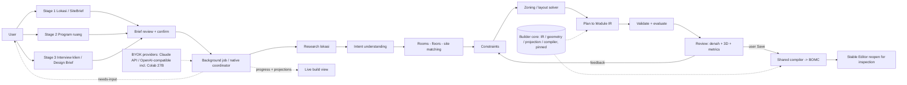
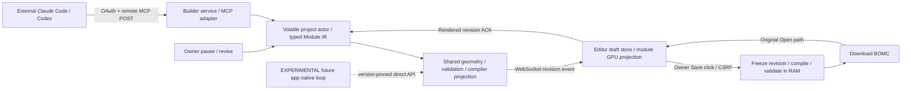

# MASTER IMPLEMENTATION PLAN — Sibambo Stable Editor and Experimental Builder

ID: **SIB-TWO-PHASE-001** · Version: **1.4 — PROPOSED (additive only)** · Date: **2026-11-08, Asia/Jakarta**

Author of the v1.4 additions: Claude Code planning session (Anthropic), at the owner's request, after reading the complete v1.3 master (all 24 work packages), the ADR ledger, gap audit, resource map, Stable-only handoff prompt, the v1.3 handoff receipt and the Notion hubs/boards for Stable Editor, BOMC Modular Builder and Experimental Builder. No subagents were used. The v1.3 author/provenance statement is preserved verbatim in Part 4.

Status: **PROPOSED — awaiting owner acceptance.** Until the owner accepts v1.4, **v1.3 remains the governing CURRENT contract**. On acceptance, v1.4 becomes CURRENT and supersedes v1.3 **only by addition**. Product implementation NOT STARTED. No experiment, provider/Colab run, deployment, release, merge, Notion task row or GitHub issue was created for the v1.4 additions in this session.

**Additive-only rule** (owner instruction 2026-11-08: *"kalau ada yang bisa ditambahin tambahin, tapi jangan ada yang dikurangi"*): Part 4 reproduces the entire v1.3 master verbatim. Nothing in it is deleted, relaxed, re-scoped or re-numbered. Parts 1–3 only add framing, ADRs TP-013…TP-020, sub-increments, acceptance criteria, dependencies, epics XB-12…XB-18, a brainstorm appendix and owner decisions. If an addition and the v1.3 base could be read as conflicting, the stricter reading wins and every v1.3 gate/invariant holds.

Revision history: v1.0…v1.3 as recorded in Part 4. **v1.4** records the owner's two-batch framing — **Batch 1** = Stable Editor as live viewer and receiver of remote MCP construction, BOMC only when the owner clicks Save; **Batch 2** = the WHOLE system as a separate, permanently EXPERIMENTAL app with many increments. It deepens the three-stage onboarding (exact location / room program in the style of Drafted / client interview and desired feeling as architects run client meetings), the native agentic loop (location research → understanding client intent → matching rooms, floors and site → floor plan (denah) + 3D → BOMC), the open BYOK token input with a Colab open-weight ~27B model as the test target and the Claude API as the likely future provider, and splits Batch 2 into many small, independently demoable increments.

## Ringkasan v1.4 (Bahasa Indonesia)

- **Batch 1 = Stable Editor + Remote MCP (SE-00…SE-11), tidak berubah.** Editor jadi live viewer + receiver MCP; agent eksternal (Claude Code / Codex) membangun lewat remote MCP, setiap operasi terlihat live, dan **file BOMC baru tercipta saat owner klik Save**. v1.4 cuma menambah sub-increment kecil: panduan konstruksi untuk agent + katalog error (wajib, karena SE-11 butuh agent AI sungguhan yang memilih tool sendiri), checklist acceptance owner (wajib), dan opsi (pilihan owner di SE-00): inbox "minta revisi ke agent", timeline aktivitas + highlight modul yang berubah, kamera "follow agent" (default OFF), dan receipt Save opsional. Critical path SE tidak berubah.
- **Batch 2 = WHOLE system, app terpisah, EXPERIMENTAL permanen** (nama kerja "Experimental BOMC Builder app", brand menyusul). Gate tetap: tidak ada eksekusi Batch 2 sebelum SE-11 diterima owner.
- **Onboarding 3 tahap dipecah jadi banyak increment:** (1) Lokasi — pin + polygon tapak + ukuran lahan + data turunan (arah utara, lintasan matahari, arah kiblat opsional, iklim, kontur, risiko bencana informatif, KDB/KLB/GSB dari dokumen user); (2) Program ruang ala Drafted — kartu ruang, jumlah, ukuran S/M/L, lantai, hubungan antar ruang, meter anggaran luas; (3) Interview klien — metode yang dipakai arsitek saat meeting (architectural programming, day-in-the-life, preferensi suasana, image board, multi-responden keluarga), **tanpa** diagnosis psikologis/skor kepribadian.
- **Agentic loop native (tanpa MCP), output tetap BOMC:** riset lokasi → memahami intensi klien → mencocokkan ruang/lantai/tapak → zoning/layout → denah + 3D → evaluasi → review & revisi user → Save → BOMC. Ada state baru `needs-input` (agent boleh bertanya ke user saat ragu), job berjalan di background, dan **live build view** supaya user melihat progres selagi menunggu.
- **Token API dibebaskan (BYOK):** Claude API, endpoint OpenAI-compatible (termasuk self-hosted/Colab). Target testing: Colab + model open-weight ~27B, dengan mode *notebook-native* (tanpa tunnel) dan mode *remote endpoint* sementara (opt-in, tidak pernah produksi). Claude API kandidat utama setelah perbandingan terukur.
- **Epic baru:** XB-12 multi-lantai, XB-13 denah 2D, XB-14 paket lokal Indonesia, XB-15 privasi/consent (UU PDP), XB-16 live build view & pengalaman menunggu, XB-17 brand/nama/repo (termasuk implikasi lisensi GPL-3.0), XB-18 paket handoff arsitek & meeting mode.
- **Tidak ada yang dikurangi.** Seluruh v1.3 ada utuh di Part 4.

## How to read this document

- **Part 1 — v1.4 additions (normative once accepted).** Framing, rules, new ADRs, Batch 1 sub-increments, Batch 2 whole-system design, increments for every existing XB epic, new epics XB-12…XB-18, DAG/milestone/checkpoint extensions, extra sources.
- **Part 2 — Brainstorm appendix (draft, unvalidated).** Site data inventory, room catalogue, interview question bank v0, atmosphere vocabulary, design-implication candidates, native tool inventory, open questions. Input to the `.0` discovery increments; not requirements.
- **Part 3 — Owner decisions requested.**
- **Part 4 — v1.3 master, preserved verbatim (normative base).**

# Part 1 — v1.4 additions (normative once the owner accepts v1.4)

## 1.1 Two batches, two apps

| | **Batch 1 — Stable** | **Batch 2 — EXPERIMENTAL (whole system)** |
|---|---|---|
| v1.3 name | Phase 1 / Stable Editor + Remote MCP | Phase 2 / EXPERIMENTAL standalone AI Architectural Builder |
| App | Existing Sibambo Editor (SvelteKit, private repo) + Builder remote service | New separate app, working name **"Experimental BOMC Builder app"**, brand/repo TBD (XB-17) |
| Who drives the design | External Claude Code / Codex through authenticated remote MCP | Native in-app agent loop; no MCP for internal orchestration (TP-009) |
| What the user sees | Each accepted construction transaction rendered live in Editor | Three-stage onboarding, then a live progress + build view while the agent loop works |
| When a BOMC exists | Only after the owner clicks **Save** (TP-008) | Only after the user clicks **Save** on an accepted candidate (XB-10) |
| Output | Valid BOMC, reopened by the original Editor importer | Valid BOMC via the same shared compiler + denah (2D plan) + brief/provenance package |
| Label | "Stable" is the workstream name; readiness NOT_RUN until SE-11 | **EXPERIMENTAL everywhere, permanently**, even after a passing pilot (TP-013) |
| Tasks | SE-00…SE-11 + v1.4 sub-increments | XB-00…XB-18, each split into many increments `XB-NN.k` |
| Gate | Absolute priority | Locked until STABLE_ACCEPTED (SE-11) and a subsequent owner Phase-2 instruction |

Shared foundation unchanged: Builder owns Module IR, geometry, validation, projection and the BOMC compiler; both apps consume it, Batch 1 through the remote service, Batch 2 through version-pinned in-process Python API calls.

## 1.2 Global rules for all v1.4 additions

1. **Phase gate unchanged.** `STABLE_ACCEPTED` (v1.3 definition) → XB-00 → every Batch 2 epic and increment, including the new XB-12…XB-18. Every v1.3 sentence that names "all 12 Experimental tasks" or "XB-00…XB-11" extends to XB-00…XB-18 and all of their increments. Before the gate they stay Blocked, unclaimed, with an empty Focus Lane.
2. **Increment model.** Each epic (`SE-NN`, `XB-NN`) keeps its v1.3 ID, AND dependencies, priority, locks, acceptance and negative assertions. v1.4 splits epics into increments:
   - Batch 1: `SE-NN.X` (letter suffix). Each is marked **Required** (adds acceptance to its parent; the parent cannot close without it), **Owner-selectable** (chosen or declined at SE-00; declined means v1.3 behaviour exactly), or **Parking lot** (not scheduled; needs a new plan version).
   - Batch 2: `XB-NN.k` (number suffix). Each increment is small (planning range 0.5–3 days), independently demoable, has its own acceptance line, inherits the epic's lock, dependencies, phase gate and negative assertions, and runs in listed order unless marked *parallel*. An epic is Done only when all its increments and the v1.3 epic acceptance pass.
   - Increments become Notion rows (relation to the parent epic) and GitHub issue checklists **only after the owner accepts v1.4** and decides when to create them (Part 3, D4). None were created in this session.
3. **Discovery increments `.0`.** XB-01.0, XB-02.0, XB-03.0, XB-04.0, XB-05.0, XB-06.0 and XB-12.0 are brainstorm/literature/workshop increments producing documents. After the gate they are the first increment of their epic. Before the gate, the only permitted activity is what v1.3 CP0 already allows — *maintenance of future planning documents* (for example refining Part 2 of this plan). No participants, interviews, experiments, provider or Colab calls, code, claims or board cards. The owner may forbid even that (Part 3, D3).
4. **EXPERIMENTAL marking contract** (TP-013) applies to every Batch 2 surface.
5. **Estimates.** v1.3 epic estimates are retained as written. Increment ranges are additional planning ranges, not promises and not spending authority; the XB-00.3 budget increment re-estimates the whole of Batch 2. No percentage estimates.
6. **Stop rules unchanged.** Every v1.3 checkpoint/stop rule applies to every increment; v1.4 adds the extra stop rules in §1.17.

## 1.3 New architecture decisions TP-013…TP-020 (additive to TP-001…TP-012)

| ADR | Decision and alternatives rejected | Consequence / owner |
|---|---|---|
| TP-013 | **Batch naming + EXPERIMENTAL marking.** Batch 1 = Stable (Phase 1), Batch 2 = EXPERIMENTAL whole system (Phase 2). Every Batch 2 screen header, onboarding step, review page, export dialog, API response (`experimental: true`), README, repo description and pilot report carries an EXPERIMENTAL label. Exported files: filename suffix `-experimental` plus an optional provenance sidecar; if the BOMC format already has a free-form provenance/generator field it may be filled, otherwise **the BOMC schema is never changed for labelling**. Reject: removing the label after a passing pilot; hiding it in settings. | Applies to XB-09…XB-18. Owner: Batch 2 app. |
| TP-014 | **Experimental job runtime and retention.** The Batch 2 agent loop runs as a background job with immutable stage checkpoints in a job store scoped to that app (never the Stable service). Default retention: job records for the run plus a short window (proposed 24 h, owner decides at XB-00) so the user can wait or come back; durable project storage only after an explicit user **Save project** under the XB-15 policy. Reject: reusing Stable's volatile-only rule (the user must be able to leave while the loop works); silent indefinite storage. | Formalises v1.3 XB-10 "future app retention policy". Stable TP-004 unchanged. |
| TP-015 | **Colab test modes.** Mode A *notebook-native* (preferred): the pinned Builder + experiments package and the ~27B model run inside the same Colab runtime; the full loop executes in the notebook; BOMC and receipts are downloaded; no tunnel. Mode B *remote endpoint* (opt-in, app integration tests only): an OpenAI-compatible server in Colab exposed through a short-lived authenticated tunnel, session-scoped credential, auto-expiry, documented risk. Reject: always-on public tunnel, Colab as a production service (both already rejected by TP-012), unauthenticated endpoints. | XB-04.5/XB-04.6. |
| TP-016 | **Single source for denah and 3D.** 2D floor-plan drawings are derived from the same canonical plan/Module IR as the 3D and BOMC output; no separately drawn plan. Every drawing carries "SKEMATIK — bukan gambar kerja / schematic, not for construction". Reject: an independent 2D drafting model; construction-document claims. | XB-13. |
| TP-017 | **Locale pack, Indonesia first, jurisdiction-agnostic core.** Bahasa Indonesia + English UI, Indonesian residential room typology, regulation fields (KDB/KLB/KDH/GSB/height/floor limits) captured as user-stated or source-cited values only; cultural/religious options are optional user choices and are never inferred from location, name or answers. Reject: auto-deriving regulations as facts; assuming culture or religion. | XB-14; consumed by XB-01/02/03/09. |
| TP-018 | **Client interview methods = architectural programming + stated-preference instruments.** Problem-seeking-style programming, day-in-the-life mapping, semantic-differential atmosphere preferences, visual preference cards and multi-respondent household input. **Extends TP-011 without relaxing it**: still no diagnosis, personality score or inferred traits. Answers touching religion, health/disability or children are treated as sensitive personal data needing explicit, granular, revocable consent and data minimisation (Indonesian UU PDP No. 27/2022 as the first jurisdiction; owner obtains qualified legal advice). | XB-03, XB-15. |
| TP-019 | **Live build view in Batch 2.** While the job runs, the app streams typed progress events and per-module projections that follow the public `draft-view-v1` schema from SE-01, in-process, no MCP. The Batch 2 viewer is its own implementation against the public schema and applies the v1.3 coordinate rule `R * M_world` once. Reject: copying private Editor code; GPU data as canonical state; rendering a different geometry from what Save compiles. | XB-05.7, XB-07.6, XB-16. |
| TP-020 | **Owner → agent request inbox (Stable, owner-selectable).** The owner can type a revision request in Editor; it is held in actor RAM (same TTL, purge and no-log rules as draft content) and exposed to agents through a read-only MCP tool. It grants no write, never bypasses lease, fence, pause or Save rules, and never increments `projectRevision`. Reject: free-form owner→agent command execution; relying on MCP server→client notifications (removed in the 2026-07-28 transport). | SE-03.C/SE-04.A/SE-05.A; declined at SE-00 means v1.3 behaviour exactly. |

## 1.4 Batch 1 (Stable) additions

The critical path `SE-00 → 01 → 02 → 03 → 05 → 06 → 07 → 08 → 10 → 11` (SE-04 joins 05, SE-09 joins 10) is **unchanged**. No v1.4 addition creates a new dependency edge into SE-11; Required items add acceptance inside existing parents.

| ID | Parent | Class | One-line scope |
|---|---|---|---|
| SE-03.A | SE-03 | **Required** | Remote construction guide + agent-grade tool descriptions so a real agent can build through typed tools |
| SE-03.B | SE-03 | **Required** | Typed error catalogue with retryable flag and agent-actionable `nextAction` hint |
| SE-03.C | SE-03 | Owner-selectable (TP-020) | Read-only `read_owner_requests` MCP tool + RAM request store |
| SE-04.A | SE-04 | Owner-selectable (TP-020) | "Minta revisi ke agent" compose UI + BFF route |
| SE-05.A | SE-05 | Owner-selectable (TP-020) | Request-status WebSocket message, separate from revisions |
| SE-06.A | SE-06 | Owner-selectable | Live activity timeline + changed-module highlight |
| SE-06.B | SE-06 | Owner-selectable | "Follow agent" camera toggle, **default OFF** |
| SE-07.A | SE-07 | Owner-selectable | Opt-in Save receipt sidecar JSON |
| SE-11.A | SE-11 | **Required** | Bilingual owner acceptance checklist for both client runs |
| SE-12 | — | Parking lot | Post-acceptance Stable backlog; each item needs a new plan version |

### SE-03.A · Remote construction guide and agent-grade tool descriptions — Required

Why: SE-11 demands that a *real* Claude Code and Codex agent selects and invokes geometry tools itself. Tool descriptions and a construction guide are the agent's only manual; the existing `docs/AGENT-CONSTRUCTION-GUIDE.md` (BMB-025) targets stdio journal tools, not the remote typed transaction tools.

Change surface: Builder NEW `service/guide/REMOTE-CONSTRUCTION-GUIDE.md` (public, synthetic examples only), `service/guide/tool_descriptions.py`, `tests/test_remote_mcp_guide.py`. MODIFY `service/mcp_http.py` (SE-03-owned) to publish descriptions, an MCP resource (proposed URI `sibambo://guide/remote-construction`) and a prompt `build_from_brief` **where the pinned clients support resources/prompts**; otherwise `read_project` returns `guideVersion`, `guideSha256` and a short guide pointer. READ ONLY `docs/AGENT-CONSTRUCTION-GUIDE.md`.

Guide content: metres, right-handed +Z up, module-ID namespace rules; 1–8-module transactions including both reciprocal seam participants; recommended order floor → walls → seams → openings → revisions; writer lease etiquette (acquire, refresh every 10 s, release); `RENDER_PENDING` handling via `operation_status`; reading typed errors (SE-03.B); checking owner requests when SE-03.C is selected; **agents never Save or export**.

Acceptance: UNIT lint — every tool description states units, bounds, an example and the error codes it can return; guide hash pinned in the receipt. INTEGRATION — a scripted SDK client following only the guide's worked example completes a two-module seam build. LIVE (recorded inside SE-11) — per client, report first-attempt valid tool-call rate and recovered-error count; reported, not a new threshold.

Negative assertion: no credentials, private Editor code, Save/export capability or instructions to bypass lease/fence in the guide.

Estimate: 0.5–1 engineer-day inside SE-03.

### SE-03.B · Typed error catalogue — Required

Change surface: NEW `schemas/draft-errors-v1.schema.json`, `docs/two-phase/ERROR-CATALOG.md`; extend `tests/test_remote_mcp.py` and `tests/test_project_actor.py`.

Codes already fixed in v1.3 stay exactly as named: `REVISION_CONFLICT`, `IDEMPOTENCY_CONFLICT`, `DEPENDENCY_UPDATE_REQUIRED`, `RENDER_PENDING`, `BUSY`, `EMPTY_PROJECT`, HTTP 401/403 semantics. Additional codes for cases v1.3 describes but does not name (stale fence/lease, owner paused or absent, epoch mismatch, transaction above the 8-module/256 KiB ceiling, rate/quota excess, schema/geometry validation failure) are **proposals finalised in SE-03.B**. Every entry has: stable code, MCP/HTTP mapping, `retryable`, a `nextAction` hint (for example "call read_project and rebase on revision N"), and a guarantee that it leaks no other tenant's data.

Acceptance: each code has a test that triggers it and asserts IR, revisions, digest and GPU content unchanged (v1.3 Invariant 4).

Estimate: 0.5 engineer-day inside SE-03.

### SE-03.C + SE-04.A + SE-05.A · Owner → agent request inbox — Owner-selectable (TP-020)

- **SE-03.C (Builder):** NEW `core/project/requests.py` — RAM-only, per project/epoch, bounded (proposed 50 open requests × 4 KiB), same 30-min TTL/purge/no-log/no-swap rules as draft content. MCP tool `read_owner_requests(sinceId)` (read-only). Optional informational `requestId` on `apply_operation` metadata; it changes no authorisation.
- **SE-04.A (Editor):** NEW `apps/editor/src/lib/mcp/OwnerRequests.svelte`; BFF route `apps/editor/src/routes/api/mcp/requests/+server.ts` with CSRF. Owner writes text and may attach selected module IDs. Status: open → read by agent → addressed (an operation referencing it was rendered) → withdrawn.
- **SE-05.A (Editor + `service/draft_ws.py`):** message type `owner_request_status`, distinct from `DraftEventV1`; never increments `projectRevision`.

Acceptance: a request never enables writes; a paused project rejects writes even with open requests; cross-tenant reads denied; TTL purge tested; request text absent from logs.

SE-11 linkage: if selected at SE-00, the SE-11 step "owner pauses, requests private window 1.0→1.2 m, resumes" is executed by the agent reading the inbox; if declined, the v1.3 path (owner applies a typed parameter revision through the fenced actor) is used. Both are documented; neither is removed.

Estimate: 1–2 engineer-days across the three parents.

### SE-06.A · Live activity timeline and changed-module highlight — Owner-selectable

Change surface: Editor NEW `apps/editor/src/lib/mcp/ActivityTimeline.svelte`, `apps/editor/src/lib/mcp/draft-highlight.ts`. Uses only `DraftEventV1` fields and the existing ACK timing; no new server data.

Rows: revision, local time, principal label (honest credential-principal wording per v1.3), operation summary, changed/removed module IDs, accepted→ACK latency, rendered/renderPending. Highlight: changed module groups get a temporary overlay (≤ 1.5 s) using a separate overlay material that never mutates or shares module materials and is disposed under viewport ownership rules. Clicking a row selects/frames that module (user-initiated only).

Acceptance: SE-10 performance trials re-run with highlight on and off; budgets unchanged; no automatic camera change.

Estimate: 1–1.5 engineer-days.

### SE-06.B · "Follow agent" camera — Owner-selectable, default OFF

v1.3 "never auto-fit on each operation" remains the default. Only when the owner explicitly enables the toggle does the camera frame the union of changed-module bounds with a damped transition; any user camera input cancels the move. Session-local preference, not a revision.

Acceptance: default-OFF browser test; enabling it never alters selection or revisions.

Estimate: 0.5 engineer-day.

### SE-07.A · Opt-in Save receipt sidecar — Owner-selectable

Change surface: Editor NEW `apps/editor/src/lib/mcp/draft-save-receipt.ts`. Opt-in checkbox at Save produces a second download `project-r.receipt.json`: projectId, epoch, savedRevision, draftSha256, BOMC SHA-256, operation IDs/principals/timestamps since the previous save, Builder/Editor source SHAs. No IR, no credentials. Never required for reopen.

Acceptance: unchecked → exactly one file; checked → receipt BOMC hash equals the downloaded file hash.

Estimate: 0.5 engineer-day.

### SE-11.A · Owner acceptance checklist — Required

Change surface: NEW `docs/two-phase/SE-11-OWNER-CHECKLIST.md`, bilingual (ID/EN). One sheet per client run (Claude Code first, Codex second) listing every mandatory SE-11 step with expected result, observed result, PASS/FAIL/NOT_RUN and evidence links, plus the explicit owner acceptance statement. It makes the existing SE-11 steps executable; it adds no new step and removes none.

Estimate: 0.25 engineer-day inside SE-11.

### SE-12 · Post-acceptance Stable parking lot — not scheduled

Collected from items v1.3 places outside v1; each needs a new plan version before work: hosted saved projects/cloud storage; an IR sidecar project format to re-edit saved BOMC; multi-writer/disjoint parallel module leases; binary projection buffers; a server-side headless render snapshot tool so agents can "see" the result (privacy/security review first); production hosting; release packaging; MCP clients beyond Claude Code and Codex; adoption of any Module IR v1.1 evolution produced by XB-12.2.

## 1.5 Batch 2 — the whole system (EXPERIMENTAL)

### End-to-end user journey

1. **Stage 1 · Lokasi.** The user searches or drops a pin, then confirms the site boundary (draw on map, enter lot dimensions + frontage direction, trace over an uploaded survey/certificate sketch, or walk the boundary with phone GPS). The app derives true north, sun path, optional qibla bearing, climate normals, elevation/slope, surrounding roads/buildings and informational hazard flags, each with a source, resolution and evidence status. The user enters regulation values from their own documents (KDB/KLB/GSB…) or leaves them *unknown*. A *hypothetical lot* mode (dimensions only, no real site research) exists for users still looking for land and is labelled as such.
2. **Stage 2 · Program ruang.** In the style of Drafted's room list (reference only, original interaction design): room cards with counts, S/M/L size presets, floor assignment, adjacency/privacy relationships and must/should/could priority, with a live area-budget meter against what the site and regulations allow.
3. **Stage 3 · Interview klien.** The methods architects use in client briefing meetings: goals, household and life stage, day-in-the-life routines, privacy and social patterns, sensory comfort, desired atmosphere (stated preferences), image preferences, materials, budget/timeline, future plans. Each household member can answer privately. Every interpreted need is paraphrased back for confirmation. No diagnosis or personality scoring (TP-011/TP-018).
4. **Brief review.** One screen shows all three stages with evidence badges, conflicts and unknowns; the user confirms and presses **Mulai desain**.
5. **Agentic loop (native, background job).** Research the location → understand client intent → match rooms ↔ floors ↔ site → constraints → zoning → layout → geometry → validate → evaluate. The agent may pause with `needs-input` to ask the user a bounded question. The user waits on a **live progress + build view** (findings with citations, stage timeline, cost meter, progressive 3D) and can cancel.
6. **Review.** Up to three candidates with denah (2D plan), 3D, metrics and "why this layout" explanations tied to brief items.
7. **Feedback.** Click a room/wall/window, choose an action or describe it; the affected sub-problem re-runs; a diff is shown; the user accepts or rejects.
8. **Save.** Only on explicit user Save: valid BOMC through the shared compiler (+ `-experimental` filename, optional provenance sidecar), denah SVG/PDF and an architect handoff package. The BOMC opens in Stable Editor for inspection.

### Mechanism

### Batch 2 epic DAG (v1.3 edges preserved; v1.4 additions in bold)

| Epic | Title | AND dependencies | Lock |
|---|---|---|---|
| XB-00 | EXPERIMENTAL charter, future repository split and evaluation protocol | SE-11 | experimental/charter |
| XB-01 | Exact-location map and evidence provenance | XB-00 | experimental/site |
| XB-02 | Room-program onboarding and constraint interpretation | XB-00 | experimental/room-program |
| XB-03 | Client interview and desired-feeling research | XB-00 (**XB-03.11 also XB-15**) | experimental/client-interview |
| XB-04 | BYOK provider abstraction, credential safety and 27B Colab benchmark | XB-00 | experimental/providers |
| XB-05 | Native internal agent state machine and research synthesis | XB-01, XB-02, XB-03, XB-04 | experimental/orchestrator |
| XB-06 | Zoning and floor-plan algorithm comparison | XB-05 | experimental/spatial-planning |
| XB-07 | Verified floor plan → Module IR → 3D/BOMC | XB-06, SE-01 | experimental/geometry-lowering |
| XB-08 | Independent evaluation, environmental constraints and uncertainty | XB-07 | experimental/evaluation |
| XB-09 | Separate application split and three-stage onboarding prototype | XB-01, XB-02, XB-03, XB-04, XB-08, **XB-14, XB-15, XB-16, XB-17** | experimental/app-split |
| XB-10 | Human feedback, localized revision and valid BOMC export | XB-09 | experimental/feedback |
| XB-11 | EXPERIMENTAL end-to-end pilot and provider go/no-go | XB-10, **XB-13, XB-18** | experimental/pilot |
| **XB-12** | **Multi-storey (lantai) research contract** | **XB-06, XB-07** | **experimental/multistorey** |
| **XB-13** | **Denah — 2D floor-plan drawings from the canonical plan** | **XB-07** | **experimental/plan-drawing** |
| **XB-14** | **Indonesia locale and regulation context pack** | **XB-00** | **experimental/locale** |
| **XB-15** | **Privacy, consent and retention** | **XB-00** | **experimental/privacy** |
| **XB-16** | **Live build view and waiting experience** | **XB-05, XB-07** | **experimental/live-view** |
| **XB-17** | **Brand, naming, repository and licence decision** | **XB-00** | **experimental/brand** |
| **XB-18** | **Architect handoff package and meeting mode** | **XB-10, XB-13** | **experimental/handoff** |

The graph stays acyclic and SE-11 remains an ancestor of every Batch 2 node. XB-12 does not block the pilot; multi-storey briefs enter XB-11 only if XB-12 passes its own go/no-go.

## 1.6 XB-00 increments — charter

| Inc | Scope | Acceptance |
|---|---|---|
| XB-00.1 | Verify `STABLE_ACCEPTED` evidence on actual SE-11 records; record the owner's Phase-2 release instruction | Missing/conflicting evidence → STOP (v1.3) |
| XB-00.2 | Charter: research questions per track, ownership, stop rules, TP-013 marking contract adopted | `docs/two-phase/EXPERIMENTAL-CHARTER.md` (v1.3 path) names all 19 epics |
| XB-00.3 | Budget and capacity: research budget cap, per-run and monthly provider spend caps, Colab tier choice, participant recruitment budget, re-estimate of Batch 2 | Owner-signed numbers; no spending before this |
| XB-00.4 | Evaluation protocol: frozen held-out split manifest `experiments/protocol/manifest.json`, metric definitions, failures-in-denominator rule | Manifest hash committed before any trial |
| XB-00.5 | Data, consent and licensing register (links XB-15) | Every dataset/source has licence + consent status |
| XB-00.6 | Pre-split layout under Builder `experiments/` with an import-lint test (no production imports) | Lint test fails on any `experiments` import from production paths |

## 1.7 XB-01 increments — Stage 1 · Lokasi (exact location)

v1.3 SiteBrief v1 fields, uncertainty rules, evidence statuses, 12 curated sites and negative assertions are unchanged. Increments:

| Inc | Scope | Acceptance |
|---|---|---|
| XB-01.0 | **Discovery:** what site information architects need at schematic stage; data-source inventory with licence, resolution and coverage for Indonesia and global (Part 2 §2.1); basemap/tiles/geocoding/satellite provider shortlist with licence limits | Inventory doc; every candidate marked *licence to verify* |
| XB-01.1 | SiteBrief v1 schema + normaliser (v1.3 fields) | v1.3 antimeridian/hemisphere/CRS tests |
| XB-01.2 | Map pin and search prototype (MapLibre, licensed tiles, geocoder candidate) with pin-precision disclosure | Pin never labelled as boundary |
| XB-01.3 | Boundary capture modes, each storing method + uncertainty: (a) draw polygon; (b) lot dimensions + frontage bearing (e.g. 8 × 15 m facing the road); (c) manual trace over an uploaded survey/certificate image with user scale calibration (no OCR claim); (d) phone GPS walk with accuracy readout; (e) **hypothetical lot** (dimensions only; site research disabled and labelled) | Each mode round-trips to the same polygon schema; mode and uncertainty always visible |
| XB-01.4 | Deterministic derived facts: true north and local ENU transform; sun path for solstices/equinoxes (published solar-position algorithm); façade sun exposure; optional qibla bearing (great-circle) | Unit tests against published reference values within a stated tolerance |
| XB-01.5 | Opt-in environmental context fetch: reanalysis climate normals (temperature, humidity, rainfall, wind rose), DEM elevation/slope with resolution, OSM roads/buildings (status *unverified*), hazard layers marked *informational, not an assessment* | v1.3 SSRF allowlist, timeout/retry ≤ 2, licensed cache only |
| XB-01.6 | Regulation fields, user-stated or source-cited: KDB, KLB, KDH, GSB/side/rear setbacks, height/floor limits, source document (e.g. KRK/PKKPR/RDTR); derived max footprint and floor area; generic coverage/FAR/setback fields for other jurisdictions | Missing → *unknown*, which blocks feasibility claims (v1.3); arithmetic unit tests |
| XB-01.7 | Evidence review screen: per-field status badge, critical-missing checklist, confirmation creates a SiteBrief revision | 100 % evidence completeness (v1.3) |
| XB-01.8 | Curated sites: the v1.3 12 sites must include Indonesian cases — narrow deep row lot, corner lot with two frontages, sloped highland lot, coastal lot, flood-prone lot, trapezoid/irregular lot — plus hemisphere/antimeridian cases; architect verifies one real site (v1.3 manual gate) | Corrections retained as evidence |

## 1.8 XB-02 increments — Stage 2 · Program ruang (room selection à la Drafted)

v1.3 program schema, contradiction detection, 30-brief test set and negative assertions unchanged.

| Inc | Scope | Acceptance |
|---|---|---|
| XB-02.0 | **Discovery:** room taxonomy (Indonesian + global, Part 2 §2.2), sourced starter size ranges (cited standards/references/architect input, labelled suggestions), interaction study of room-list tools as reference only | Taxonomy doc; every number cites a source or is labelled placeholder |
| XB-02.1 | Program schema v1 + deterministic normaliser (v1.3) | v1.3 30-brief tests |
| XB-02.2 | Room catalogue and templates: cards with count ±, S/M/L presets mapped to area ranges, templates (e.g. type 36/45/54/70 references, *rumah tumbuh* (growable house), two-storey 3-bedroom, house + small business) — all editable | Template expansion is deterministic and fully editable |
| XB-02.3 | Floor assignment: columns per floor (Lantai 1/2/3/rooftop) plus "any floor"; multi-floor captured, solver reports unsupported until XB-12 passes (v1.3) | No silent floor collapse |
| XB-02.4 | Relationships: adjacency chips (must be near / prefer near / keep apart), bubble-diagram view, privacy level per room (public / semi-private / private / service) | Edits round-trip between chip and bubble views |
| XB-02.5 | Live area-budget meter: Σ room targets + circulation reserve + wall allowance vs max footprint (KDB × lot) and max floor area (KLB × lot) and floor count; actionable conflict list requiring an owner choice (v1.3) | 100 % detection of seeded contradictions |
| XB-02.6 | Optional natural-language entry ("rumah 2 lantai, 3 kamar, ada mushola, carport 2 mobil") → typed draft program, every field `inferred` until confirmed; provider via XB-04; form-only fallback | No room silently added/deleted; hard constraints never downgraded |
| XB-02.7 | Program versioning and diff (revision IDs consumed by XB-10) | Diff deterministic |
| XB-02.8 | Usability check: client + architect confirm interpreted program (v1.3 manual gate) | Corrections recorded |

## 1.9 XB-03 increments — Stage 3 · Interview klien and desired feeling

TP-011 stands unchanged; TP-018 adds methods and sensitive-data handling. v1.3 study targets (≥ 90 % participant-confirmed paraphrases, 5–8 consenting clients, ≥ 2 architects) unchanged.

| Inc | Scope | Acceptance |
|---|---|---|
| XB-03.0 | **Discovery / literature map:** architectural programming (problem-seeking matrix: function/form/economy/time × goals/facts/concepts/needs), briefing and post-occupancy practice (v1.3 RIBA references), environmental-psychology constructs used **only as question prompts** (privacy regulation, prospect–refuge, territoriality, sensory comfort), biophilic design patterns; output `experiments/interview/literature-map.md` mapping construct → question → candidate spatial implication | Every construct cites a source; none produces a score |
| XB-03.1 | Question bank v0 (ID/EN) by theme (Part 2 §2.3): purpose, answer type, optional/sensitive flag, skip/unknown, follow-up rules | v1.3 `question-bank.md`; unit test blocks diagnostic fields |
| XB-03.2 | Atmosphere instrument: semantic-differential sliders per space group (Part 2 §2.4), framed as *preference for this space*, never as a trait | Schema has no person-level trait field |
| XB-03.3 | Visual preference cards: licensed or self-produced images only (no scraped boards), like/dislike/why tags, pre-tagged features; output = stated liked features confirmed by the user | Image licence register complete |
| XB-03.4 | Day-in-the-life mapper: weekday/weekend timeline per household member (age band, no names required) → activities → space/time needs (e.g. morning kitchen light, quiet WFH room 09–17, prayer times, guest gatherings) | Each need links to timeline entries |
| XB-03.5 | Household and life stage: members by age band, expected changes (children, elderly parents, domestic helper, home business), optional mobility/accessibility needs under consent | Sensitive items optional with explicit consent |
| XB-03.6 | Multi-respondent mode: share link so each member answers privately; differing answers shown side by side as options; the household decides | No conflict inference stored as fact (v1.3 negative assertion) |
| XB-03.7 | Optional conversational interviewer: grounded in the question bank only, asks follow-ups, outputs structured answers + verbatim quotes + paraphrases, user confirms each paraphrase; works with Claude API and the 27B model through XB-04; guided-form fallback | Schema rejects diagnostic fields; paraphrase confirmation measured |
| XB-03.8 | Architect meeting mode: architect drives the session with the client present, adds notes, same schema (links XB-18) | Notes attributed to the architect |
| XB-03.9 | Design Brief generator: bilingual readable brief — quote → need → constraint → design-implication candidates (Part 2 §2.5), each confirmed or rejected; the confirmed brief is XB-05's input | v1.3 quote→need→constraint→confirmation chain 100 % |
| XB-03.10 | Consent and sensitive data with XB-15: religion (prayer room/qibla), health/disability, children's data — granular, revocable, minimised, deletable | Deletion test removes raw answers and derived needs |
| XB-03.11 | Bounded pilot (v1.3: 5–8 consenting clients, ≥ 2 architects); on failure revise questions and repeat before autonomous use | v1.3 ≥ 90 % confirmation target, denominators reported |

## 1.10 XB-04 increments — open token input (BYOK), Colab ~27B, Claude API

v1.3 provider contract, 27B memory arithmetic, per-run in-memory keys, no silent fallback, SSRF allowlist and benchmark design unchanged.

| Inc | Scope | Acceptance |
|---|---|---|
| XB-04.0 | **Discovery:** pin the candidate list on the start date — open-weight ~27B models with tool/JSON support (Qwen3.5-27B per v1.3; other ~27B open-weight models only if licence fits), serving stacks (vLLM, llama.cpp/GGUF, transformers), Colab tiers and real VRAM (T4 16 GB / L4 24 GB / A100 40–80 GB as observed, not promised); Claude API capabilities relevant to the loop (tool use, structured outputs, prompt caching, server-side web search, batch processing) verified on official docs that day, with current pricing source/date | Candidate manifest with exact revisions, licences, dates |
| XB-04.1 | Provider interface `experiments/providers/base.py` + deterministic fake provider + normalised response (v1.3 fields) | Fake-provider determinism tests |
| XB-04.2 | **Open token input UX** ("bebasin input API token"): provider type (Claude API / OpenAI-compatible endpoint incl. self-hosted or Colab / others via OpenAI-compatible), key + base URL, per-run memory only by default, never in logs/URLs/browser storage; allowlisted endpoints plus an explicit *custom endpoint* mode with warning; per-run spend cap; test-connection with a minimal call | Key-scan tests on traces/logs/errors; custom endpoint cannot reach private network ranges |
| XB-04.3 | Claude API adapter `anthropic_adapter.py`: tool use / structured outputs, prompt caching for long static context (guide, question bank, schemas), optional server-side web search for XB-05.3 with citations, native usage tokens recorded | Schema-valid outputs measured; native tokens or null |
| XB-04.4 | OpenAI-compatible adapter `openai_compatible.py` with constrained decoding (JSON schema / grammar) where the server supports it; native usage if returned, else null | No bytes/4 estimate called native usage (v1.3) |
| XB-04.5 | **Colab mode A, notebook-native** (TP-015): `experiments/colab/27b-eval.ipynb` installs pinned Builder + experiments package, serves the model in-runtime, runs the full loop on fixture briefs, downloads BOMC + receipts; records GPU type, VRAM peak, quantisation, context length, tokens/s | OOM or unavailable allocation recorded NOT_RUN, never faked |
| XB-04.6 | **Colab mode B, remote endpoint** (TP-015, opt-in): short-lived authenticated tunnel for app integration tests only, session-scoped credential, auto-expiry | No always-on/public/unauthenticated endpoint; never production |
| XB-04.7 | Benchmark (v1.3): 20 structured prompts × 3 repeats per provider + loop-level metrics with identical schemas and caps across Claude API and 27B; cost per completed brief | All failures in the denominator |
| XB-04.8 | Per-stage model routing experiment (smaller model for extraction, larger for synthesis) — measured, not assumed | Routing chosen only on measured quality/cost |
| XB-04.9 | Credential safety and cancellation: key scans, cancellation stops spend within one model call | Cancellation test passes on both adapters |

## 1.11 XB-05 increments — native agentic loop

v1.3 state machine (brief-confirmed → research → constraints → zoning → layout → geometry → validate → evaluate → human-review), single coordinator (no swarm), caps (max 3 candidates and 2 repair rounds per stage, max 60 model calls, max 30 min, default USD 2 test-run spend cap), untrusted model output, deterministic validators and direct Builder API calls are unchanged. v1.4 adds one state and named sub-stages.

| Inc | Scope | Acceptance |
|---|---|---|
| XB-05.0 | **Discovery:** stage I/O contracts, native tool inventory (Part 2 §2.6), failure taxonomy | Contract doc reviewed by an architect |
| XB-05.1 | State-machine skeleton + immutable run records + fake-model replay; **new state `needs-input`**: the agent asks the user one bounded, typed question (e.g. "north boundary unknown — confirm?"), the run pauses, resumes on answer; timeout ends the run with an explicit incomplete label | Replay deterministic; `needs-input` never auto-answered by the model |
| XB-05.2 | Job runtime (TP-014): background job, stage checkpoints, cancel, spend/time caps, resumable after browser close within the retention window | Kill/restart tests resume from last checkpoint without duplicate spend |
| XB-05.3 | **Research lokasi** sub-stage: deterministic site facts (XB-01) + optional web research (provider tool or allowlisted fetch) → cited findings (climate strategies, local typology/vernacular, material availability, regulation pointers marked *user must confirm*); fetched text handled as untrusted data | v1.3 prompt-injection test; every finding has source + retrieval time |
| XB-05.4 | **Memahami intensi klien** sub-stage: confirmed Design Brief (XB-03) + program (XB-02) → ranked design drivers, concept statement, explicit assumption list; **client approval gate in the app** in addition to the v1.3 architect gate | No layout generation before approval |
| XB-05.5 | **Matching rooms ↔ floors ↔ site:** floor assignment and stacking hints (single floor in the initial gate; multi-floor via XB-12), orientation preferences from the brief as soft constraints, typed constraint set for the solver | Hard vs soft explicit; provenance per constraint |
| XB-05.6 | Constraint reconciliation and plain-language infeasibility explanation with user options | No silent weakening (v1.3) |
| XB-05.7 | Typed, versioned progress-event stream for XB-16 (stage start/finish, findings, candidate ready, cost, `needs-input`) | Event schema tests; ordering preserved |
| XB-05.8 | Prompt-injection, stale-brief and provider-timeout tests (v1.3) + determinism replay | v1.3 acceptance |

## 1.12 XB-06 increments — zoning and layout

v1.3 baseline/CP-SAT/LLM-zoning comparison, 100 mm grid, lexicographic objectives, 30 s limit, held-out targets and blind architect ranking unchanged.

| Inc | Scope |
|---|---|
| XB-06.0 | **Discovery:** metrics and fixture design including common Indonesian lot shapes (e.g. 6 × 15, 8 × 20, corner lots) |
| XB-06.1 | Deterministic baseline (v1.3) |
| XB-06.2 | CP-SAT candidate placement (v1.3, OR-Tools pinned for the experiment only) |
| XB-06.3 | LLM zoning + the same deterministic solver (v1.3) |
| XB-06.4 | Door placement and circulation graph/corridor generation with configurable clearances |
| XB-06.5 | Orientation/climate/street-privacy soft objectives from XB-01 facts and XB-03 preferences |
| XB-06.6 | Candidate diversity (max 3) + "why this layout" explanation linking each choice to constraints and brief items |
| XB-06.7 | Held-out benchmark + ≥ 2 architects blind ranking (v1.3) |
| XB-06.8 | Irregular/concave lot branch as an explicit research contract (v1.3) |

## 1.13 XB-07 increments — floor plan → Module IR → 3D/BOMC

| Inc | Scope |
|---|---|
| XB-07.1 | Single-floor flat-roof lowering with one shared wall per boundary (owner = min lexical roomId) (v1.3) |
| XB-07.2 | Doors/windows with real cutouts and documented constraints (v1.3) |
| XB-07.3 | Plan-room ↔ face ↔ module mapping table (v1.3), also consumed by XB-13 and XB-10 |
| XB-07.4 | Compile valid BOMC through the shared compiler + independent reader + original Editor reopen (v1.3) |
| XB-07.5 | Localised revision touching only affected private modules and invalidated seam dependents (v1.3) |
| XB-07.6 | Live build emission (TP-019): `draft-view-v1`-compatible per-module projections emitted in-process as geometry proceeds, for XB-16 |

## 1.14 XB-08 … XB-11 increments

**XB-08 · Evaluation** — 08.1 hard-constraint validator suite (v1.3); 08.2 preference satisfaction vs the confirmed brief; 08.3 environmental heuristics (sun hours per room orientation, cross-ventilation heuristic from opposing openings) labelled *heuristic* (v1.3); 08.4 arithmetic check against user-stated KDB/KLB/GSB, no permit claim; 08.5 blind architect protocol (v1.3); 08.6 report generator with denominators and confidence intervals (v1.3).

**XB-09 · App split and onboarding prototype** — 09.1 consume the XB-17 decision; create the repo only after approval (v1.3); 09.2 app shell with EXPERIMENTAL badge everywhere (TP-013), ID/EN locale (XB-14), app-user authentication per XB-15/XB-17; 09.3 Stage 1 UI; 09.4 Stage 2 UI; 09.5 Stage 3 UI; 09.6 brief review + **Mulai desain**; 09.7 waiting experience (XB-16); 09.8 provider settings and spend (XB-04.2); 09.9 accessibility and mobile pass at 320/768/1440 px, keyboard only; 09.10 browser tests (v1.3).

**XB-10 · Feedback, revision, export** — 10.1 typed feedback referencing room/module IDs and brief revision (v1.3); 10.2 input modes: click a room/wall/window in denah or 3D, choose an action (move, resize, add window, swap rooms) or describe it, converted to a typed constraint with confirmation; 10.3 locked regions + re-run of the affected sub-problem (v1.3); 10.4 plan + 3D diff with accept/reject (v1.3); 10.5 explicit Save → BOMC via the shared compiler + Editor reopen (v1.3); 10.6 *Save project* under the TP-014/XB-15 retention policy.

**XB-11 · Pilot and provider go/no-go** — 11.1 protocol and recruitment of 10 consented briefs incl. difficult/infeasible sites (v1.3); 11.2 Claude API vs Colab 27B comparison under identical prompts/schemas/caps (v1.3); 11.3 metrics and receipts against v1.3 targets (≥ 80 % feasible briefs with a valid owner-reviewed candidate within budget, 0 accepted hard violations, 100 % reopen, ≥ 90 % provenance coverage); 11.4 continue/revise/stop per intelligence track; the app stays EXPERIMENTAL (v1.3, TP-013).

## 1.15 New epics XB-12 … XB-18 (work packages)

Every new epic carries the v1.3 global phase gate verbatim: *SE-11 accepted Stable evidence is mandatory before every XB task. Status Blocked, Focus Lane empty until phase release; this is a future roadmap, not current executable work.* Every one ends with the v1.3 local CHECKPOINT rule (missing symbol, changed baseline/lock, failing invariant, unsupported real input, missing credential/consent/budget or architecture contradiction → STOP dependent work → record evidence → REVIEW/PLAN). Pre-split code lives under Builder `experiments/<area>/`; app code lives in the future repository after XB-17/XB-09.1.

### WORK PACKAGE XB-12 · Multi-storey (lantai) research contract

Classification: **EXPERIMENTAL** · Priority **P2** · Milestone **Experimental 1 (research branch)**. State: **NOT STARTED / Blocked (phase gate)**. AND: **XB-06, XB-07**. Lock: `experimental/multistorey`; XB-12.2 additionally needs a Builder-owned shared-schema contract. Estimate: 6–12 research-days.

Grounding (read in source): `core.geometry.roof` already provides `build_stair_flight`, `build_roof_shell` and `build_ceiling_shell`, but `docs/BMB-016-ROOF-STAIRS.md` states these are internal geometry API kinds that Module IR v1 does not admit; persisting/compiling them needs a separately approved schema evolution. Floor slabs already carry an explicit elevation.

Increments: 12.0 **discovery** — stacking rules, stair types, common two-storey residential typologies; 12.1 floor-assignment/stacking solver (wet areas stacked, public/private split by level, ground-floor bedroom when an elderly member is confirmed, structural grid alignment as a soft objective); 12.2 **Module IR v1.1 proposal** for stair-flight / roof-shell / ceiling-shell / void — versioned, Builder-owned, compiler support or explicit typed unsupported; Stable stays on Module IR v1 unless adopted through SE-12 by a new plan; 12.3 stair core and void placement coupled across floors; 12.4 per-floor layout sharing the stair footprint and aligned wet stacks; 12.5 vertical circulation validation (riser/tread/headroom from user- or jurisdiction-sourced configurable values; no code-compliance claim); 12.6 roofs — flat first, gable only within the existing builder's stated constraints, complex roofs later; 12.7 held-out two-storey benchmark + architect review; 12.8 own go/no-go before multi-storey briefs may enter XB-11.

Acceptance: held-out two-storey briefs either compile valid BOMC that reopens in the original Editor or return explicit unsupported; stairs connect the declared floors in geometry; zero accepted hard violations.

Negative assertion: **capturing floors is not solving floors; no hidden compiler cap increase; no Stable schema change without a new approved contract.**

Manual gate: ≥ 2 architects review five two-storey candidates for stacking, stair usability and circulation.

### WORK PACKAGE XB-13 · Denah — 2D floor-plan drawings from the canonical plan (TP-016)

Priority **P2** · Milestone **Experimental 1**. AND: **XB-07** (needs XB-07.3 mapping). Lock: `experimental/plan-drawing`. Estimate: 3–5 engineer-days. Change surface: `experiments/drawing/{plan_svg.py,annotate.py}`, `tests/test_experimental_drawing.py`; later the future app's review view.

Increments: 13.1 plan-view generator from the canonical plan/IR — walls with thickness, openings, door swing arcs, window symbols — as SVG; 13.2 annotations: room labels (ID/EN), area m², overall and room dimension chains, north arrow, scale bar, level name; 13.3 per-floor sheets (after XB-12); 13.4 export SVG/PDF (DXF as optional later research); 13.5 consistency test: drawn wall/opening geometry equals the IR projection footprint within 1 mm; 13.6 "SKEMATIK — bukan gambar kerja / schematic, not for construction" watermark (TP-013/TP-016).

Negative assertion: **no separately drawn plan; no construction-document or permit claim.**

Manual gate: architect checks five denah sheets against the 3D for labels, dimensions and door/window topology.

### WORK PACKAGE XB-14 · Indonesia locale and regulation context pack (TP-017)

Priority **P2** · Milestone **Experimental 0**. AND: **XB-00**; v1.4 adds XB-14 to XB-09's AND set. Lock: `experimental/locale`. Estimate: 3–5 research/engineering-days.

Increments: 14.1 Bahasa Indonesia + English strings and glossary (denah, tampak, potongan, KDB, KLB, GSB…); 14.2 room typology and naming map (Part 2 §2.2); 14.3 regulation field set (KDB/KLB/KDH/GSB/height/floors; source documents such as KRK/PKKPR/RDTR/PBG supplied by the user) on a jurisdiction-agnostic core; 14.4 tropical climate strategy library (cross-ventilation, shading/overhangs, roof insulation, rain handling, raised floors in flood-prone areas) as cited *candidate* implications; 14.5 optional cultural option set (prayer room and qibla, guest/family zone separation, wet/dry kitchen split, helper's room, front terrace) — user choices only; 14.6 units and currency formatting (m, m², IDR).

Negative assertion: **no regulation derived as fact; no culture or religion assumed from location, name or answers.**

### WORK PACKAGE XB-15 · Privacy, consent and retention (TP-014, TP-018)

Priority **P2** · Milestone **Experimental 0**. AND: **XB-00**; v1.4 adds XB-15 to XB-09's AND set and to XB-03.11. Lock: `experimental/privacy`. Estimate: 3–6 days + external legal review time.

Increments: 15.1 data inventory and classification (personal data; sensitive/specific data such as religion, health, children's data); 15.2 granular, revocable consent flows, with research consent separate from product use; 15.3 retention implementation (job/brief store default expiry per TP-014, delete-my-data, export-my-data); 15.4 de-identification for research datasets; 15.5 provider data-transfer disclosure per run (which provider receives what, BYOK); 15.6 legal review checkpoint — the owner obtains qualified advice on UU PDP and any other target jurisdiction; this plan is not legal advice.

Negative assertion: **no mandatory sensitive question; no raw interview content in public traces, logs or Stable systems.**

### WORK PACKAGE XB-16 · Live build view and waiting experience (TP-019)

Priority **P2** · Milestone **Experimental 1**. AND: **XB-05, XB-07** (uses XB-05.7 and XB-07.6; public `draft-view-v1` schema from SE-01); v1.4 adds XB-16 to XB-09's AND set. Lock: `experimental/live-view`. Estimate: 4–8 engineer-days.

Increments: 16.1 job timeline (stage cards, durations, model calls, cost meter, ETA labelled *estimate*); 16.2 findings feed with citations (research results, assumptions); 16.3 progressive 3D viewer implementing the public schema (own Three.js code, `R * M_world` once, no private Editor copy); 16.4 `needs-input` answer UI, pause and cancel; 16.5 notifications — in-tab first; email/push only after an infrastructure decision; 16.6 honest failure/partial states (OOM, provider error, infeasible brief → explanation and options).

Acceptance: event order verified end to end; viewer geometry numerically equals the compiled BOMC reopened in the original Editor; cancel stops spend within one model call.

Negative assertion: **no frame or stage hidden to look faster; no viewer geometry that Save would not compile.**

### WORK PACKAGE XB-17 · Brand, naming, repository and licence decision

Priority **P2** · Milestone **Experimental 0**. AND: **XB-00**; v1.4 adds XB-17 to XB-09's AND set. Lock: `experimental/brand`. Estimate: 0.5–2 owner-days.

Increments: 17.1 name shortlist with trademark/domain checks (owner); 17.2 repository name, visibility and **licence decision** — Builder is GPL-3.0 and the app consumes it in-process, so distribution of the app may carry GPL obligations (hosted use differs because GPL-3.0 is not AGPL); the owner obtains advice and records the decision; 17.3 the working name "Experimental BOMC Builder app" is used in docs until the decision.

Negative assertion: **no finalised brand or public repository without this decision (v1.3 XB-09).**

### WORK PACKAGE XB-18 · Architect handoff package and meeting mode

Priority **P2** · Milestone **Experimental 2**. AND: **XB-10, XB-13**; v1.4 adds XB-18 to XB-11's AND set. Lock: `experimental/handoff`. Estimate: 3–5 engineer-days.

Increments: 18.1 handoff bundle: BOMC + denah SVG/PDF + Design Brief + provenance/assumption list + evaluation report; 18.2 architect review mode — annotate candidates, mark assumptions verified/rejected; 18.3 meeting mode for in-person client sessions (with XB-03.8); 18.4 open the BOMC in Stable Editor for inspection through the existing importer (v1.3: no reverse compiler into editable IR).

Negative assertion: **the handoff package is schematic and EXPERIMENTAL, never construction documentation.**

## 1.16 Milestones (v1.3 table retained; v1.4 mapping added)

| Milestone | v1.3 content (unchanged) | v1.4 additions |
|---|---|---|
| Stable0 | Baselines + typed actor/projection | — |
| Stable1 | Live draft + Save/reopen in staging | SE-03.A, SE-03.B (Required); selected options |
| Stable2 | Recovery/security/performance + both real clients + owner acceptance | SE-11.A (Required) |
| Experimental0 | Evidence/program/interview/provider datasets + pilots | XB-00…04 increments, XB-14, XB-15, XB-17, all `.0` discovery increments |
| Experimental1 | Native loop + solver/geometry experiments | XB-05…08 increments, XB-12 (research branch), XB-13, XB-16 |
| Experimental2 | Separate app prototype/pilot | XB-09…11 increments, XB-18 |

Added planning ranges: XB-12 6–12, XB-13 3–5, XB-14 3–5, XB-15 3–6 (+ legal), XB-16 4–8, XB-17 0.5–2 owner, XB-18 3–5 days. The increment breakdown may reveal more work inside existing epics; XB-00.3 re-estimates. No percentages.

## 1.17 Checkpoints and stop rules (additions)

- **CP1–CP3 (Stable):** SE-03.A guide hash and SE-03.B error tests are part of CP2 evidence; SE-11.A completed checklists are part of CP3 evidence.
- **X0 (extended):** also requires the XB-14 locale pack, XB-15 consent/retention design + legal checkpoint status and the XB-17 decision.
- **X1 (extended):** XB-13 denah ↔ IR consistency, XB-16 viewer ↔ BOMC parity, and the XB-12 go/no-go recorded separately (a failed XB-12 does not fail X1 for single-floor work).
- **X2 (extended):** XB-18 handoff package and the measured waiting experience (timeline, `needs-input`, cancel) included in the pilot evidence.
- **Extra stop rules:** a Batch 2 surface without the EXPERIMENTAL label; any sensitive question made mandatory; any provider key observed in a trace/log/URL; a denah not derived from the canonical plan; any change to Stable schemas outside an approved contract — each → STOP → REVIEW/PLAN.

## 1.18 Additional references (candidates; NOT fetched in this planning session — verify licence/version/availability when the increment starts)

- Architectural programming: W. Peña & S. Parshall, *Problem Seeking* (problem-seeking matrix).
- C. Alexander et al., *A Pattern Language* (1977) — pattern vocabulary for design-implication candidates.
- Environmental psychology prompts: I. Altman (privacy regulation, 1975); J. Appleton (prospect–refuge, 1975); C. Osgood et al. (semantic differential).
- Terrapin Bright Green, *14 Patterns of Biophilic Design* (2014).
- E. Neufert, *Architects' Data* — starter room dimensions (cite edition used).
- Indonesia: UU No. 27/2022 on Personal Data Protection (UU PDP); PP No. 16/2021 on buildings (PBG regime); spatial planning documents KRK/PKKPR/RDTR as user-supplied sources; DEMNAS (Badan Informasi Geospasial) elevation; InaRISK (BNPB) hazard information; BMKG climate data; SNI 1726 seismic design (engineering — out of scope, flagged only).
- Global data: Copernicus DEM GLO-30 / SRTM; OSM data and Nominatim usage policies; NOAA solar position algorithm.
- Open-model serving: vLLM structured outputs; llama.cpp grammars (GBNF).
- Claude API: official docs for tool use, structured outputs, prompt caching, web search and batch processing (v1.3 already cites structured outputs).

# Part 2 — Brainstorm appendix (draft, unvalidated; input to the `.0` discovery increments)

Nothing in Part 2 is a requirement, threshold or validated fact. Numbers are illustrative placeholders to be replaced with cited values in XB-02.0. All sources are candidates whose licence and coverage must be verified.

## 2.1 Site data inventory (Stage 1)

| Data | Why the architect needs it | Candidate sources (global / Indonesia) | Honest limit |
|---|---|---|---|
| Base map, search | Find and confirm the plot | MapLibre + licensed tiles; geocoder (Nominatim within usage policy, or a commercial geocoder) | Pin ≠ boundary |
| Satellite imagery | Trace boundary, see trees/neighbours | Commercial imagery providers (licence restricts tracing/storage — verify) | Date/resolution vary; not a survey |
| Boundary | Buildable area | User drawing, lot dimensions, survey/certificate image trace, GPS walk | Only a licensed survey is authoritative |
| True north / sun path | Orientation, shading, room placement | Computed (solar-position algorithm) | Deterministic; obstructions unknown |
| Qibla bearing (optional) | Prayer room orientation if the user wants it | Computed (great-circle) | Optional user choice |
| Climate normals, wind rose | Ventilation, shading, rain | Open-Meteo reanalysis; BMKG | Grid cell ≠ site sensor |
| Elevation / slope | Slope handling, drainage | Copernicus DEM / SRTM; DEMNAS (BIG) | Pixel ≠ survey |
| Roads, neighbour buildings | Access side, privacy, overshadowing | OSM | Unverified; legal access unknown |
| Hazards | Flood, earthquake, landslide awareness | InaRISK (BNPB) and equivalents | Informational, not an assessment |
| Regulations | Max footprint/floor area/height/setbacks | User documents: KRK, PKKPR, RDTR, PBG; local GIS portals | User-stated or source-cited only |
| Soil / groundwater | Foundations | Requires survey | Always *missing* unless supplied |

## 2.2 Room catalogue (Stage 2) — illustrative starter ranges

| Ruang (ID) | Room (EN) | Group / privacy | Illustrative starter range | Notes |
|---|---|---|---|---|
| Teras | Front terrace | Public / transition | 4–10 m² | Shoe/guest buffer |
| Ruang tamu | Guest living room | Public | 9–16 m² | May be merged with family room |
| Ruang keluarga | Family room | Semi-private | 12–25 m² | Gatherings |
| Ruang makan | Dining | Semi-private | 9–14 m² | Often open to kitchen |
| Dapur bersih | Dry/clean kitchen | Semi-private | 6–10 m² | |
| Dapur kotor | Wet/heavy kitchen | Service | 4–8 m² | Ventilation, service access |
| Kamar tidur utama (+KM dalam) | Master bedroom (+ensuite) | Private | 12–20 m² (+3–5 m²) | |
| Kamar tidur anak | Child's bedroom | Private | 9–12 m² | Growth over time |
| Kamar tamu | Guest bedroom | Private | 9–12 m² | Flexible use |
| Kamar mandi / WC | Bathroom / WC | Service | 2.5–5 m² | Stack across floors |
| Mushola | Prayer room | Private / quiet | 4–6 m² | Optional; qibla optional |
| Ruang kerja | Study / WFH room | Private / quiet | 6–10 m² | Acoustic separation |
| Gudang | Storage | Service | 2–6 m² | |
| Ruang cuci / jemur | Laundry / drying | Service | 4–8 m² | Sun/air for drying |
| Kamar ART + KM | Helper's room + bath | Service / private | 6–8 m² (+2 m²) | Optional |
| Carport / garasi | Carport / garage | Service | ~12–15 m² per car | Motorcycles separate |
| Taman / inner court | Garden / courtyard | Outdoor | variable | Light/air |
| Void | Double-height void | Spatial | variable | Multi-storey only |
| Tangga | Stair | Circulation | derived | Multi-storey only (XB-12) |
| Balkon / rooftop | Balcony / roof deck | Outdoor | variable | |
| Ruang usaha | Home shop/office | Public | variable | Separate entrance option |

Templates to explore: type 36/45/54/70 references, *rumah tumbuh*, two-storey 3-bedroom on a narrow lot, house + small business, house with elderly parents.

## 2.3 Interview question bank v0 (Stage 3) — themes and sample questions (ID)

All questions optional; "tidak tahu / lewati" always available; sensitive themes marked ⚠ (explicit consent).

1. **Tujuan** — Kenapa membangun/renovasi sekarang? Rumah ini dianggap berhasil kalau 5–10 tahun lagi seperti apa?
2. **Penghuni & tahap hidup** — Siapa saja yang tinggal (rentang usia)? Apa yang akan berubah dalam 5–10 tahun (anak, orang tua, ART, usaha)?
3. **Rutinitas harian** — Ceritakan hari kerja dan akhir pekan, dari bangun sampai tidur. Ruang mana yang paling sering dipakai, jam berapa?
4. **Memasak & makan** — Seberapa sering memasak? Masakan berat/berminyak? Makan bersama di meja atau santai?
5. **Kerja & belajar** — Ada yang WFH atau sering video call? Anak belajar di mana?
6. **Sosial & tamu** — Seberapa sering menerima tamu, berapa orang, acara apa (arisan, pengajian, kumpul keluarga)? Ada tamu menginap?
7. **Privasi** — Bagian rumah mana yang sebaiknya tidak terlihat tamu? Seberapa penting kamar tidak terlihat dari jalan?
8. **Indera & kenyamanan** — Suka matahari pagi? Lebih nyaman AC atau angin alami? Sensitif terhadap bising atau bau dapur?
9. **Luar ruang & hijau** — Taman untuk apa (bermain, berkebun, duduk)? Sanggup merawat tanaman? Ada hewan peliharaan?
10. **Barang & kendaraan** — Berapa mobil/motor/sepeda? Hobi yang butuh ruang/penyimpanan?
11. **Keyakinan & orientasi** ⚠ — (opsional) Perlu mushola/ruang ibadah? Ada preferensi arah tertentu (kiblat, feng shui, primbon)?
12. **Aksesibilitas & menua** ⚠ — (opsional) Ada kebutuhan mobilitas sekarang atau nanti?
13. **Suasana** — slider per kelompok ruang (§2.4) + kartu gambar suka/tidak suka dan alasannya.
14. **Material & gaya** — Material yang disukai/dihindari? Seberapa toleran terhadap perawatan?
15. **Anggaran & waktu** — Rentang anggaran? Dibangun sekaligus atau bertahap?
16. **Masa depan** — Rencana tambah lantai/kamar, disewakan sebagian, atau usaha di rumah?

## 2.4 Atmosphere vocabulary (stated preference per space group, never a trait)

hangat ↔ sejuk (warm ↔ cool) · terang ↔ teduh (bright ↔ shaded) · terbuka ↔ terlindung (open ↔ enclosed) · ramai/sosial ↔ tenang/menyendiri (lively ↔ calm/secluded) · lapang ↔ intim (spacious ↔ cosy) · minimal ↔ dekoratif · modern ↔ tradisional/vernakular · alami ↔ industrial · formal ↔ santai · menyatu dengan alam ↔ terpisah dari luar.

## 2.5 Design-implication candidates (stated preference → candidate spatial strategies; confirm with client and architect, never rules)

| Confirmed statement | Candidate strategies |
|---|---|
| "Teduh dan privat dari jalan" | Deeper overhangs, inner courtyard, buffered street façade, bedrooms away from the street |
| "Sering kumpul keluarga besar" | Open living–dining that can extend onto the terrace |
| "Masak berat setiap hari" | Separate wet kitchen with cross-ventilation and service access |
| "WFH dengan video call" | Acoustically separated, daylit room away from children's area |
| "Orang tua akan tinggal bersama" | Ground-floor bedroom + bathroom, step-free route |
| "Suka matahari pagi" | Bedrooms/dining on the east side |
| "Ingin hemat listrik" | Cross-ventilation, shading, daylight before AC |
| "Tamu jangan lihat area keluarga" | Guest zone near the entrance with visual separation |
| "Punya hewan peliharaan" | Washable area with garden access |

## 2.6 Native tool inventory for the agent loop (typed, in-process, no MCP)

`site.get_facts`, `site.sun_path`, `site.qibla` (optional), `research.web_search` (optional, cited, untrusted), `brief.get_confirmed`, `program.get`, `constraints.build`, `solver.layout` (baseline / CP-SAT), `geometry.lower_plan`, `geometry.validate`, `drawing.render_denah`, `eval.score`, `ask_user` (`needs-input`), `progress.emit`, `compiler.compile_bomc` (**only after the user's Save**). Deterministic except the LLM-backed reasoning stages.

## 2.7 Open brainstorm questions for owner and architects

- How many candidates should the user see first (1, 2 or 3)?
- May the agent *propose* program changes (e.g. "drop the guest room to fit KDB"), always pending user confirmation?
- Should an architect review candidates before the client sees them (architect-in-the-loop mode)?
- Support renovation/extension of an existing house later (needs existing-condition capture)?
- Which interview mode first: guided form, conversational, or architect meeting mode?
- Which locale after Indonesia?

# Part 3 — Owner decisions requested

| # | Decision | Default if not decided |
|---|---|---|
| D1 | Accept v1.4 as CURRENT (additive) | v1.3 stays CURRENT |
| D2 | Which Owner-selectable Stable items enter Batch 1 scope: inbox (SE-03.C/04.A/05.A), timeline (SE-06.A), follow camera (SE-06.B), Save receipt (SE-07.A) | None; v1.3 scope + Required SE-03.A, SE-03.B, SE-11.A |
| D3 | Allow document-only refinement of Part 2 / `.0` discovery during Phase 1 | Only what v1.3 CP0 already allows (maintenance of planning documents) |
| D4 | When to create Notion rows/GitHub issues for v1.4 increments and epics XB-12…18 (now as Blocked/no lane, or after SE-11) | After acceptance of v1.4; Blocked, no lane |
| D5 | Indonesia-first locale (XB-14) | Indonesia first, English second |
| D6 | Batch 2 budget, Colab tier and spend caps (XB-00.3) | No spending |
| D7 | Licence stance for the Batch 2 app consuming GPL-3.0 Builder (XB-17.2) | Undecided; blocks XB-09 |
| D8 | Working name until brand decision | "Experimental BOMC Builder app" |
| D9 | Job retention default (TP-014; proposed 24 h) | Decided at XB-00 |

# Part 4 — v1.3 master, preserved verbatim (normative base)

The following is the complete, unmodified text of `MASTER_IMPLEMENTATION_PLAN_2026-11-08_SIB-TWO-PHASE-001_v1.3.md` (git blob `d9abf796c9f3e5b118618d4d1ae73d251ad7d7b6`). Every gate, invariant, contract, work package, acceptance criterion and negative assertion in it remains in force.

---

# MASTER IMPLEMENTATION PLAN — Sibambo Stable Editor and Experimental Builder

ID: **SIB-TWO-PHASE-001** · Version: **1.3** · Date: **2026-11-08, Asia/Jakarta** · Investigation/authoring started 09:35 WIB; publication receipt records final verification time.

Author: primary Codex architect in this session. Requested author setting: **GPT-6.1 Sol MAX**. The runtime exposes the GPT-6/Codex family but does not independently attest the precise deployment variant or reasoning setting; precise model provenance is **unverified**, not fabricated. Eligibility is established by the user's explicit authorization of this primary planner for this scope. No subagents used.

Status: **ARCHITECTURE DECISIONS RECORDED; EXECUTION CONTRACT FROZEN subject to SE-00 baseline/environment gate. Product implementation NOT STARTED by this planning session.** Implementation, paid model trials, production deployment, releases and merging existing implementation PRs require their separate authority. Documentation publication and project-management changes are authorized now.

Scope: `KaisAbiyyi/sibambo-editor` (private) and `KaisAbiyyi/sibambo-bomc-builder` (public), plus their actual Notion workstreams. Supersedes: [v1.2](MASTER_IMPLEMENTATION_PLAN_2026-11-08_SIB-TWO-PHASE-001_v1.2.md) for sequencing and board eligibility; v1.0/v1.1 remain historical; old BMB32 roadmap **as a product-delivery schedule only**, and old Editor On Hold designation **for this newly authorized Stable planning scope only**. Historical artifacts, completed component statuses, author provenance, licensing restrictions and unrelated Editor backlog are retained. Revision history: v1.0 first two-product execution contract, preserved; v1.1 locks Python/browser canonical byte representation, project digest, credential-principal identity and restart restoration. v1.2 corrects a source-proven reciprocity constraint: bounded multi-module atomic transactions, corresponding atomic render swap, canonical revisions/tombstones and coordinate projection are now explicit. v1.3 records the owner correction: Experimental execution is strictly Phase2 after Stable SE-11 acceptance, not parallel research or an active owner-budget task now. No product implementation occurred between versions.

## Intent

**Phase 1 / Stable has absolute implementation priority.** An owner opens Editor, uses Extensions → MCP Extension to sign in/select a project/approve an agent, and sees each accepted remote construction operation rendered while a real external Claude Code or Codex agent works. The owner can inspect, pause, revoke access, and request revisions. Only the owner's Save action produces a persisted BOMC design file. That exact file must reopen through the original Editor importer. “Stable” is the delivery workstream name; readiness remains NOT_RUN until its product gate passes.

**Phase 2 / EXPERIMENTAL** is a separate future application, brand and repository name TBD. It collects exact site selection with uncertainty, room requirements, and client lifestyle/desired feeling, then uses native internal orchestration to research, plan, build, evaluate and revise. It calls shared Builder APIs directly, not MCP for its internal agent loop. Every intelligence capability has a separate experiment and go/no-go. It cannot block Stable or change Stable schemas without a new approved contract. Its entire executable program is LOCKED until Stable SE-11 is Done with actual remote MCP/live creation, required reliability/security/performance evidence, Save/reopen and explicit owner acceptance. Research documents already authored are future planning references, not authorization to execute Experimental now.

## Repository-first audit and evidence limits

Inspected actual source, repository instructions, dependency manifests, tests, issues, PR metadata and Notion task schemas/rows. Main source pins at inspection:

| Surface | Verified state | Consequence |
|---|---|---|
| Builder main | `7cd6ca7771e7ad64418cb1808edf9460e9f6cc19` | Python headless core, Module IR, geometry, compiler, stdio MCP, context sessions and deterministic experiments exist. No remote product service. |
| Editor main | `04e4c1d1656e7c65b093d1667f556c3fdb4b5130` | SvelteKit/Three/Bun workspace; browser import and bounded local authoring. No hosted project/auth/collaboration APIs. |
| Builder BMB-026 #62 | Draft, open, `8fc6ebbeb1996889983bd6fff0958d1f9a7aaf00` | Accepted bounded house evidence does not mean its code is integrated in main. Preserve localized-window revision and compiler-budget workaround evidence. |
| Editor #12 / #13 | Open/unmerged predecessors; #12 `b5f46a761d1763241b60375cbb5f7110d62d99d2`; current #13 branch `98b01dc16ae11f6712dd86de38541a1b889f699d` | Original consumer fixes/proof are distinct from main readiness. |
| Editor BMB-027 #14 | Merged **into #13 feature branch**, merge `98b01dc...`; original head `7d03a40e19df3a8ee19ced02d0fcac8bec3a2944` | File picker read-only preview disables Save BOMC and Move; no live MCP bridge. Not merged into main. |
| Builder BMB-031 #69 | Draft open `253725b8143f08aa6e5fc0718e10235392e861f5` | Packaging Ready cloud PASS; Release Approved BLOCKED. Release is not a prerequisite for building the Stable slice from an authorized source pin. |
| Notion BMB registry | 31 Done, 031 Review; historical Last Done 027/028/029/030/032 | Preserve task-specific acceptance. Remove 96.9% as product-readiness proxy. |
| BMB-025/028 | `agentguide/controller.py::MCPClient.batch` uses scripted subprocess stdio batches; benchmark native provider tokens null | Real tools/compiler are used, but no autonomous real-model remote-live browser proof. |
| BMB-032 | `integration/generator/brief.py::lower`, `handoff.py::submit` | Deterministic single-row room proof; journal and IR produced separately; no site intelligence/native autonomous planning system. |

BMB-021 native synthetic Exact/visual acceptance was accepted by the owner on its recorded source/consumer pins. Keep that bounded receipt; do not request the same visual check again or generalize it to remote Save, arbitrary authoring, release, or complex round-trip. The local `BMB021-NATIVE-LOCAL-ACCEPTANCE.md` was re-read. Source/branch installation identities may since have changed; no new native check occurred here.

### Why the 32-task plan missed the product

1. It measured component completion, not a top-level end-to-end remote product invariant. A valid file compiler and a read-only file-picker preview could both be Done while the intended experience did not exist.
2. Journal generic JSON blocks, typed Module IR, and compiled geometry are separate sources. Current MCP exposes journal operations and supplied-IR validation, not an authoritative typed geometry-authoring transaction or compiler tool. A bridge cannot infer their equivalence.
3. Stdio launcher identity/private filesystem assumptions do not establish internet OAuth, pairing, tenant isolation, revocation or reconnect semantics.
4. File preview reload is not a live operation feed. There is no revision/frame acknowledgment path, draft owner, or explicit owner-only remote Save boundary.
5. Scripted controller/estimated tokens and a one-row deterministic survey adapter do not prove an autonomous architectural planner, a live model's reliability, or a client interview's validity.
6. Stacked merges and accepted evidence can leave default branches missing essential code. Baseline integration must precede new features; green component CI cannot fill that gap.

The remedy is **new product gates**, not reopening every accepted component task. Remote gates and Experimental research are a new ledger, SE-00…11 and XB-00…11. All inherited gates remain scoped.

## Mechanism and ownership

Builder exclusively owns Module IR, typed geometry operation lowering, stable IDs, project CAS and validation, pure face/mesh projection, BOMC compiler and interoperability schemas. Editor owns onboarding, owner intent, browser synchronization, draft projection/navigation, downloaded-file acknowledgment, and original consumer proof. Remote service code lives in Builder; same-origin BFF code lives in Editor. Experimental future app owns site/brief/interview/research/planning/provider loop, and consumes shared Python APIs. Do not copy the private Editor kernel into public Builder. Retain GPL-3.0, owner-attested/clean-room restrictions and synthetic-only public fixtures; records of private client data remain private. A public protocol schema is allowed; source reuse is not inferred from matching licenses.

Current traced flows, not inferred from filenames:

| Existing path/symbol | Current flow and ownership | Planned boundary |
|---|---|---|
| `agent/bmb_mcp.py::SCHEMAS, _command, _perform, Server.handle` | request bounds→CLI dispatcher→filesystem journals; launcher owns root; per-process stdio | Unchanged stdio adapter; new HTTP adapter calls actor directly. Protocol and authentication are separate adapters. |
| `core/identity/store.py::ModuleStore.apply`; `core/storage/journal.py::JournalStore.apply` | generic block CAS/idempotency; JournalStore adds disk write/recovery | Reuse in-memory ModuleStore in staged actor; do not use disk journal for unsaved model. Existing disk workflows remain unchanged. |
| `core/assembly/merge.py::assemble`; `core/validator/validation.py` | IR→seam ownership/placements→typed diagnostics | Actor consumes canonical validated IR, never guesses IR from generic journal blocks. |
| `bomc/compiler/graph_to_bomc.py::compile_document, compile_assembly`; `semantic_v12.py::_shape_faces, _mesh, encode_semantic` | supplied IR→assembly validation→existing geometry builders→face triangles→BOMC bytes | Extract shared pure projection intermediate. Compiler and live view use identical face/triangle/material semantics; golden bytes unchanged. |
| `apps/editor/src/routes/+page.svelte::openModel` | file→admitE4File→loadE4InWorker→EditorSession/viewport; conditional editable-subset inspection | Reopen remains unchanged. Add distinct builder-draft mode rather than convert arbitrary Builder output to local editable subset. |
| `+page.svelte::saveBomc, cancelSave, requestTransition, snapshotLoadedState, restoreLoadedState, unload, onDestroy` | worker write→Blob download→acknowledgeDownload; generation fences, dirty transition guard and disposal | Route Save by explicit mode; local authoring worker flow unchanged; remote draft path freezes server r and saves exact bytes. Every exit handles unsaved warning and socket/resource disposal. |
| `PreparedSceneViewport::setDomainOverlay, setAuthoringBounds, dispose, observe` | caller-built objects transferred to viewport for disposal; renderOnce on change | New external-draft wrapper uses module keys, source-face metadata/picking and frame receipt. Unchanged module objects retained. Overlay disposal stays viewport-owned. |
| `authoring/scene.ts::boundsForSnapshot, geometryForFace` | private local-authoring graph→GPU projection | Read-only reference. Do not make Builder dependent on this private implementation. |

## Locked Architecture Decisions / ADR ledger

| ADR | Decision and alternatives rejected | Consequence / owner |
|---|---|---|
| TP-001 | Two products in strict sequence: Phase1 Stable accepted through SE-11, then Phase2 Experimental; future Experimental repo/brand TBD. Reject embedding an autonomous planner in Editor. | Separate budgets/backlogs/processes; Builder shared core owner. XB-00 depends on accepted SE-11; no Experimental execution/claim before that gate. |
| TP-002 | Remote MCP Streamable HTTP over TLS; fixed researched protocol 2026-07-28, compatibility probe for actual clients. Reject stdio tunnelling/localhost listener/browser extension as primary product transport. | MCP clients do not need access to owner filesystem. No deploy occurs in this planning session. |
| TP-003 | Browser live feed is application WebSocket, independent of MCP notifications/sessions. Reject full BOMC reload each edit and assuming MCP GET/SSE session semantics persist in 2026. | Browser sees exact ordered revisions even when agent client has no subscription support. |
| TP-004 | Volatile drafts only before Save. Reject default automatic journal/IndexedDB/server model persistence. | Unsaved draft lost if both service and page disappear. RAM state/revisions/replay retained within TTL; recovery is explicit. |
| TP-005 | Typed canonical Module IR plus in-memory ModuleStore CAS, one fenced project writer at a time with bounded multi-module atomic transactions. Reject CRDT/OT and simultaneous independent per-module writers for v1. | Simpler deterministic seam/revision correctness; multiple agents read and take turns; disjoint parallel writers require a future plan. |
| TP-006 | Auth0 Auth for MCP + Universal Login is the managed authorization server recommendation, OAuth PKCE S256; Editor BFF opaque cookie, grant bound to tenant/project/subject/client. Reject self-built passwords, bearer URLs or pairing-code-as-auth. | SE-00 needs actual tenant/audience/client registration/environment receipt; missing configuration blocks dependent implementation, not architecture improvisation. Auth0 access/cost not assumed purchased. |
| TP-007 | One shared Python face/mesh projection and compiler, Editor consumes public typed view schema. Reject separate TS geometry generation and GPU-as-document. | No duplicate geometry math, loss of fidelity or private source transfer. |
| TP-008 | Owner-only Save freezes r, compiles/validates in RAM, downloads exact BOMC. Reject agent export/save capability or auto-export on operations. | Browser dispatch is acknowledged, actual file retention is owner evidence. Cloud saved-project storage is out of initial Stable scope. |
| TP-009 | Native Experimental coordinator/state machine calls direct Builder API. Reject reusing BMB-032 MCP orchestration as internal architecture or a swarm framework. | Existing legacy handoff remains a compatibility adapter; new app can optionally expose an external MCP adapter later only by new plan. |
| TP-010 | Constraint solver+deterministic geometry, with LLM reasoning restricted to typed briefs/zoning/critique. Reject unconstrained mesh/code generation as foundation. | CP-SAT experiment versus deterministic baseline; learned layouts only candidates, not accepted geometry. |
| TP-011 | Evidence provenance and user-confirmed needs, no psychological diagnosis/personality score. Reject false precision from map pin/weather grids and unsupported psychometrics. | Site/needs/interview research independently qualified. Architecture outputs remain schematic EXPERIMENTAL. |
| TP-012 | Configurable BYOK providers; Qwen ~27B notebook experiments, Claude API candidate after measured comparison. Reject hard-coded provider/hidden fallback or Colab production service. | Per-run spend/usage/cancellation and credential retention boundaries mandatory. |

### Protocol and state contract (normative)

Stable v1 new project starts empty at `projectRevision=0`, with `projectId` UUID, `tenantId`, `epoch` random UUID, canonical `modules` map, `moduleRevisions` map, `savedRevision=null`, grant map and `writerFence=0`. Existing BOMC files can be opened for inspection. Importing arbitrary saved BOMC back into editable Module IR is **not** part of the first slice; never fabricate a reverse compiler or section241 compatibility. An optional IR sidecar project format needs a separate approved plan.

`DraftOperationV1={schemaVersion:1, projectId, epoch, operationId:UUID, expectedProjectRevision:uint53, leaseFence:uint53, expectedModuleRevisions:{id:uint53|null}, action:{kind:'transaction',changes:[{kind:'replace_module',module:ModuleIR1}|{kind:'remove_module',moduleId}]}}`. Authentication supplies principal/tenant; those are never trusted from payload. Helper add_floor/add_wall/add_opening/update_operation tools validate arguments and lower deterministically into this same transaction; full-module raw IR is schema-validated. Module ID/operation IDs retain existing schema rules. One construction transaction changes 1–8 distinct modules atomically, including both participants of a reciprocal seam. Private-window revisions normally change one module. Shared-seam creation/revision includes every directly affected participant in the same transaction; a missing peer update is rejected `DEPENDENCY_UPDATE_REQUIRED`, never accepted as a dangling intermediate. Splitting a physically atomic seam update across separately accepted operations is forbidden.

Source correction for v1.2: `core/assembly/merge.py::_world_port` requires peer and seamId together; `_check_seams` requires the peer port to exist and point back, exactly one owner and coincident opposing world frames. These cannot be introduced by two individually valid single-module commits. The project layer therefore stages **all transaction changes** before invoking `assemble`/validation once. Existing assembly/validator rules remain unchanged.

Transaction normalization and revision rules: changes length1–8; derive moduleId from each replacement/remove, reject duplicate IDs, sort changes lexicographically by ASCII moduleId before request hashing and staging. Existing targets require their exact current revision; new targets require expectedModuleRevisions[id]=null and must never have been created/tombstoned in this epoch. New canonical module revision is1; replacing an existing module requires module.revision=expected+1, with uint53 overflow rejection. Each targeted existing/new module increments once, project revision increments once for the whole transaction; untargeted modules retain their revisions/hashes. Compute and require expected revisions for every existing touched seam peer and dependency outside the target set; missing or stale entries reject. Global project CAS remains mandatory.

Reuse `ModuleStore` only in an isolated staged clone. Each live module stores exactly one block `canonical-module` whose data is the canonical Module IR dictionary; its serialized block data must fit the existing65,536-byte core cap (strictly enforce it, do not raise it). New module: create in the clone at revision0 then one apply to revision1. Per-module core idempotency key is `tx-` + SHA256(UTF8(operationId + newline + moduleId)). Removal replaces that block with `{deleted:true,moduleId,revision:expected+1}` in the clone and records a tombstone; no same-epoch ID resurrection. Typed live-module map excludes tombstones. Stage all changes, validate the final assembly/geometry/ports/compiler budgets, then swap cloned ModuleStore, typed map, tombstones, module revisions, project revision, event and project idempotency outcome together. No clone write is observable through reads. Any failure discards the entire clone, including newly created modules, core idempotency entries and tombstones.

Render transaction: every event includes all changed/removed modules and must be staged completely before attaching new scene objects. `setExternalDraftProjection` accepts the complete transaction list and performs one scene swap and one render; do not call the existing immediate-render `setDomainOverlay` separately for each target. Retain previous dedicated groups and pick/bounds records detached but undisposed until the new render succeeds. On success dispose retired groups exactly once; on failure detach/dispose new groups, reattach all previous groups/metadata/bounds, render the previous scene and pause writes. New dedicated module groups own their geometry/materials; do not share disposable materials between changed and retained groups. Unchanged groups keep object identity. ACK once after the completed render/next animation frame, naming the single project revision. Never expose a half-seam frame as an accepted construction operation.

Coordinate projection: shared Python projection contains **module-local** Float64 positions/normals/face indices and one **row-major canonical world transform** from `Assembly.world_transforms`. Editor flattens module groups and applies `R * M_world`, where R is the -PI/2 rotation about X mapping (x,y,z)→(x,z,-y). Construct Matrix4 from row-major values with `Matrix4.set(...values)`, not untransposed fromArray; do not also apply parent/local transforms or bake world coordinates a second time. Three normal matrices handle nonuniform/mirrored placements; distinct front/back materials use explicit FrontSide/BackSide face passes with correct winding. IR remains unmodified. Test nested/mirrored/sheared fixtures against original importer world-space geometry.

Snapshot/restore includes tombstone ID/revision rows and the same active/null manifest, so deleted IDs cannot silently resurrect after recovery. Empty new/all-deleted project Save returns typed EMPTY_PROJECT with no bytes or saved marker; current compiler's nonempty-assembly constraint is retained. Existing saved BOMC files still reopen for inspection.

Actor transaction order, under one mutex:

1. Validate token+project grant+role+epoch, owner presence and live fenced writer. Reject before expensive work.
2. If operationId exists: equal canonical request digest returns prior result; unequal digest → IDEMPOTENCY_CONFLICT. Then check project CAS and touched/neighbor module revisions.
3. Clone complete candidate module state and stage every transaction target in ModuleStore; validate schema, assemble and all affected geometry/ports/seams, project faces/triangles. Enforce existing compiler support/budgets before acceptance; a later Save cannot discover unsupported geometry hidden by preview.
4. Compute canonical IR SHA256/draft digest and replace actor state, revision, module counters and idempotency outcome **in one swap**. No disk I/O. Produce event r+1.
5. Deliver event to owner. Until its render ACK or timeout, next write gets RENDER_PENDING. Tool may return `{status:'applied',revision,rendered:false}` after2s; polling operation_status returns known outcome. Do not roll back an already accepted operation because client disconnects.

`DraftEventV1={schemaVersion:1,projectId,epoch,revision,previousRevision,operationId,changed:[{moduleId,moduleRevision,canonicalIrJson,contentSha256,projectionJson,projectionSha256}],removed:[moduleId],draftSha256}`. Server SHA hashes the exact UTF-8 bytes of canonicalIrJson, not GPU buffers or a JavaScript reserialization. Projection contains indexed triangles, face IDs/loops/normals/solid front/back materials, module transform; JSON is finite-number-only; signed numeric matrix semantics from Module IR. Binary typed buffers may be added only in a later version, not guessed during this implementation.

Byte contract: Python serializes each validated module with `json.dumps(module, sort_keys=True, ensure_ascii=False, separators=(",",":"), allow_nan=False)` and encodes UTF-8. `canonicalIrJson` carries that exact JSON text as a string; its UTF-8 SHA256 is `contentSha256`. Browser hashes `TextEncoder.encode(canonicalIrJson)` **before** parsing; it must never regenerate bytes with JSON.stringify. Parsed IR is read-only projection/context state, while the original canonical string is retained for restore. Reject duplicate keys/nonfinite JSON and re-canonicalization mismatch on server restore. Project digest is SHA256 of UTF-8 compact JSON for `[[moduleId,moduleRevision,contentSha256_or_null],...]`, sorted lexicographically by ASCII moduleId, with separators comma/colon and no whitespace. Active rows have a content hash; deleted/tombstone rows use null. This manifest uses only ASCII strings, uint53 integers and null, avoiding cross-language float spellings. Event draftSha256 is verified by the browser from its updated manifest. A projection carries its own payload SHA over an exact `projectionJson` string under the same rule; parse only after hashing and validate face/index/count limits. Snapshot has the same module records and manifest, never an independently reserialized numerical digest.

Restart restore: owner reauthenticates and explicitly approves restore of the browser-held canonical strings; new actor gets a **new epoch**, retains supplied revision counters only after validating every module/hash/manifest/geometry/compiler budget, and publishes a full snapshot before any write grant. Old epoch requests/tickets/leases are rejected. Old operation outcomes are not silently recreated or automatically replayed; operator reconciles final canonical state and grants new writer authority. If browser and service both lose state, unsaved changes are unavailable; a retained BOMC file still opens for inspection. No automatic reverse compiler or new unsaved disk state.

Agent identity is `(issuer,subject,client_id)` plus owner-approved application grant. It is a credential principal, not proof of a particular AI process or clientInfo display name. Two sessions sharing the same credential principal share its grant and revocation; UI must label that scope honestly. The required multi-agent contention proof uses distinct Claude Code and Codex client principals. Per-process cryptographic identities or simultaneous module leases are outside v1; do not imply isolation between credential-sharing processes.

Browser stage event only when epoch/project/generation match and `previousRevision==appliedRevision`. Verify content/hash/schema off main thread, replace affected projection atomically, render, then emit ACK `{revision,draftSha256}`; distinct accepted operations receive distinct render receipts. If duplicate identical event, acknowledge existing state without reapplying; if hash mismatch/gap, pause and request snapshot. A resync snapshot is bounded current canonical state plus projection and revision, not infinite events. Camera and selection are browser-local, not revisions.

Resource constants: request ≤256KiB per tool/operation, canonical project JSON≤2MiB, compiled file≤2MiB, existing stricter MAX_MODULES/operations/strings/materials/triangles/geometry caps remain in force. One in-flight transaction/project, max8 queued requests then BUSY; max20 active projects/service worker; worker CPU/wall deadline30s and RSS512MiB. Single service instance/actor owner for first staging slice; no multi-worker routing to duplicate actors. Memory event ring128 entries/8MiB, TTL30min after disconnect; heartbeat5s/expiry15s; writer lease30s/refresh10s, transfer increments fence. Rates: writes≤5/s/project; reads≤60/min/principal with burst10, pairing5 attempts/5min. Quota excess explicit typed error. No model/credential content in logs, service swap/core dumps/model backups disabled; inability to configure those retention boundaries blocks nonproduction deployment qualification.

Save contract: `POST /projects/{id}/save-intents` only through authenticated owner browser BFF/CSRF, requires exact epoch/revision/digest. Freeze actor at r, return intent ID and binary after independent validation; intent is owner/project bound, one use, expires60s. Agent OAuth grants never include save capability. Browser verifies file/hash before download; `POST /save-intents/{id}/ack` marks only savedRevision r and retains dirty if draft advanced after freeze release. Compile failure/cancel means no saved marker, old file intact, dirty preserved. Save cannot encode unsupported IR by dropping data. Bytes and intents discarded after ACK/expiry. File download is sole durable model output in Stable v1; no automatic project database. Closing/discard never saves silently.

### Auth, UX and operational boundaries

Editor requires same-origin BFF endpoints under `apps/editor/src/routes/api/mcp/` (login/callback/logout/session/ticket/grants/pause/save proxies), with allowlisted service URL in server configuration, no caller URL. New server module `apps/editor/src/lib/server/mcp-bff.ts` owns OAuth state/PKCE/opaque sessions and CSRF. The actual IdP tenant, redirect URI allowlist, service endpoint and secret store are deployment inputs recorded by SE-00, never committed credentials. Use Auth0 supported standards-based registration; pre-register supported client IDs when necessary. Test actual Claude Code/Codex versions; unsupported SDK/protocol/IdP combination is **blocked→REVIEW/PLAN**, not a custom insecure fallback.

The Extension explains “Unsaved draft: retained in this open session; use Save for a BOMC file.” Initial connection is read-only until owner grants write and a lease. Pairing compares real subject/client and code; a display name is not identity. Agent list shows scopes/current writer/last seen/last rendered revision/pause/revoke/remove. Errors offer retry/reconnect/re-pair with no content loss while page remains. Browser background/owner absent pauses writes so the live-view promise stays honest. User intervention supports pause, revoke, typed parameter revision through actor and supply a typed parameter revision through the same fenced actor; free-form arbitrary local mesh editing of Builder drafts is outside v1. A seam-wide edit must include all reciprocal participants within the 8-module/256KiB transaction ceiling; larger edits return a clear supported-scope error without partial state change.

Infrastructure recommendation: existing SvelteKit Editor remains frontend/BFF; Python ASGI Builder service runs long-lived process in isolated nonproduction container with TLS reverse proxy capable of WebSocket and request-streaming, no CDN buffering. Do not place actor state in short-lived Vercel functions. Production hosting/vendor purchase is not authorized here. Auth sessions/grants are volatile for staging (IdP owns account data), so restart requires login/pairing; no hidden durable design state. A later hosted-save/collaborative durability design needs separate approval.

## Invariants

1. Every accepted geometry revision is attributable to one authenticated principal/project/epoch/operation and one visible frame or explicit renderPending recovery state. No skipped revision marketed as live.
2. No BOMC design file or durable model snapshot is written before owner Save; auth metadata and non-content timing counters are not model storage. Draft and saved revision remain separate.
3. One project writer lease and monotonic fence; stale/unauthorized/conflicting writes cannot change canonical or visible geometry.
4. Rejected operations leave IR/revisions/digest/GPU content unchanged. Render failures preserve the last good frame and prevent new agent writes.
5. Canonical geometry uses metres/right-handed+Z; GPU coordinates are disposable and never compile source. One conversion into Editor coordinate space.
6. Save and live projection use the same canonical revision/geometry. Saved BOMC passes independent reader and original Editor; no private flat-subset reserialization that loses Builder geometry.
7. Existing stdio/journal APIs, compiler support ceilings and historical receipts retain their semantics. No E5, producer/RBZ changes, certification promotion or native-host automation in this plan.
8. Experimental has no dependency edge into Stable delivery; the required reverse edge is SE-11 → XB-00 and transitively every Experimental task. Experimental is not eligible for execution before accepted Stable proof. Provider keys and sensitive briefs never reach public traces or Stable credentials.
9. No accepted old task/owner UX receipt is erased; replacement product gates start NOT_RUN. Notion task state is PM truth; exact GitHub source/tests/artifacts are technical truth.

## Change surface / expected diff shape

**This session MUST change documentation/navigation only inside tracked repos**, through `docs/two-phase-architecture-20261108` draft PRs. New `docs/two-phase/{MASTER_IMPLEMENTATION_PLAN_...v1.0.md,ADR-LEDGER.md,GAP-AUDIT.md,TASK-CONTRACTS.md,RESOURCE-MAP.md}`; Builder `README.md`, `docs/ROADMAP.md`, `docs/ARCHITECTURE.md`, `docs/TASK-INDEX.md`; Editor `README.md`, `docs/architecture.md`, `docs/TASK-INDEX.md`. Existing docs receive a dated supersession notice/link, not rewritten evidence. Workspace canonical plan and summary use dated/versioned directories and indexes. No dependency lock/package/source/test/workflow implementation changes now. Public docs include public contracts and synthetic technical evidence only.

**Future implementation MUST change** only the paths/symbols listed in each work package, plus their prescribed tests/docs. New files have explicit responsibility in the package. **MAY change** imports/manifests/dependency locks when needed for the frozen MCP SDK/ASGI/Auth0 integration, and existing tests strictly when extending coverage without altering old assertion meaning. SE-06 new viewport methods use `setDomainOverlay` for ownership/disposal and source-face picking; no speculative scene rewrite. A syntax-level adaptation is allowed only if behavior/ownership/test meaning is unchanged and recorded.

**READ ONLY references:** existing geometry builders, public Module IR schema, original E4 reader, private local authoring worker/writer, immutable fixtures/receipts. **MUST NOT change:** producer/SketchUp/runtime/RBZ/lineup, unrelated Rooms/Benchmark/Model-Eval source, old E1 guards, unapproved compiler limits, private-to-public source transfers, production deployment settings or release/merge state. Unexpected source diff or changed compiler golden hash is a stop condition even when builds pass.

## Execution order, milestones and resource ownership

Stable critical path: **SE-00 → SE-01 → SE-02 → SE-03 → SE-05 → SE-06 → SE-07 → SE-08 → SE-10 → SE-11**; SE-04 follows SE-00 and joins SE-05; SE-09 follows03/04/05/07 and joins10. No backend-first “complete” label until user Save/reopen/live-agent gate.

| Milestone | Gate / tangible outcome | Planning estimate, not promise |
|---|---|---|
| Stable0 | Baselines authorized and typed actor/projection contract proven | 5–8 engineer-days plus owner decisions |
| Stable1 | Remote agent can feed visible draft and owner can Save/reopen in staging; hardening still outstanding | 10–18 incremental engineer-days |
| Stable2 | Recovery/security/performance and both real-client owner sessions pass; no release implied | 7–12 incremental engineer-days + owner time |
| Experimental0 | Licensed evidence/program/interview/provider datasets+pilots | 10–17 research-days + recruitment/compute |
| Experimental1 | Native loop and measured solver/geometry experiments | 10–18 incremental research-days |
| Experimental2 | Separate app prototype/pilot; brand TBD and entire product EXPERIMENTAL | 11–20 incremental research/engineering-days + participants |

Dependency table and exact patch/test contract follow in WORK PACKAGES. Estimates exclude procurement/live environment/approval queues and do not authorize spending. Stable gets first capacity; Experimental research is not an independent parallel stream: no XB execution, claim, fixture experiment, provider/Colab benchmark, prototype or repository creation before the Stable acceptance gate. Disjoint resources do not waive the phase boundary. No percentage estimates.

One task/one writer, branch isolation and explicit owner/session/base SHA/resource lease. Resource locks listed per task cover logical IR/compiler/auth/actor ownership, not just files. SE-01 and SE-07 both touch shared compiler lock: serialize. SE-03 and SE-09 auth edits serialize. SE-05/08 cross-repo sync edits serialize. Owner pause/revoke actions may happen concurrently with requests but actor fence defines order. GitHub labels are not locks. This PLAN author used no delegates; a later IMPLEMENT requires explicit delegation authorization and only Luna max if delegated. Direct implementor self-review is required; independent reviewer is optional under current repository policy. A critical failure goes to REVIEW/PLAN regardless.

## Strict phase gate — Stable accepted before any Experimental execution

**Owner correction, 2026-11-08: Phase1 must finish before Phase2 starts.** The earlier interpretation that Experimental research/capacity work could begin independently was wrong and is superseded.

`STABLE_ACCEPTED` is true only when SE-11 is canonical Done with: exact accepted combined Builder/Editor source pins; SE-07/08/09/10 required acceptance evidence; real remote Claude Code and Codex construction/revision; each accepted operation observed live in Editor; owner pause/intervention/reconnect; owner-triggered Save and original Editor reopen; and explicit owner acceptance of the Stable MCP/live-creation flow. Component CI, stdio MCP, file-picker preview, a successful intermediate demo, packaging or an unsigned readiness statement cannot set this flag. Production deployment/release and SketchUp certification are not silently added requirements.

Mandatory execution order is **SE-00…SE-11 → XB-00 → XB-01…XB-11 following their AND DAG**. XB-00 gains SE-11 as a hard prerequisite. Every XB task inherits the global phase gate even when its immediate prerequisite is another XB task. A downstream agent must check the actual SE-11 status/evidence and owner acceptance before claiming any XB task; missing/conflicting/failing evidence means Blocked/STOP, not an invented waiver. Subsequent failed Stable acceptance evidence requires a fresh phase eligibility review before new Experimental work.

While `STABLE_ACCEPTED=false`, all12 Experimental tasks remain Blocked with no active claim and no Now/Up Next focus-lane selection. The Experimental roadmap/database remains available as a future reference. Board Aktif BOMC Builder and Current State Editor show Stable delivery; the Experimental linked view is in a separate LOCKED Phase2 section, not presented as current executable work. XB-00 capacity/budget/repo decisions themselves are future Phase2 work. Existing approved architectural documentation can be retained/corrected without running research experiments or implementing the product.

A Stable-only IMPLEMENT instruction ends after SE-11 evidence and handoff; it must not automatically start XB tasks even if Stable has just passed. Experimental execution requires a subsequent owner instruction for Phase2 within its own scope/budget. This correction performs planning/status synchronization only.

At initial v1.3 publication, Stable SE-11 is NOT_STARTED/Blocked, so the gate is false, all Experimental focus lanes are empty and its active view must contain zero cards. Test board projection against this condition; never use free workers, a separate repo, open API credentials or a green Builder CI run to make Phase2 actionable. No additional approval is requested by this correction; future implementation remains within the owner's separately authorized scope.

## Experimental program: fixed architecture, research choices under controlled trials

Three-stage onboarding captures (1) pin+confirmed polygon/CRS/terrain/climate/orientation/access/surroundings/evidence quality, (2) room counts/floors/dimensions/areas/relationships/priorities, (3) routines/privacy/sensory/comfort/atmosphere/family-use needs, with optional sensitive answers and user confirmation. Each field is source-tagged and changeable. Map precision is not survey accuracy; no inferred psychological traits. Experiment XB-03 derives questions from architectural briefing/post-occupancy/user-needs research, then tests understandability and paraphrase agreement rather than asserting questionnaire validity.

Native loop is a bounded coordinator of typed functions with immutable candidate records and deterministic validators. Stages research→reconcile constraints→zoning→layout→3D→evaluate→human revision each have independent inputs/outputs/budgets and failure records. No direct production integration of model-generated code. Begin single-storey orthogonal schematic plans, then evaluate irregular site/concavity, sloped terrain, multi-floor circulation, accessibility, daylight/environment and complex roofs as **explicit subsequent research contracts**, not hidden initial capability. Capturing a multi-floor requirement does not claim a multi-floor solver.

Research methods compare baseline versus solver versus LLM-assisted zoning with a held-out set and all failed trials in denominator. Architecture intelligence, spatial planning, deterministic geometry, independent evaluation and UX are separately qualified. Site research cannot certify title/boundary/access or regulatory compliance; missing critical data returns unknown/needs-confirmation. Provider trials record exact model/revision/quantization/runtime/context/schema/prompt versions, actual tokens or null, cost dated source, retries, time, completion rate and geometry validity. Colab is interactive research compute with variable allocation; model loading may legitimately be NOT_RUN/OOM. Claude is a candidate future primary, not a pre-decided quality claim.

## Proof, checkpoints and failure rules

STATIC confirms source boundaries/protocol/schema/links. UNIT confirms CAS/geometry/error invariants. INTEGRATION confirms real SDK/network/auth/compiler behavior. BROWSER confirms actual rendering, lifecycle, Save/download/original reopen. PERFORMANCE measures defined corpus/hardware/network. LIVE records real external model tool calls. MANUAL records owner/architect usability/fidelity and actual retained file. No category substitutes for a stronger required outcome.

**CHECKPOINT CP0 after SE-00:** exact baseline/IdP/client/service inputs, source disposition and scope authority exist; no new production remote source yet. Required original-consumer regressions pass on selected combined baseline. If owner disposition/environment absent or patches contradict current pins, STOP dependent work with evidence. Independent Stable work or maintenance of future planning documents may continue; no Experimental execution is authorized before the Stable acceptance gate.

**CHECKPOINT CP1 after SE-01/02:** typed actor, shared projection/compiler goldens and transaction race/no-disk tests pass; no internet endpoint or new saved project claims. Diff limited to project/projection extraction and tests. Golden/coordinate/ownership mismatch → STOP; no cap increase or duplicate geometry workaround.

**CHECKPOINT CP2 after SE-03…07:** real protocol client can mutate scoped draft, browser renders ordered frames, owner Save creates exact valid downloaded file reopened by original importer. OAuth actual-client qualification may remain pending but blocks readiness. Full live-model readiness cannot be claimed. Scope limited service/BFF/onboarding/draft UI/tests. Save auto-write or dropped geometry → STOP dependent qualification.

**CHECKPOINT CP3 after SE-08…11:** exact-source security/recovery/performance receipts, both live client runs and owner acceptance. All mandatory gate states PASS, or Stable remains PARTIAL/NOT_RUN/FAIL. No auto-deploy/release/merge. Return full SHA/receipt links and manual result to primary reviewer if REVIEW invoked.

**CHECKPOINT X0 after accepted SE-11 and XB-00…04:** provenance, licensing, participant confirmation and actual model/hardware feasibility known; no architectural-quality claims. Missing Stable acceptance → STOP all Experimental execution. After Stable acceptance only, missing credentials, consent or data budget → continue independently authorized Phase2 fixtures and mark live trials NOT_RUN.

**CHECKPOINT X1 after XB-05…08:** native loop reproducible, solver comparisons and geometric validity independently measured, hard violations zero among accepted candidates; original importer reopens outputs. Failed research target produces documented revise/stop decision; no lowering thresholds.

**CHECKPOINT X2 after XB-09…11:** separate app repository approved, three onboarding stages and feedback/export pilot measured. EXPERIMENTAL label remains. Architect/client acceptance and provider choice separate; pilot never certifies construction documents.

Each work package below also ends with a local CHECKPOINT and explicit negative assertion. Before claiming completion run its checks plus existing affected regressions (Builder unittest modules; Editor Bun check/typecheck/build and named browser suites on exact SHA). Existing missing protected historical fixtures are documented, not replaced. Tests named for future work do not exist yet and were not run in this planning session.

Stop rather than redesign if required symbol/API disappeared; source/remote changed materially; historical reference differs from inspected version; IdP/SDK fails required HTTP profile; valid projected geometry cannot compile unchanged; real input exceeds frozen 8-module-transaction/one-floor design; quota proof fails; or an active exclusive owner lock conflicts. Record expected vs actual, exact SHA, failing test/input and dependent tasks. Material architecture/interface/data/error/performance/test/scope changes require a new plan version with Supersedes; do not hide them as implementation details.

## Sources and research interpretation

External sources fetched 2026-11-08; architecture selections above are the planner's recommendations, not claims that these products already implement them.

- [MCP 2026-07-28 transport](https://modelcontextprotocol.io/specification/2026-07-28/basic/transports/streamable-http): per-request POST and response streams; current revision removed GET stream and protocol sessions. This is why browser synchronization owns its separate application channel.
- [MCP authorization](https://modelcontextprotocol.io/specification/2026-07-28/basic/authorization) and [Auth0 Auth for MCP](https://auth0.com/ai/docs/mcp/overview): resource-scoped OAuth discovery/registration and validation inform the selected boundary. Actual tenant/client access is unverified.
- [Claude Code MCP](https://code.claude.com/docs/en/mcp) and [official Codex MCP](https://learn.chatgpt.com/docs/extend/mcp?surface=cli): support remote configuration/authentication; compatibility still needs actual pinned-client tests, not an assumption from documentation.
- [Drafted Revit workflow](https://www.drafted.ai/learn/docs/revit): footprint, room list and iterative schematic options inform interaction research, not proprietary implementation reuse or a performance promise.
- [House-GAN](https://arxiv.org/abs/2003.06988), [House-GAN++](https://arxiv.org/abs/2103.02574): graph constraints and iterative layouts motivate explicit adjacency/refinement evaluation; neither establishes this system's feasibility or architecture quality.
- [CP-SAT](https://developers.google.com/optimization/cp/cp_solver): integer constraints and explicit solver statuses fit the100mm-grid experiment; measured results, not solver choice, decide suitability.
- [RIBA post-occupancy research](https://www.architecture.com/-/media/GatherContent/Paywalled-resource-with-many-PDFs-VPC/Additional-Documents/Post-Occupancy-Evaluationanessentialtooltoimprovethebuiltenvironmentpdf.pdf) and [briefing/research practice](https://www.architecture.com/-/media/gathercontent/how-architects-use-research/additional-documents/howarchitectsuseresearch2014pdf.pdf): user needs and feedback guide interview research; they do not validate psychometric profiling. These references were located in official primary research; full literature/ethics synthesis is a bounded XB-03 deliverable.
- [MapLibre](https://maplibre.org/maplibre-gl-js/docs/), [OSM tile policy](https://operations.osmfoundation.org/policies/tiles/), [Open-Meteo reanalysis](https://open-meteo.com/en/docs/historical-weather-api): UI/library and environmental source candidates; licenses, resolution, uncertainties and production tile capacity require verification per site/source.
- [Qwen3.5-27B model card](https://huggingface.co/Qwen/Qwen3.5-27B), [Colab limits](https://research.google.com/colaboratory/faq.html), [Claude structured outputs](https://platform.claude.com/docs/en/build-with-claude/structured-outputs): model/API candidates, variable notebook allocation and schema mechanisms. Schema compliance does not prove architectural correctness; all performance/cost claims remain experiments.

## Work packages

The appended task contracts are normative parts of this MASTER IMPLEMENTATION PLAN. The Stable-only next IMPLEMENT handoff is also recorded in NEXT-STABLE-IMPLEMENT-PROMPT.md; it must explicitly forbid all XB execution until SE-11 acceptance. Each task is one executable issue mirrored in Notion with exact links, dependencies, lock, scope, acceptance and stop rule. No task is marked implemented by creating this plan.

| Task | Repository | AND dependencies | Priority | Resource locks |
|---|---|---|---|---|
| [SE-00](https://github.com/KaisAbiyyi/sibambo-bomc-builder/issues/70) · Reconcile stacked baselines and authorize the Stable slice | builder | owner gate | P0 | stable/baseline |
| [SE-01](https://github.com/KaisAbiyyi/sibambo-bomc-builder/issues/71) · Typed geometry authoring contract and shared render projection | builder | SE-00 | P0 | shared/ir; shared/compiler |
| [SE-02](https://github.com/KaisAbiyyi/sibambo-bomc-builder/issues/72) · Volatile project actor, revisions and fenced write ownership | builder | SE-01 | P0 | stable/project-actor |
| [SE-03](https://github.com/KaisAbiyyi/sibambo-bomc-builder/issues/73) · Authenticated remote Streamable HTTP MCP adapter | builder | SE-02 | P0 | stable/mcp; stable/auth-resource |
| [SE-04](https://github.com/KaisAbiyyi/sibambo-editor/issues/15) · MCP Extension onboarding, pairing and agent management | editor | SE-00 | P0 | stable/editor-onboarding; stable/auth-ui |
| [SE-05](https://github.com/KaisAbiyyi/sibambo-editor/issues/16) · Live draft WebSocket synchronization and lifecycle | editor | SE-03, SE-04 | P0 | stable/editor-sync |
| [SE-06](https://github.com/KaisAbiyyi/sibambo-editor/issues/17) · Render every acknowledged construction operation live | editor | SE-01, SE-05 | P0 | stable/editor-render |
| [SE-07](https://github.com/KaisAbiyyi/sibambo-editor/issues/18) · Explicit Save, frozen revision compile and original Editor reopen | editor | SE-06 | P0 | stable/save; shared/compiler |
| [SE-08](https://github.com/KaisAbiyyi/sibambo-bomc-builder/issues/74) · Reconnect, actor recovery and multi-agent error semantics | builder | SE-02, SE-05, SE-07 | P1 | stable/project-actor; stable/recovery |
| [SE-09](https://github.com/KaisAbiyyi/sibambo-bomc-builder/issues/75) · Cross-application security and bounded remote execution | builder | SE-03, SE-04, SE-05, SE-07 | P1 | stable/auth-resource; stable/security |
| [SE-10](https://github.com/KaisAbiyyi/sibambo-editor/issues/19) · Measured live rendering performance and onboarding usability | editor | SE-06, SE-08, SE-09 | P1 | stable/editor-performance; stable/ux-evidence |
| [SE-11](https://github.com/KaisAbiyyi/sibambo-editor/issues/20) · Real remote AI construction → live owner view → Save → reopen gate | editor | SE-07, SE-08, SE-09, SE-10 | P0 | stable/product-acceptance |
| [XB-00](https://github.com/KaisAbiyyi/sibambo-bomc-builder/issues/76) · EXPERIMENTAL charter, future repository split and evaluation protocol | builder | SE-11 | P2 | experimental/charter |
| [XB-01](https://github.com/KaisAbiyyi/sibambo-bomc-builder/issues/77) · Exact-location map and evidence provenance experiment | builder | XB-00 | P2 | experimental/site |
| [XB-02](https://github.com/KaisAbiyyi/sibambo-bomc-builder/issues/78) · Room-program onboarding and constraint interpretation | builder | XB-00 | P2 | experimental/room-program |
| [XB-03](https://github.com/KaisAbiyyi/sibambo-bomc-builder/issues/79) · Client interview and desired-feeling research | builder | XB-00 | P2 | experimental/client-interview |
| [XB-04](https://github.com/KaisAbiyyi/sibambo-bomc-builder/issues/80) · BYOK provider abstraction, credential safety and 27B Colab benchmark | builder | XB-00 | P2 | experimental/providers |
| [XB-05](https://github.com/KaisAbiyyi/sibambo-bomc-builder/issues/81) · Native internal agent state machine and research synthesis | builder | XB-01, XB-02, XB-03, XB-04 | P2 | experimental/orchestrator |
| [XB-06](https://github.com/KaisAbiyyi/sibambo-bomc-builder/issues/82) · Zoning and floor-plan algorithm comparison experiment | builder | XB-05 | P2 | experimental/spatial-planning |
| [XB-07](https://github.com/KaisAbiyyi/sibambo-bomc-builder/issues/83) · Verified floor plan → Module IR → 3D/BOMC geometry | builder | XB-06, SE-01 | P2 | experimental/geometry-lowering |
| [XB-08](https://github.com/KaisAbiyyi/sibambo-bomc-builder/issues/84) · Independent evaluation, environmental constraints and uncertainty | builder | XB-07 | P2 | experimental/evaluation |
| [XB-09](https://github.com/KaisAbiyyi/sibambo-bomc-builder/issues/85) · Separate application split and three-stage onboarding prototype | builder | XB-01, XB-02, XB-03, XB-04, XB-08 | P2 | experimental/app-split |
| [XB-10](https://github.com/KaisAbiyyi/sibambo-bomc-builder/issues/86) · Human feedback, localized revision and valid BOMC export | builder | XB-09 | P2 | experimental/feedback |
| [XB-11](https://github.com/KaisAbiyyi/sibambo-bomc-builder/issues/87) · EXPERIMENTAL end-to-end pilot and provider go/no-go | builder | XB-10 | P2 | experimental/pilot |

## WORK PACKAGE SE-00 · Reconcile stacked baselines and authorize the Stable slice

Classification: **Stable Editor + Remote MCP** · Priority **P0** · Milestone **Stable 0 · Contract & baseline**.
State: **NOT STARTED / Blocked**. Owner gate: approve exact baseline disposition, service/IdP inputs and separate IMPLEMENT scope
Repository owner: `KaisAbiyyi/sibambo-bomc-builder`. Dependencies (AND): **Owner gate only**.
Resource lock(s): `stable/baseline`. Claim is unassigned; no lock is held by this plan. Execution: Owner Gate. Estimate: 0.5–1 engineer-day plus owner decision (planning range, no spending authority).
Eligible implementer: any approved primary implementer that follows the frozen contract; delegates only with explicit later authorization, GPT-6 Luna maximum supported reasoning and disjoint ownership. Sol/eligible primary REVIEW optional unless stop rule triggers; direct exact-SHA self-review mandatory.

## Change surface / code anchors

READ ONLY: Builder #62 at 8fc6ebb; Editor #12 b5f46a7, #13 at current 98b01dc (contains #14), Editor main 04e4c1d, Builder main 7cd6ca7. MUST: docs/two-phase/BASELINE-DISPOSITION.md and pinned contract manifest.

## Ordered patch contract

1. Read governing master SIB-TWO-PHASE-001 v1.3 and live prerequisite evidence; verify exact baseline, ownership and scope authority. If incomplete, stop dependent edits.
2. Record owner disposition for existing unmerged predecessors; do not merge them in this planning session. For future IMPLEMENT, integrate their task-owned necessary fixes through explicit owner-approved PRs, preserving original receipts and attribution. Compare both source bases before touching production. Freeze cross-repo schema hashes, compiler source hashes, exact consumer SHA and supported four-room corpus. Resolve accepted Notion BMB-026 Done versus draft/unmerged code as accepted bounded evidence, not main readiness. Authorize the named Stable implementation batch and nonproduction live-agent test environment; no deployment authority follows.
3. Add the prescribed regression/proof, inspect final diff versus named surface, run affected existing checks on exact source. Preserve old fixture thresholds/claims. Record failures and NOT_RUN honestly.
4. Publish task-owned branch/draft PR and exact-source receipt; sync this Notion task and matching GitHub issue. Do not merge/deploy/release under planning authorization.

## Acceptance and test contract

STATIC/INTEGRATION: baseline manifest names actual target commits and proves required original E4 material/directory-count behavior plus four-room compile/readback on those commits; all inherited failures remain listed. No downstream implementation until disposition and authorization recorded.

Negative assertion: **Do not silently retarget, merge, cherry-pick unrelated patches, relabel old tasks incomplete, or assume merged #14 reached main.**

## Manual gate — owner / expected result

Owner: approve exact baseline integration disposition and Stable IMPLEMENT scope; expected explicit decision, no release/merge automation in this session.

## CHECKPOINT SE-00

The listed artifact/mechanism and acceptance evidence must exist on the recorded SHA; dependent product claims must not appear before the named manual/live gate. Diff must remain in the named boundary. A missing symbol, changed baseline/lock, failing invariant, unsupported real input, missing credential/consent/budget, or architecture contradiction means **STOP dependent work → record evidence → REVIEW/PLAN**. Independent authorized Stable work can continue. Experimental work remains globally blocked until accepted SE-11. Do not weaken acceptance or select a substitute architecture. Return source/base SHAs, changed paths, test links/verdicts/limits, all failures, owner evidence and next action.

Normative v1.3: atomic1–8-module transactions are required for reciprocal seam ports; stage every target then one actor swap and one complete render ACK. Existing64KiB per-module core block and256KiB request caps stay fixed. Module-local positions use R*M_world once. canonicalIrJson/projectionJson exact UTF-8 bytes are hashed before browser parsing; project manifest includes active hash/tombstone null rows. Credential principal identity and explicit new-epoch owner restore apply. See master v1.3 for exact revision, disposal/rollback, serialization, tombstone and failure rules.

Notion source of task state: https://app.notion.com/p/412c4a6aaf73817a95c4f924aeb464ab?pvs=204

GitHub implementation/evidence: https://github.com/KaisAbiyyi/sibambo-bomc-builder/issues/70

## WORK PACKAGE SE-01 · Typed geometry authoring contract and shared render projection

Classification: **Stable Editor + Remote MCP** · Priority **P0** · Milestone **Stable 0 · Contract & baseline**.
State: **NOT STARTED / Blocked**. Await accepted AND prerequisites: SE-00; then claim exact base and locks under separate execution authority.
Repository owner: `KaisAbiyyi/sibambo-bomc-builder`. Dependencies (AND): **SE-00**.
Resource lock(s): `shared/ir; shared/compiler`. Claim is unassigned; no lock is held by this plan. Execution: Cloud + Owner. Estimate: 2–4 engineer-days (planning range, no spending authority).
Eligible implementer: any approved primary implementer that follows the frozen contract; delegates only with explicit later authorization, GPT-6 Luna maximum supported reasoning and disjoint ownership. Sol/eligible primary REVIEW optional unless stop rule triggers; direct exact-SHA self-review mandatory.

## Change surface / code anchors

MUST NEW: core/project/operations.py, core/project/projection.py, schemas/draft-operation-v1.schema.json, schemas/draft-view-v1.schema.json, tests/test_draft_operations.py. MUST MODIFY: bomc/compiler/semantic_v12.py::_shape_faces, _mesh, encode_semantic to extract one pure shared projection. READ ONLY geometry builders and Module IR 1.0 schema.

## Ordered patch contract

1. Read governing master SIB-TWO-PHASE-001 v1.3 and live prerequisite evidence; verify exact baseline, ownership and scope authority. If incomplete, stop dependent edits.
2. Define v1 transaction containing1–8 unique replace_module/remove_module changes; full validated Module IR for each replacement, reciprocal seam participants staged together; typed helper tools add_floor/add_wall/add_opening/update_operation lower to replace_module through existing geometry builders. No arbitrary Python/shell/code evaluation. Render projection and compiler both consume the same canonical face/triangle intermediate, using stable module/operation/face IDs. Preserve encode_semantic bytes for the pinned corpus. Deletion rejects live dependent/seam references. Preview carries metre/+Z Float64 source positions and triangle indices; GPU conversion belongs to Editor. Reserve module revision, project revision and idempotency fields per master contract.
3. Add the prescribed regression/proof, inspect final diff versus named surface, run affected existing checks on exact source. Preserve old fixture thresholds/claims. Record failures and NOT_RUN honestly.
4. Publish task-owned branch/draft PR and exact-source receipt; sync this Notion task and matching GitHub issue. Do not merge/deploy/release under planning authorization.

## Acceptance and test contract

UNIT tests/test_draft_operations.py: four-room walls, concave floor, real door/window cutout, mirrored/nested transforms; compiled golden bytes unchanged by extraction; projection faces/triangles/materials numerically equal independent BOMC decode. Schema rejects NaN, missing seam owner, invalid references and unsupported operations before state mutation. Regression must fail under the old one-module-only design: create two previously unconnected modules, atomically add reciprocal ports/shared seam/one owner; reject either one-sided half alone, then prove full transaction yields one valid project revision and unchanged compiler bytes.

Negative assertion: **No box proxy as final geometry; no second triangulator, raised compiler limits, lost faces/material labels, or journal JSON guessed to be typed IR.**

## Manual gate — owner / expected result

Developer: inspect operation list and matching rendered semantic face IDs in a nonproduction sample; owner visual gate remains SE-11.

## CHECKPOINT SE-01

The listed artifact/mechanism and acceptance evidence must exist on the recorded SHA; dependent product claims must not appear before the named manual/live gate. Diff must remain in the named boundary. A missing symbol, changed baseline/lock, failing invariant, unsupported real input, missing credential/consent/budget, or architecture contradiction means **STOP dependent work → record evidence → REVIEW/PLAN**. Independent authorized Stable work can continue. Experimental work remains globally blocked until accepted SE-11. Do not weaken acceptance or select a substitute architecture. Return source/base SHAs, changed paths, test links/verdicts/limits, all failures, owner evidence and next action.

Normative v1.3: atomic1–8-module transactions are required for reciprocal seam ports; stage every target then one actor swap and one complete render ACK. Existing64KiB per-module core block and256KiB request caps stay fixed. Module-local positions use R*M_world once. canonicalIrJson/projectionJson exact UTF-8 bytes are hashed before browser parsing; project manifest includes active hash/tombstone null rows. Credential principal identity and explicit new-epoch owner restore apply. See master v1.3 for exact revision, disposal/rollback, serialization, tombstone and failure rules.

Notion source of task state: https://app.notion.com/p/412c4a6aaf738116964dc411de6377b0?pvs=204

GitHub implementation/evidence: https://github.com/KaisAbiyyi/sibambo-bomc-builder/issues/71

## WORK PACKAGE SE-02 · Volatile project actor, revisions and fenced write ownership

Classification: **Stable Editor + Remote MCP** · Priority **P0** · Milestone **Stable 0 · Contract & baseline**.
State: **NOT STARTED / Blocked**. Await accepted AND prerequisites: SE-01; then claim exact base and locks under separate execution authority.
Repository owner: `KaisAbiyyi/sibambo-bomc-builder`. Dependencies (AND): **SE-01**.
Resource lock(s): `stable/project-actor`. Claim is unassigned; no lock is held by this plan. Execution: Cloud + Owner. Estimate: 2–3 engineer-days (planning range, no spending authority).
Eligible implementer: any approved primary implementer that follows the frozen contract; delegates only with explicit later authorization, GPT-6 Luna maximum supported reasoning and disjoint ownership. Sol/eligible primary REVIEW optional unless stop rule triggers; direct exact-SHA self-review mandatory.

## Change surface / code anchors

MUST NEW: core/project/actor.py, core/project/state.py, tests/test_project_actor.py. READ ONLY: core/identity/store.py::ModuleStore, core/storage/journal.py::JournalStore, agentctx/session.py.

## Ordered patch contract

1. Read governing master SIB-TWO-PHASE-001 v1.3 and live prerequisite evidence; verify exact baseline, ownership and scope authority. If incomplete, stop dependent edits.
2. One in-memory actor per tenant/project/epoch; use ModuleStore CAS/idempotency in a staged copy and canonical typed IR map, never JournalStore for unsaved designs. Project-global revision starts 0. Under actor mutex validate grant, owner heartbeat, lease fence, expectedProjectRevision and touched dependency revisions; validate and project candidate before swapping all actor state once. Cache operationId+request hash+outcome atomically with swap. Same key/hash returns prior outcome before stale-revision check; different hash conflicts. One agent writer lease at a time; readers concurrent. Owner pause takes priority at next operation boundary and increments fence. Bounded1–8-module atomic transactions are mandatory. Stage every target in a cloned ModuleStore/map, validate final assembly, then swap once; new rev1, existing expected+1, unchanged untouched, tombstone deletion with no same-epoch reuse. Canonical-module data keeps existing64KiB core block cap. Follow v1.2 exact per-module derived key and revision rules.
3. Add the prescribed regression/proof, inspect final diff versus named surface, run affected existing checks on exact source. Preserve old fixture thresholds/claims. Record failures and NOT_RUN honestly.
4. Publish task-owned branch/draft PR and exact-source receipt; sync this Notion task and matching GitHub issue. Do not merge/deploy/release under planning authorization.

## Acceptance and test contract

UNIT tests/test_project_actor.py: race two agents from same revision (one accepted, other REVISION_CONFLICT); repeat exact op once; key reuse mismatch; crash-before-swap unchanged; pause/revoke fenced write rejected; rejected geometry leaves all state/digests unchanged. Test no project writes to disk. Inject invalid second participant and failure after staging first: neither target/revision/idempotency/tombstone changes. Successful two-module seam increments each target once and project once, supports exact idempotent replay.

Negative assertion: **No last-write-wins, actor race, cross-tenant lookup, fsync draft journal, or unbounded operation queue.**

## Manual gate — owner / expected result

Developer: two clients contend; expected named writer, explicit conflict, owner can pause and acquire ownership.

## CHECKPOINT SE-02

The listed artifact/mechanism and acceptance evidence must exist on the recorded SHA; dependent product claims must not appear before the named manual/live gate. Diff must remain in the named boundary. A missing symbol, changed baseline/lock, failing invariant, unsupported real input, missing credential/consent/budget, or architecture contradiction means **STOP dependent work → record evidence → REVIEW/PLAN**. Independent authorized Stable work can continue. Experimental work remains globally blocked until accepted SE-11. Do not weaken acceptance or select a substitute architecture. Return source/base SHAs, changed paths, test links/verdicts/limits, all failures, owner evidence and next action.

Normative v1.3: atomic1–8-module transactions are required for reciprocal seam ports; stage every target then one actor swap and one complete render ACK. Existing64KiB per-module core block and256KiB request caps stay fixed. Module-local positions use R*M_world once. canonicalIrJson/projectionJson exact UTF-8 bytes are hashed before browser parsing; project manifest includes active hash/tombstone null rows. Credential principal identity and explicit new-epoch owner restore apply. See master v1.3 for exact revision, disposal/rollback, serialization, tombstone and failure rules.

Notion source of task state: https://app.notion.com/p/412c4a6aaf73815db620eb541ab93435?pvs=204

GitHub implementation/evidence: https://github.com/KaisAbiyyi/sibambo-bomc-builder/issues/72

## WORK PACKAGE SE-03 · Authenticated remote Streamable HTTP MCP adapter

Classification: **Stable Editor + Remote MCP** · Priority **P0** · Milestone **Stable 1 · Live Save vertical slice**.
State: **NOT STARTED / Blocked**. Await accepted AND prerequisites: SE-02; then claim exact base and locks under separate execution authority.
Repository owner: `KaisAbiyyi/sibambo-bomc-builder`. Dependencies (AND): **SE-02**.
Resource lock(s): `stable/mcp; stable/auth-resource`. Claim is unassigned; no lock is held by this plan. Execution: Cloud + Owner. Estimate: 2–4 engineer-days (planning range, no spending authority).
Eligible implementer: any approved primary implementer that follows the frozen contract; delegates only with explicit later authorization, GPT-6 Luna maximum supported reasoning and disjoint ownership. Sol/eligible primary REVIEW optional unless stop rule triggers; direct exact-SHA self-review mandatory.

## Change surface / code anchors

MUST NEW: service/app.py, service/mcp_http.py, service/auth.py, service/requirements.lock, tests/test_remote_mcp.py. READ ONLY: agent/bmb_mcp.py::SCHEMAS, Server.handle, _validate_args; agentguide/controller.py::MCPClient.

## Ordered patch contract

1. Read governing master SIB-TWO-PHASE-001 v1.3 and live prerequisite evidence; verify exact baseline, ownership and scope authority. If incomplete, stop dependent edits.
2. Use official Python MCP SDK mcp==2.3.0 as inspected baseline, ASGI deployment process, exact dependency lock. Verify SDK supports the researched 2026-07-28 HTTP profile before adapter implementation; failing compatibility probe blocks to REVIEW/PLAN, no handwritten protocol replacement. Implement project-scoped resource endpoint POST /mcp; current per-request metadata and request-scoped response streams, plus explicitly tested 2025-11-25 compatibility only if actual client requires it. Tools read_project, inspect_module, apply_operation, operation_status, acquire_writer, release_writer and validate_draft call actor directly, not CLI/subprocess stdin. No MCP save/export tool. OAuth protected-resource metadata, external managed authorization server, PKCE S256, audience/issuer/signature/expiry validation, subject/tenant+project grants; clientInfo is display data only.
3. Add the prescribed regression/proof, inspect final diff versus named surface, run affected existing checks on exact source. Preserve old fixture thresholds/claims. Record failures and NOT_RUN honestly.
4. Publish task-owned branch/draft PR and exact-source receipt; sync this Notion task and matching GitHub issue. Do not merge/deploy/release under planning authorization.

## Acceptance and test contract

INTEGRATION tests/test_remote_mcp.py: real SDK client over TLS staging transport executes typed write, validation/read and stale retry. Assert both negotiated protocol versions only when supported; unsupported version explicit error. Missing/expired/wrong-audience token 401, missing project capability 403. Existing stdio tests unchanged.

Negative assertion: **Never pass through provider credentials, treat MCP session ID as auth, open localhost tunnelling as product architecture, or use current MCP GET stream/session assumptions from older revisions.**

## Manual gate — owner / expected result

Owner/developer: real Claude Code and Codex connect to nonproduction remote URL after OAuth and project grant; expected discovery + authorized scoped read/write, versions recorded.

## CHECKPOINT SE-03

The listed artifact/mechanism and acceptance evidence must exist on the recorded SHA; dependent product claims must not appear before the named manual/live gate. Diff must remain in the named boundary. A missing symbol, changed baseline/lock, failing invariant, unsupported real input, missing credential/consent/budget, or architecture contradiction means **STOP dependent work → record evidence → REVIEW/PLAN**. Independent authorized Stable work can continue. Experimental work remains globally blocked until accepted SE-11. Do not weaken acceptance or select a substitute architecture. Return source/base SHAs, changed paths, test links/verdicts/limits, all failures, owner evidence and next action.

Normative v1.3: atomic1–8-module transactions are required for reciprocal seam ports; stage every target then one actor swap and one complete render ACK. Existing64KiB per-module core block and256KiB request caps stay fixed. Module-local positions use R*M_world once. canonicalIrJson/projectionJson exact UTF-8 bytes are hashed before browser parsing; project manifest includes active hash/tombstone null rows. Credential principal identity and explicit new-epoch owner restore apply. See master v1.3 for exact revision, disposal/rollback, serialization, tombstone and failure rules.

Notion source of task state: https://app.notion.com/p/412c4a6aaf7381049e91cd47e4924c37?pvs=204

GitHub implementation/evidence: https://github.com/KaisAbiyyi/sibambo-bomc-builder/issues/73

## WORK PACKAGE SE-04 · MCP Extension onboarding, pairing and agent management

Classification: **Stable Editor + Remote MCP** · Priority **P0** · Milestone **Stable 1 · Live Save vertical slice**.
State: **NOT STARTED / Blocked**. Await accepted AND prerequisites: SE-00; then claim exact base and locks under separate execution authority.
Repository owner: `KaisAbiyyi/sibambo-editor`. Dependencies (AND): **SE-00**.
Resource lock(s): `stable/editor-onboarding; stable/auth-ui`. Claim is unassigned; no lock is held by this plan. Execution: Cloud + Owner. Estimate: 2–3 engineer-days (planning range, no spending authority).
Eligible implementer: any approved primary implementer that follows the frozen contract; delegates only with explicit later authorization, GPT-6 Luna maximum supported reasoning and disjoint ownership. Sol/eligible primary REVIEW optional unless stop rule triggers; direct exact-SHA self-review mandatory.

## Change surface / code anchors

MUST MODIFY: apps/editor/src/routes/+page.svelte::EditorMode, requestTransition, executeTransition, unload, onDestroy; apps/editor/src/lib/ui/editor-workspace.css. MUST NEW: apps/editor/src/lib/mcp/McpPanel.svelte, connection.ts, tests/mcp-onboarding.spec.ts. MUST NEW Builder side paired endpoints remain owned by SE-03 auth owner; coordinate API through frozen schema, no simultaneous edits. MUST NEW: apps/editor/src/lib/server/mcp-bff.ts; routes/api/mcp/{login,callback,logout,session,ticket,grants,pause}/+server.ts. BFF routes belong to this task; service auth endpoints SE-03. MUST NEW: apps/editor/src/lib/server/mcp-bff.ts; routes/api/mcp/{login,callback,logout,session,ticket,grants,pause}/+server.ts. BFF routes belong to this task; service auth endpoints SE-03.

## Ordered patch contract

1. Read governing master SIB-TWO-PHASE-001 v1.3 and live prerequisite evidence; verify exact baseline, ownership and scope authority. If incomplete, stop dependent edits.
2. Add in-app Extensions → MCP Extension, not an OS/browser addon dependency. States disconnected→signing-in→project-selected→pairing→awaiting-owner-grant→connected/read-only→writer-active, plus paused/reconnecting/expired/error. Owner login via same-origin BFF HttpOnly Secure SameSite=Lax cookie, CSRF token on mutations; no access token in localStorage. Remote agent OAuth obtains pending grant; owner approves exact agent subject/client/project/scopes in Editor. Pair code is human comparison only (8 chars, 5min, 5 attempts); OAuth + explicit grant required. Display actual capabilities, current writer, seen/rendered revision and pause/revoke/remove. Show client-specific setup instructions from official docs; never put credentials in command text, URLs or telemetry.
3. Add the prescribed regression/proof, inspect final diff versus named surface, run affected existing checks on exact source. Preserve old fixture thresholds/claims. Record failures and NOT_RUN honestly.
4. Publish task-owned branch/draft PR and exact-source receipt; sync this Notion task and matching GitHub issue. Do not merge/deploy/release under planning authorization.

## Acceptance and test contract

BROWSER tests/mcp-onboarding.spec.ts: keyboard-only path, denied consent, expired pairing, fake agent name with different subject, revoke, reopen panel retains current draft; 320/768/1440 widths no inaccessible actions. Wrong code and missing grant never enable writes.

Negative assertion: **Do not promote every old Editor On Hold task or copy private Editor code into public Builder.**

## Manual gate — owner / expected result

Owner: fresh onboarding in actual supported agent clients; expected identity, project and permission choices understandable, pause/revoke visible.

## CHECKPOINT SE-04

The listed artifact/mechanism and acceptance evidence must exist on the recorded SHA; dependent product claims must not appear before the named manual/live gate. Diff must remain in the named boundary. A missing symbol, changed baseline/lock, failing invariant, unsupported real input, missing credential/consent/budget, or architecture contradiction means **STOP dependent work → record evidence → REVIEW/PLAN**. Independent authorized Stable work can continue. Experimental work remains globally blocked until accepted SE-11. Do not weaken acceptance or select a substitute architecture. Return source/base SHAs, changed paths, test links/verdicts/limits, all failures, owner evidence and next action.

Normative v1.3: atomic1–8-module transactions are required for reciprocal seam ports; stage every target then one actor swap and one complete render ACK. Existing64KiB per-module core block and256KiB request caps stay fixed. Module-local positions use R*M_world once. canonicalIrJson/projectionJson exact UTF-8 bytes are hashed before browser parsing; project manifest includes active hash/tombstone null rows. Credential principal identity and explicit new-epoch owner restore apply. See master v1.3 for exact revision, disposal/rollback, serialization, tombstone and failure rules.

Notion source of task state: https://app.notion.com/p/412c4a6aaf73813e9ae3e4172ec00e55?pvs=204

GitHub implementation/evidence: https://github.com/KaisAbiyyi/sibambo-editor/issues/15

## WORK PACKAGE SE-05 · Live draft WebSocket synchronization and lifecycle

Classification: **Stable Editor + Remote MCP** · Priority **P0** · Milestone **Stable 1 · Live Save vertical slice**.
State: **NOT STARTED / Blocked**. Await accepted AND prerequisites: SE-03, SE-04; then claim exact base and locks under separate execution authority.
Repository owner: `KaisAbiyyi/sibambo-editor`. Dependencies (AND): **SE-03, SE-04**.
Resource lock(s): `stable/editor-sync`. Claim is unassigned; no lock is held by this plan. Execution: Cloud + Owner. Estimate: 2–3 engineer-days (planning range, no spending authority).
Eligible implementer: any approved primary implementer that follows the frozen contract; delegates only with explicit later authorization, GPT-6 Luna maximum supported reasoning and disjoint ownership. Sol/eligible primary REVIEW optional unless stop rule triggers; direct exact-SHA self-review mandatory.

## Change surface / code anchors

MUST NEW: apps/editor/src/lib/mcp/draft-client.ts, draft-protocol.ts, draft-store.ts, tests/draft-sync.spec.ts. MODIFY +page.svelte::snapshotLoadedState, restoreLoadedState, requestTransition, unload/onDestroy. Builder NEW service/draft_ws.py owned by this cross-repo task, isolated from SE-03 files.

## Ordered patch contract

1. Read governing master SIB-TWO-PHASE-001 v1.3 and live prerequisite evidence; verify exact baseline, ownership and scope authority. If incomplete, stop dependent edits.
2. Browser-only WebSocket /draft attaches after same-origin BFF produces a single-use 30s ticket via authenticated POST; send ticket in first message within 5s, never query string. Check Origin allowlist and tenant/project grant on upgrade/attachment. HELLO(epoch,lastAppliedRevision,lastRenderedRevision) → bounded snapshot or contiguous events. Event envelope and ordered handling fixed in master. Parse/validate off main thread; stage canonical module replacements; apply only contiguous revision; stale duplicate ignore by hash, hash mismatch pause. Gap triggers resync; retain last good visible draft until complete replacement validated. Heartbeat every5s with 15s TTL. Generation token fences stale socket callbacks; closing page closes socket and revokes presence, not saved file.
3. Add the prescribed regression/proof, inspect final diff versus named surface, run affected existing checks on exact source. Preserve old fixture thresholds/claims. Record failures and NOT_RUN honestly.
4. Publish task-owned branch/draft PR and exact-source receipt; sync this Notion task and matching GitHub issue. Do not merge/deploy/release under planning authorization.

## Acceptance and test contract

BROWSER tests/draft-sync.spec.ts: drop after accepted operation before response; reconnect uses same operationId and no duplicate; reordered/missing/corrupt event freezes then resyncs; late old-project response cannot replace new project; failed reconnect preserves last good model. No IndexedDB/localStorage/network durable draft.

Negative assertion: **No full BOMC download/import per edit, unbounded replay, token in WebSocket URL, or event from old epoch accepted.**

## Manual gate — owner / expected result

Developer: disconnect browser network then restore; expected visible paused state, reconciled revision, no duplicate walls.

## CHECKPOINT SE-05

The listed artifact/mechanism and acceptance evidence must exist on the recorded SHA; dependent product claims must not appear before the named manual/live gate. Diff must remain in the named boundary. A missing symbol, changed baseline/lock, failing invariant, unsupported real input, missing credential/consent/budget, or architecture contradiction means **STOP dependent work → record evidence → REVIEW/PLAN**. Independent authorized Stable work can continue. Experimental work remains globally blocked until accepted SE-11. Do not weaken acceptance or select a substitute architecture. Return source/base SHAs, changed paths, test links/verdicts/limits, all failures, owner evidence and next action.

Normative v1.3: atomic1–8-module transactions are required for reciprocal seam ports; stage every target then one actor swap and one complete render ACK. Existing64KiB per-module core block and256KiB request caps stay fixed. Module-local positions use R*M_world once. canonicalIrJson/projectionJson exact UTF-8 bytes are hashed before browser parsing; project manifest includes active hash/tombstone null rows. Credential principal identity and explicit new-epoch owner restore apply. See master v1.3 for exact revision, disposal/rollback, serialization, tombstone and failure rules.

Notion source of task state: https://app.notion.com/p/412c4a6aaf7381e29bd5d6be758b2303?pvs=204

GitHub implementation/evidence: https://github.com/KaisAbiyyi/sibambo-editor/issues/16

## WORK PACKAGE SE-06 · Render every acknowledged construction operation live

Classification: **Stable Editor + Remote MCP** · Priority **P0** · Milestone **Stable 1 · Live Save vertical slice**.
State: **NOT STARTED / Blocked**. Await accepted AND prerequisites: SE-01, SE-05; then claim exact base and locks under separate execution authority.
Repository owner: `KaisAbiyyi/sibambo-editor`. Dependencies (AND): **SE-01, SE-05**.
Resource lock(s): `stable/editor-render`. Claim is unassigned; no lock is held by this plan. Execution: Cloud + Owner. Estimate: 2–4 engineer-days (planning range, no spending authority).
Eligible implementer: any approved primary implementer that follows the frozen contract; delegates only with explicit later authorization, GPT-6 Luna maximum supported reasoning and disjoint ownership. Sol/eligible primary REVIEW optional unless stop rule triggers; direct exact-SHA self-review mandatory.

## Change surface / code anchors

MUST NEW: apps/editor/src/lib/mcp/draft-scene.ts, draft-projection.worker.ts, tests/draft-render.spec.ts. MUST MODIFY: packages/viewport/src/prepared-scene-viewport.ts::PreparedSceneViewport (new setExternalDraftProjection/clearExternalDraftProjection methods, dispose cleanup); +page.svelte projection selection. READ ONLY existing authoring/scene.ts, BomcDocument writer and imported E4 decoder.

## Ordered patch contract

1. Read governing master SIB-TWO-PHASE-001 v1.3 and live prerequisite evidence; verify exact baseline, ownership and scope authority. If incomplete, stop dependent edits.
2. Dedicated builder-draft mode owns external disposable Group and moduleId→GPU-resource map. Add the two named external-draft methods beside setDomainOverlay, with a dedicated atomic transaction attachment path under builder/module/<moduleId> keys plus source-face picking/observation records. Do not invoke the existing immediate-render setDomainOverlay once per target. Viewport owns attached Group geometry/material disposal; wrappers must never dispose a Group a second time. Unchanged groups stay attached; imported scene picking remains unchanged. Stage changed modules offscreen and swap affected groups atomically; delete old resources once, retain unchanged module objects/material cache references. Map canonical +Z to Three +Y by one root rotation -PI/2 about X; no per-module double conversion. Preserve camera/selection for surviving IDs; never auto-fit on each operation. Render a frame then send renderAck(projectRevision,digest); server permits next write only after ACK. Invalid projection keeps previous frame and pauses further writes. For a multi-module transaction stage all groups, atomically attach once and render once, retaining old groups until success; rollback entire group/pick/bounds set on render failure. Existing setDomainOverlay immediate-render semantics stay unchanged. Apply only R*M_world to module-local projection, Matrix4.set row-major; no parent/world double application. Dedicated module materials prevent disposing retained resources.
3. Add the prescribed regression/proof, inspect final diff versus named surface, run affected existing checks on exact source. Preserve old fixture thresholds/claims. Record failures and NOT_RUN honestly.
4. Publish task-owned branch/draft PR and exact-source receipt; sync this Notion task and matching GitHub issue. Do not merge/deploy/release under planning authorization.

## Acceptance and test contract

BROWSER tests/draft-render.spec.ts: floor→wall→opening→window revision each produces distinct completed frame with exact revision/hash, source-face pick survives unrelated replacement. Holes are visibly empty, shared walls single-owned, mirrored transforms correct. After 200 replacements resource counts return within baseline+5 after disposal/GC, unchanged modules retain object identity. Add two-module seam transaction: exactly one completed frame, both peers/owner appear together; injected second-group/render failure restores both old groups, no half-seam ACK. Test world transforms with nested/mirror/shear.

Negative assertion: **No GPU data used as canonical state, preview boxes as final solids, bypass of importer admission for saved files, or resetting camera each event.**

## Manual gate — owner / expected result

Owner: observe sequential construction and request a window revision while orbiting; expected visible incremental operations and stable navigation. Subjective fidelity recorded in SE-11.

## CHECKPOINT SE-06

The listed artifact/mechanism and acceptance evidence must exist on the recorded SHA; dependent product claims must not appear before the named manual/live gate. Diff must remain in the named boundary. A missing symbol, changed baseline/lock, failing invariant, unsupported real input, missing credential/consent/budget, or architecture contradiction means **STOP dependent work → record evidence → REVIEW/PLAN**. Independent authorized Stable work can continue. Experimental work remains globally blocked until accepted SE-11. Do not weaken acceptance or select a substitute architecture. Return source/base SHAs, changed paths, test links/verdicts/limits, all failures, owner evidence and next action.

Normative v1.3: atomic1–8-module transactions are required for reciprocal seam ports; stage every target then one actor swap and one complete render ACK. Existing64KiB per-module core block and256KiB request caps stay fixed. Module-local positions use R*M_world once. canonicalIrJson/projectionJson exact UTF-8 bytes are hashed before browser parsing; project manifest includes active hash/tombstone null rows. Credential principal identity and explicit new-epoch owner restore apply. See master v1.3 for exact revision, disposal/rollback, serialization, tombstone and failure rules.

Notion source of task state: https://app.notion.com/p/412c4a6aaf738141b140f7f4f4750290?pvs=204

GitHub implementation/evidence: https://github.com/KaisAbiyyi/sibambo-editor/issues/17

## WORK PACKAGE SE-07 · Explicit Save, frozen revision compile and original Editor reopen

Classification: **Stable Editor + Remote MCP** · Priority **P0** · Milestone **Stable 1 · Live Save vertical slice**.
State: **NOT STARTED / Blocked**. Await accepted AND prerequisites: SE-06; then claim exact base and locks under separate execution authority.
Repository owner: `KaisAbiyyi/sibambo-editor`. Dependencies (AND): **SE-06**.
Resource lock(s): `stable/save; shared/compiler`. Claim is unassigned; no lock is held by this plan. Execution: Cloud + Owner. Estimate: 2–4 engineer-days (planning range, no spending authority).
Eligible implementer: any approved primary implementer that follows the frozen contract; delegates only with explicit later authorization, GPT-6 Luna maximum supported reasoning and disjoint ownership. Sol/eligible primary REVIEW optional unless stop rule triggers; direct exact-SHA self-review mandatory.

## Change surface / code anchors

MUST MODIFY: +page.svelte Save handler (existing saveBomc/write acknowledgment path remains unchanged for local authoring), transition dirty guard. MUST NEW: lib/mcp/draft-save.ts, tests/draft-save-reopen.spec.ts; Builder service/save.py and tests/test_draft_save.py. READ ONLY bomc/compiler/graph_to_bomc.py::compile_document and original E4 import path.

## Ordered patch contract

1. Read governing master SIB-TWO-PHASE-001 v1.3 and live prerequisite evidence; verify exact baseline, ownership and scope authority. If incomplete, stop dependent edits.
2. Only owner browser Save click issues CSRF-protected POST /projects/{id}/save-intents with epoch+expectedProjectRevision+digest. Atomically freeze draft at r, pause agent writer; compile same canonical IR with Builder compiler in RAM, independently validate exact bytes, return one-use owner-only binary response with sha256 and revision. Agents cannot mint intents or export. Browser verifies bytes/hash, downloads filename project-r.bomc (File System Access optional only with user choice); acknowledge save dispatch only after successful browser dispatch or file writer close. Set savedRevision=r only; any later draft revision stays dirty. Failure/cancel leaves dirty and lease resumable; Blob URLs revoked. Discard confirms unsaved loss. Reopen via existing file picker/admitE4File/loadE4InWorker, not a new parser. Reopened output is valid inspectable BOMC; arbitrary imported BOMC→typed Module IR editing is not claimed.
3. Add the prescribed regression/proof, inspect final diff versus named surface, run affected existing checks on exact source. Preserve old fixture thresholds/claims. Record failures and NOT_RUN honestly.
4. Publish task-owned branch/draft PR and exact-source receipt; sync this Notion task and matching GitHub issue. Do not merge/deploy/release under planning authorization.

## Acceptance and test contract

INTEGRATION tests/test_draft_save.py + BROWSER tests/draft-save-reopen.spec.ts: no file or durable model before click; concurrent op versus Save frozen at one exact r; Save failure/cancel keeps dirty; token/agent cannot Save; download captured then original Editor reopens same SHA with geometry/opening/material/transforms numerically equal draft projection. At least two saves separated by localized revision. Empty/all-deleted draft Save rejects EMPTY_PROJECT without file or saved marker.

Negative assertion: **No autosave on tool completion/reconnect/close, forced section241 round-trip through private authoring subset, lost unsupported geometry, or claim that browser dispatch proves user disk fsync.**

## Manual gate — owner / expected result

Owner: click Save, retain downloaded BOMC, close/reopen in Editor, compare model and changed window; expected valid file and correct revision. Owner confirms actual retained file.

## CHECKPOINT SE-07

The listed artifact/mechanism and acceptance evidence must exist on the recorded SHA; dependent product claims must not appear before the named manual/live gate. Diff must remain in the named boundary. A missing symbol, changed baseline/lock, failing invariant, unsupported real input, missing credential/consent/budget, or architecture contradiction means **STOP dependent work → record evidence → REVIEW/PLAN**. Independent authorized Stable work can continue. Experimental work remains globally blocked until accepted SE-11. Do not weaken acceptance or select a substitute architecture. Return source/base SHAs, changed paths, test links/verdicts/limits, all failures, owner evidence and next action.

Normative v1.3: atomic1–8-module transactions are required for reciprocal seam ports; stage every target then one actor swap and one complete render ACK. Existing64KiB per-module core block and256KiB request caps stay fixed. Module-local positions use R*M_world once. canonicalIrJson/projectionJson exact UTF-8 bytes are hashed before browser parsing; project manifest includes active hash/tombstone null rows. Credential principal identity and explicit new-epoch owner restore apply. See master v1.3 for exact revision, disposal/rollback, serialization, tombstone and failure rules.

Notion source of task state: https://app.notion.com/p/412c4a6aaf73817897a4c6751980037a?pvs=204

GitHub implementation/evidence: https://github.com/KaisAbiyyi/sibambo-editor/issues/18

## WORK PACKAGE SE-08 · Reconnect, actor recovery and multi-agent error semantics

Classification: **Stable Editor + Remote MCP** · Priority **P1** · Milestone **Stable 2 · Reliability & acceptance**.
State: **NOT STARTED / Blocked**. Await accepted AND prerequisites: SE-02, SE-05, SE-07; then claim exact base and locks under separate execution authority.
Repository owner: `KaisAbiyyi/sibambo-bomc-builder`. Dependencies (AND): **SE-02, SE-05, SE-07**.
Resource lock(s): `stable/project-actor; stable/recovery`. Claim is unassigned; no lock is held by this plan. Execution: Cloud + Owner. Estimate: 2–3 engineer-days (planning range, no spending authority).
Eligible implementer: any approved primary implementer that follows the frozen contract; delegates only with explicit later authorization, GPT-6 Luna maximum supported reasoning and disjoint ownership. Sol/eligible primary REVIEW optional unless stop rule triggers; direct exact-SHA self-review mandatory.

## Change surface / code anchors

MUST MODIFY: core/project/actor.py, service/draft_ws.py, service/mcp_http.py. NEW tests/test_draft_recovery.py; Editor draft-client.ts changes coordinated under same claim.

## Ordered patch contract

1. Read governing master SIB-TWO-PHASE-001 v1.3 and live prerequisite evidence; verify exact baseline, ownership and scope authority. If incomplete, stop dependent edits.
2. No owner presence→stop new writes; in-flight operation already swapped remains accepted but renderPending, queried by operationId. Cancellation before swap rejects, after swap is outcome-known, client disconnect never implies rollback. Keep 128 events or8MiB in RAM, whichever first; 30min disconnected TTL then purge actor and grants, no draft content in logs/swap/core dumps/backups. Server restart creates new epoch; writes blocked until owner explicitly restores last browser-held canonical snapshot after reauth+validation (clear unsaved/recovery notice). If browser is also gone, recover only last user-saved BOMC for inspection; unsaved draft loss disclosed. One writer lease30s, refreshed10s, fence increments on pause/revoke/transfer; second agent BUSY, no auto-steal. Owner operation wins boundary, invalidates prior lease. Restored snapshots include tombstone ID/revision metadata and exact canonical-string hashes; no same-epoch ID resurrection or partial transaction recovery.
3. Add the prescribed regression/proof, inspect final diff versus named surface, run affected existing checks on exact source. Preserve old fixture thresholds/claims. Record failures and NOT_RUN honestly.
4. Publish task-owned branch/draft PR and exact-source receipt; sync this Notion task and matching GitHub issue. Do not merge/deploy/release under planning authorization.

## Acceptance and test contract

INTEGRATION tests/test_draft_recovery.py: process termination before/after swap, server epoch replacement, event-ring expiry, browser restore consent, two agents plus owner conflict, revoked ticket and stale lease; count failed operations, preserve all accepted IDs. Memory purge tested; no disk draft.

Negative assertion: **Do not automatically replay unknown writes under a new key, accept server stale epoch, or promise restart durability without explicit Save.**

## Manual gate — owner / expected result

Owner/developer: restart staging service with browser open, approve recovery; expected snapshot restored without duplicate operation and old agent lease invalid.

## CHECKPOINT SE-08

The listed artifact/mechanism and acceptance evidence must exist on the recorded SHA; dependent product claims must not appear before the named manual/live gate. Diff must remain in the named boundary. A missing symbol, changed baseline/lock, failing invariant, unsupported real input, missing credential/consent/budget, or architecture contradiction means **STOP dependent work → record evidence → REVIEW/PLAN**. Independent authorized Stable work can continue. Experimental work remains globally blocked until accepted SE-11. Do not weaken acceptance or select a substitute architecture. Return source/base SHAs, changed paths, test links/verdicts/limits, all failures, owner evidence and next action.

Normative v1.3: atomic1–8-module transactions are required for reciprocal seam ports; stage every target then one actor swap and one complete render ACK. Existing64KiB per-module core block and256KiB request caps stay fixed. Module-local positions use R*M_world once. canonicalIrJson/projectionJson exact UTF-8 bytes are hashed before browser parsing; project manifest includes active hash/tombstone null rows. Credential principal identity and explicit new-epoch owner restore apply. See master v1.3 for exact revision, disposal/rollback, serialization, tombstone and failure rules.

Notion source of task state: https://app.notion.com/p/412c4a6aaf738147ac4dfe112b3f7523?pvs=204

GitHub implementation/evidence: https://github.com/KaisAbiyyi/sibambo-bomc-builder/issues/74

## WORK PACKAGE SE-09 · Cross-application security and bounded remote execution

Classification: **Stable Editor + Remote MCP** · Priority **P1** · Milestone **Stable 2 · Reliability & acceptance**.
State: **NOT STARTED / Blocked**. Await accepted AND prerequisites: SE-03, SE-04, SE-05, SE-07; then claim exact base and locks under separate execution authority.
Repository owner: `KaisAbiyyi/sibambo-bomc-builder`. Dependencies (AND): **SE-03, SE-04, SE-05, SE-07**.
Resource lock(s): `stable/auth-resource; stable/security`. Claim is unassigned; no lock is held by this plan. Execution: Cloud + Owner. Estimate: 2–4 engineer-days (planning range, no spending authority).
Eligible implementer: any approved primary implementer that follows the frozen contract; delegates only with explicit later authorization, GPT-6 Luna maximum supported reasoning and disjoint ownership. Sol/eligible primary REVIEW optional unless stop rule triggers; direct exact-SHA self-review mandatory.

## Change surface / code anchors

MUST NEW: tests/test_remote_security.py, docs/two-phase/THREAT-TESTS.md. MODIFY service auth/HTTP/WebSocket/save validation only where failing cases prove contract violation; Editor auth tests in tests/mcp-onboarding.spec.ts.

## Ordered patch contract

1. Read governing master SIB-TWO-PHASE-001 v1.3 and live prerequisite evidence; verify exact baseline, ownership and scope authority. If incomplete, stop dependent edits.
2. Threat matrix tenant isolation, CSRF, malicious Origin, token audience, OAuth redirect/PKCE state, grant revocation, replay, pairing brute-force, malicious geometry, memory/CPU peaks and leaked logging. Auth metadata/refresh tokens may use encrypted managed storage; model payloads never do before Save. Use managed OIDC/OAuth authorization service contract rather than home-built password storage. Server runtime single actor per project, sticky route; 20 active projects per worker, admission rejects at cap. Geometry worker isolated process with30s CPU/wall deadline and512MiB RSS, input2MiB maximum and existing stricter operation/module/face/compiler caps. No arbitrary outbound URLs; credentials and geometry scrubbed from logs. No experimental credential can access Stable service.
3. Add the prescribed regression/proof, inspect final diff versus named surface, run affected existing checks on exact source. Preserve old fixture thresholds/claims. Record failures and NOT_RUN honestly.
4. Publish task-owned branch/draft PR and exact-source receipt; sync this Notion task and matching GitHub issue. Do not merge/deploy/release under planning authorization.

## Acceptance and test contract

INTEGRATION tests/test_remote_security.py with two tenants: cross-project every read/write/save/socket attempt denied, revoke effective before next mutation, hostile payload rejected under budgets, deadline kills computation without partial swap; scan error/log captures for secrets/geometry. Record managed authorization server conformance and residual provider policy separately.

Negative assertion: **No cloud-only test called native Windows security certification; no token passthrough or hidden authorization fallback.**

## Manual gate — owner / expected result

Developer security owner: test actual staging IdP/client redirect flows and revocation across both clients; expected fail-closed behavior.

## CHECKPOINT SE-09

The listed artifact/mechanism and acceptance evidence must exist on the recorded SHA; dependent product claims must not appear before the named manual/live gate. Diff must remain in the named boundary. A missing symbol, changed baseline/lock, failing invariant, unsupported real input, missing credential/consent/budget, or architecture contradiction means **STOP dependent work → record evidence → REVIEW/PLAN**. Independent authorized Stable work can continue. Experimental work remains globally blocked until accepted SE-11. Do not weaken acceptance or select a substitute architecture. Return source/base SHAs, changed paths, test links/verdicts/limits, all failures, owner evidence and next action.

Normative v1.3: atomic1–8-module transactions are required for reciprocal seam ports; stage every target then one actor swap and one complete render ACK. Existing64KiB per-module core block and256KiB request caps stay fixed. Module-local positions use R*M_world once. canonicalIrJson/projectionJson exact UTF-8 bytes are hashed before browser parsing; project manifest includes active hash/tombstone null rows. Credential principal identity and explicit new-epoch owner restore apply. See master v1.3 for exact revision, disposal/rollback, serialization, tombstone and failure rules.

Notion source of task state: https://app.notion.com/p/412c4a6aaf7381ea8d73eb2e09de33ea?pvs=204

GitHub implementation/evidence: https://github.com/KaisAbiyyi/sibambo-bomc-builder/issues/75

## WORK PACKAGE SE-10 · Measured live rendering performance and onboarding usability

Classification: **Stable Editor + Remote MCP** · Priority **P1** · Milestone **Stable 2 · Reliability & acceptance**.
State: **NOT STARTED / Blocked**. Await accepted AND prerequisites: SE-06, SE-08, SE-09; then claim exact base and locks under separate execution authority.
Repository owner: `KaisAbiyyi/sibambo-editor`. Dependencies (AND): **SE-06, SE-08, SE-09**.
Resource lock(s): `stable/editor-performance; stable/ux-evidence`. Claim is unassigned; no lock is held by this plan. Execution: Cloud + Owner. Estimate: 1–3 engineer-days (planning range, no spending authority).
Eligible implementer: any approved primary implementer that follows the frozen contract; delegates only with explicit later authorization, GPT-6 Luna maximum supported reasoning and disjoint ownership. Sol/eligible primary REVIEW optional unless stop rule triggers; direct exact-SHA self-review mandatory.

## Change surface / code anchors

MUST NEW: tooling/testing/run-remote-draft-performance.ts, apps/editor/tests/draft-performance.spec.ts, docs/two-phase/PERFORMANCE-RECEIPT.md. Production changes only for measured regression within existing mechanisms, otherwise STOP→PLAN.

## Ordered patch contract

1. Read governing master SIB-TWO-PHASE-001 v1.3 and live prerequisite evidence; verify exact baseline, ownership and scope authority. If incomplete, stop dependent edits.
2. Pinned four-room/five-module scene within current compiler caps, plus 100 repeated valid revisions and failed stress inputs retained. Record browser/device/network/compiler/agent SHAs; emulate100ms RTT+10Mbps and separate real-network timing. Measure actor accepted→browser render ACK P95≤500ms, all accepted operations rendered≤2s; post-render camera input P95 frame≤33ms; no main-thread task>100ms from geometry decode; Save≤5s for bounded fixture. Histograms include failures/timeouts. 320/768/1440 layout keyboard/screen reader status checks; owner usability separate. These are targets, not current measurements. Above supported caps reject visibly; do not expand limits to pass.
3. Add the prescribed regression/proof, inspect final diff versus named surface, run affected existing checks on exact source. Preserve old fixture thresholds/claims. Record failures and NOT_RUN honestly.
4. Publish task-owned branch/draft PR and exact-source receipt; sync this Notion task and matching GitHub issue. Do not merge/deploy/release under planning authorization.

## Acceptance and test contract

PERFORMANCE 20 fresh-session trials with100 revisions each; per-stage timestamps and operation IDs prove order, no skipped frame. BROWSER slow device, hidden tab pauses writer, reconnect recovery and resource disposal. Threshold failure blocks Stable acceptance without redefining workload.

Negative assertion: **No synthetic three-trial P95 advertised as product SLA, no replacing hard fixture with a rectangle, no frame coalescing that hides operations.**

## Manual gate — owner / expected result

Owner: complete fresh setup/pause/revise/Save task without developer assistance; report friction and expected understandable connection/draft/save state.

## CHECKPOINT SE-10

The listed artifact/mechanism and acceptance evidence must exist on the recorded SHA; dependent product claims must not appear before the named manual/live gate. Diff must remain in the named boundary. A missing symbol, changed baseline/lock, failing invariant, unsupported real input, missing credential/consent/budget, or architecture contradiction means **STOP dependent work → record evidence → REVIEW/PLAN**. Independent authorized Stable work can continue. Experimental work remains globally blocked until accepted SE-11. Do not weaken acceptance or select a substitute architecture. Return source/base SHAs, changed paths, test links/verdicts/limits, all failures, owner evidence and next action.

Normative v1.3: atomic1–8-module transactions are required for reciprocal seam ports; stage every target then one actor swap and one complete render ACK. Existing64KiB per-module core block and256KiB request caps stay fixed. Module-local positions use R*M_world once. canonicalIrJson/projectionJson exact UTF-8 bytes are hashed before browser parsing; project manifest includes active hash/tombstone null rows. Credential principal identity and explicit new-epoch owner restore apply. See master v1.3 for exact revision, disposal/rollback, serialization, tombstone and failure rules.

Notion source of task state: https://app.notion.com/p/412c4a6aaf73812c8805eeb230180589?pvs=204

GitHub implementation/evidence: https://github.com/KaisAbiyyi/sibambo-editor/issues/19

## WORK PACKAGE SE-11 · Real remote AI construction → live owner view → Save → reopen gate

Classification: **Stable Editor + Remote MCP** · Priority **P0** · Milestone **Stable 2 · Reliability & acceptance**.
State: **NOT STARTED / Blocked**. Await accepted AND prerequisites: SE-07, SE-08, SE-09, SE-10; then claim exact base and locks under separate execution authority.
Repository owner: `KaisAbiyyi/sibambo-editor`. Dependencies (AND): **SE-07, SE-08, SE-09, SE-10**.
Resource lock(s): `stable/product-acceptance`. Claim is unassigned; no lock is held by this plan. Execution: Cloud + Owner. Estimate: 1–2 engineer-days plus owner live session (planning range, no spending authority).
Eligible implementer: any approved primary implementer that follows the frozen contract; delegates only with explicit later authorization, GPT-6 Luna maximum supported reasoning and disjoint ownership. Sol/eligible primary REVIEW optional unless stop rule triggers; direct exact-SHA self-review mandatory.

## Change surface / code anchors

MUST NEW: apps/editor/tests/remote-agent-acceptance.spec.ts, docs/two-phase/LIVE-AGENT-ACCEPTANCE.md, evidence manifest references (synthetic-only public). No product changes in acceptance task unless bounded failing-contract fix separately recorded.

## Ordered patch contract

1. Read governing master SIB-TWO-PHASE-001 v1.3 and live prerequisite evidence; verify exact baseline, ownership and scope authority. If incomplete, stop dependent edits.
2. Run actual authenticated external Claude Code first, Codex second, recorded version/model/endpoint with credentials redacted. Agent receives four-room 8×6m brief, creates floor/walls/shared seams/door/window incrementally through remote typed tools, owner observes each frame; owner pauses, requests private window1.0→1.2m, resumes; stale second agent conflicts; disconnect/reconnect once. Owner clicks Save twice at named revisions; real downloaded bytes open through original Editor file path. Automated replay client is supporting proof only; a real AI agent must select and invoke geometry tools. Require receipts for agent calls, actor revisions, frame ACKs, save hashes, original importer semantic comparison and owner observation. Public repo gets sanitized synthetic records; no API keys/client data.
3. Add the prescribed regression/proof, inspect final diff versus named surface, run affected existing checks on exact source. Preserve old fixture thresholds/claims. Record failures and NOT_RUN honestly.
4. Publish task-owned branch/draft PR and exact-source receipt; sync this Notion task and matching GitHub issue. Do not merge/deploy/release under planning authorization.

## Acceptance and test contract

LIVE/BROWSER/MANUAL: both actual client runs pass all mandatory steps, all operation IDs mapped to visible frames, geometry/semantics equal after reopening, no persisted BOMC before Save, owner explicitly accepts flow. Failed/live-unavailable results remain FAIL/NOT_RUN and block Stable product readiness; no release/deployment implied.

Negative assertion: **No scripted controller, green SDK smoke, BMB-026 binary or preview seam alone closes this gate.**

## Manual gate — owner / expected result

Owner: personally observe live construction, intervention, Save and reopened file and return explicit acceptance; developer records exact identities. No SketchUp gate needed for this product flow.

## CHECKPOINT SE-11

The listed artifact/mechanism and acceptance evidence must exist on the recorded SHA; dependent product claims must not appear before the named manual/live gate. Diff must remain in the named boundary. A missing symbol, changed baseline/lock, failing invariant, unsupported real input, missing credential/consent/budget, or architecture contradiction means **STOP dependent work → record evidence → REVIEW/PLAN**. Independent authorized Stable work can continue. Experimental work remains globally blocked until accepted SE-11. Do not weaken acceptance or select a substitute architecture. Return source/base SHAs, changed paths, test links/verdicts/limits, all failures, owner evidence and next action.

Normative v1.3: atomic1–8-module transactions are required for reciprocal seam ports; stage every target then one actor swap and one complete render ACK. Existing64KiB per-module core block and256KiB request caps stay fixed. Module-local positions use R*M_world once. canonicalIrJson/projectionJson exact UTF-8 bytes are hashed before browser parsing; project manifest includes active hash/tombstone null rows. Credential principal identity and explicit new-epoch owner restore apply. See master v1.3 for exact revision, disposal/rollback, serialization, tombstone and failure rules.

Notion source of task state: https://app.notion.com/p/412c4a6aaf73810885c3cfe999051754?pvs=204

GitHub implementation/evidence: https://github.com/KaisAbiyyi/sibambo-editor/issues/20

## WORK PACKAGE XB-00 · EXPERIMENTAL charter, future repository split and evaluation protocol

Classification: **EXPERIMENTAL Builder — future brand TBD** · Priority **P2** · Milestone **Experimental 0 · Evidence & onboarding**.
State: **NOT STARTED / Blocked**. PHASE 2 LOCKED: wait for SE-11 Done with actual Stable MCP/live creation + Save/reopen and owner acceptance; then satisfy AND prerequisites: SE-11. No Experimental execution now.
Repository owner: `KaisAbiyyi/sibambo-bomc-builder`. Dependencies (AND): **SE-11**.
Resource lock(s): `experimental/charter`. Claim is unassigned; no lock is held by this plan. Execution: Owner Gate. Estimate: 0.5–1 research-day (planning range, no spending authority).
Eligible implementer: any approved primary implementer that follows the frozen contract; delegates only with explicit later authorization, GPT-6 Luna maximum supported reasoning and disjoint ownership. Sol/eligible primary REVIEW optional unless stop rule triggers; direct exact-SHA self-review mandatory.

## Change surface / code anchors

MUST: docs/two-phase/EXPERIMENTAL-CHARTER.md and experiments/protocol/manifest.json; future repository brand/name explicitly TBD. No application scaffold yet.

## Ordered patch contract

1. Read governing master SIB-TWO-PHASE-001 v1.3 and live prerequisite evidence; verify exact baseline, ownership and scope authority. If incomplete, stop dependent edits.
2. Before any executable work, verify STABLE_ACCEPTED per master v1.3: SE-11 Done with real remote MCP/live geometry, required Stable evidence, Save/reopen and explicit owner acceptance. Otherwise STOP/Blocked; no research trials or implementation. Owner approves independent research budget/capacity and later repository creation; Stable has first call on shared owners/locks. New app will own UI, client brief, research, providers and native orchestration in a future separate repository. Builder retains core/IR/compiler; consume version-pinned public Python package via direct in-process API, not MCP internally. Until split, code experiments isolated under experiments/ with separate lock and no production imports. Publish dataset/participant consent, source licensing, frozen evaluation split and research questions before trials.
3. Add the prescribed regression/proof, inspect final diff versus named surface, run affected existing checks on exact source. Preserve old fixture thresholds/claims. Record failures and NOT_RUN honestly.
4. Publish task-owned branch/draft PR and exact-source receipt; sync this Notion task and matching GitHub issue. Do not merge/deploy/release under planning authorization.

## Acceptance and test contract

STATIC: charter names ownership/stop decisions, task DAG acyclic, immutable held-out fixtures and metrics committed. Owner decision recorded; no brand/domain invented.

Negative assertion: **No new monolith, copy of geometry core, release claim, or Experimental dependency in Stable. Do not execute Experimental before accepted SE-11; available resources or an owner budget task cannot bypass the phase gate.**

## Manual gate — owner / expected result

Owner: approve research-only budget and later repo split gate; expected bounded experiment authority.

## CHECKPOINT XB-00

The listed artifact/mechanism and acceptance evidence must exist on the recorded SHA; dependent product claims must not appear before the named manual/live gate. Diff must remain in the named boundary. A missing symbol, changed baseline/lock, failing invariant, unsupported real input, missing credential/consent/budget, or architecture contradiction means **STOP dependent work → record evidence → REVIEW/PLAN**. Independent authorized Stable work can continue. Experimental work remains globally blocked until accepted SE-11. Do not weaken acceptance or select a substitute architecture. Return source/base SHAs, changed paths, test links/verdicts/limits, all failures, owner evidence and next action.

GLOBAL PHASE GATE: SE-11 accepted Stable evidence is mandatory before every XB task. Status Blocked, Focus Lane empty until phase release; this is a future roadmap, not current executable work.

Notion source of task state: https://app.notion.com/p/412c4a6aaf7381e39599f0e898f751f6?pvs=204

GitHub implementation/evidence: https://github.com/KaisAbiyyi/sibambo-bomc-builder/issues/76

## WORK PACKAGE XB-01 · Exact-location map and evidence provenance experiment

Classification: **EXPERIMENTAL Builder — future brand TBD** · Priority **P2** · Milestone **Experimental 0 · Evidence & onboarding**.
State: **NOT STARTED / Blocked**. PHASE 2 LOCKED: wait for SE-11 Done with actual Stable MCP/live creation + Save/reopen and owner acceptance; then satisfy AND prerequisites: XB-00. No Experimental execution now.
Repository owner: `KaisAbiyyi/sibambo-bomc-builder`. Dependencies (AND): **XB-00**.
Resource lock(s): `experimental/site`. Claim is unassigned; no lock is held by this plan. Execution: Research + Human. Estimate: 2–4 research-days (planning range, no spending authority).
Eligible implementer: any approved primary implementer that follows the frozen contract; delegates only with explicit later authorization, GPT-6 Luna maximum supported reasoning and disjoint ownership. Sol/eligible primary REVIEW optional unless stop rule triggers; direct exact-SHA self-review mandatory.

## Change surface / code anchors

MUST NEW: experiments/site/{schema.json,normalize.py,fixtures/README.md}, tests/test_experimental_site.py. Future UI site map belongs to separate app, not Editor.

## Ordered patch contract

1. Read governing master SIB-TWO-PHASE-001 v1.3 and live prerequisite evidence; verify exact baseline, ownership and scope authority. If incomplete, stop dependent edits.
2. Before any executable work, verify STABLE_ACCEPTED per master v1.3: SE-11 Done with real remote MCP/live geometry, required Stable evidence, Save/reopen and explicit owner acceptance. Otherwise STOP/Blocked; no research trials or implementation. SiteBrief v1 stores WGS84 lon/lat, user-confirmed site polygon, source CRS, uncertainty metres, source/retrievedAt/license, true north and local ENU metre transform. Use MapLibre map UI prototype with licensed tiles; initial online context candidates OSM roads/buildings and Open-Meteo reanalysis, user-provided survey/terrain authoritative only when documented. Separate point precision from survey accuracy. Every road/access/terrain/climate/setback statement has evidence status verified-source/user-stated/inferred/unverified/missing and resolution/time. Missing or contradictory critical site boundary/setback blocks feasible layout claims; mark assumptions, never invent code requirements.
3. Add the prescribed regression/proof, inspect final diff versus named surface, run affected existing checks on exact source. Preserve old fixture thresholds/claims. Record failures and NOT_RUN honestly.
4. Publish task-owned branch/draft PR and exact-source receipt; sync this Notion task and matching GitHub issue. Do not merge/deploy/release under planning authorization.

## Acceptance and test contract

UNIT/integration: antimeridian+hemisphere coordinate tests, CRS round-trip error<1cm arithmetic (not survey accuracy), 12 curated sites including slope/coast/no-data; evidence completeness100%, no silent default terrain/road. External fetch opt-in, timeout/retry≤2, SSRF allowlist, cache licensed data only.

Negative assertion: **No geocoded pin called cadastral boundary, elevation pixel called precise survey, unknown road access called legal access, or climate grid used as site sensor. Do not execute Experimental before accepted SE-11; available resources or an owner budget task cannot bypass the phase gate.**

## Manual gate — owner / expected result

Architect/site owner: verify one actual site boundary, access and uncertainties; expected corrections retained as evidence.

## CHECKPOINT XB-01

The listed artifact/mechanism and acceptance evidence must exist on the recorded SHA; dependent product claims must not appear before the named manual/live gate. Diff must remain in the named boundary. A missing symbol, changed baseline/lock, failing invariant, unsupported real input, missing credential/consent/budget, or architecture contradiction means **STOP dependent work → record evidence → REVIEW/PLAN**. Independent authorized Stable work can continue. Experimental work remains globally blocked until accepted SE-11. Do not weaken acceptance or select a substitute architecture. Return source/base SHAs, changed paths, test links/verdicts/limits, all failures, owner evidence and next action.

GLOBAL PHASE GATE: SE-11 accepted Stable evidence is mandatory before every XB task. Status Blocked, Focus Lane empty until phase release; this is a future roadmap, not current executable work.

Notion source of task state: https://app.notion.com/p/412c4a6aaf7381fca0dad8c04661ffa6?pvs=204

GitHub implementation/evidence: https://github.com/KaisAbiyyi/sibambo-bomc-builder/issues/77

## WORK PACKAGE XB-02 · Room-program onboarding and constraint interpretation

Classification: **EXPERIMENTAL Builder — future brand TBD** · Priority **P2** · Milestone **Experimental 0 · Evidence & onboarding**.
State: **NOT STARTED / Blocked**. PHASE 2 LOCKED: wait for SE-11 Done with actual Stable MCP/live creation + Save/reopen and owner acceptance; then satisfy AND prerequisites: XB-00. No Experimental execution now.
Repository owner: `KaisAbiyyi/sibambo-bomc-builder`. Dependencies (AND): **XB-00**.
Resource lock(s): `experimental/room-program`. Claim is unassigned; no lock is held by this plan. Execution: Research + Human. Estimate: 2–3 research-days (planning range, no spending authority).
Eligible implementer: any approved primary implementer that follows the frozen contract; delegates only with explicit later authorization, GPT-6 Luna maximum supported reasoning and disjoint ownership. Sol/eligible primary REVIEW optional unless stop rule triggers; direct exact-SHA self-review mandatory.

## Change surface / code anchors

MUST NEW experiments/brief/program.schema.json, normalize_program.py, tests/test_experimental_program.py; future app room selection prototype only after repository split.

## Ordered patch contract

1. Read governing master SIB-TWO-PHASE-001 v1.3 and live prerequisite evidence; verify exact baseline, ownership and scope authority. If incomplete, stop dependent edits.
2. Before any executable work, verify STABLE_ACCEPTED per master v1.3: SE-11 Done with real remote MCP/live geometry, required Stable evidence, Save/reopen and explicit owner acceptance. Otherwise STOP/Blocked; no research trials or implementation. Program rooms have stable IDs/type/count/floor, min/target/max area m², optional width/depth m, occupancy/accessibility needs, priority must/should/could and adjacency/privacy edges require/prefer/avoid. User confirms inferred values with per-field source. Multi-floor request may be captured now but solver reports unsupported until XB-07 extension gate. Calculate area budget and circulation reserve explicitly; contradictions (min>max, summed minimum>usable area, impossible adjacency) produce actionable conflict list and require owner choice. Use Drafted room-list usability as reference only, original interaction design and no proprietary asset copy.
3. Add the prescribed regression/proof, inspect final diff versus named surface, run affected existing checks on exact source. Preserve old fixture thresholds/claims. Record failures and NOT_RUN honestly.
4. Publish task-owned branch/draft PR and exact-source receipt; sync this Notion task and matching GitHub issue. Do not merge/deploy/release under planning authorization.

## Acceptance and test contract

UNIT:30 briefs including duplicate names/IDs, mixed units, impossible area, ambiguous floors; deterministic normalization and100% hard contradiction detection on seeded cases. Browser prototype later preserves edits/back navigation and shows quantities/floors/relationships.

Negative assertion: **No model silently deleting rooms or turning hard constraints into preferences. Do not execute Experimental before accepted SE-11; available resources or an owner budget task cannot bypass the phase gate.**

## Manual gate — owner / expected result

Client+architect: confirm interpreted room program matches intended quantities, areas and relationships.

## CHECKPOINT XB-02

The listed artifact/mechanism and acceptance evidence must exist on the recorded SHA; dependent product claims must not appear before the named manual/live gate. Diff must remain in the named boundary. A missing symbol, changed baseline/lock, failing invariant, unsupported real input, missing credential/consent/budget, or architecture contradiction means **STOP dependent work → record evidence → REVIEW/PLAN**. Independent authorized Stable work can continue. Experimental work remains globally blocked until accepted SE-11. Do not weaken acceptance or select a substitute architecture. Return source/base SHAs, changed paths, test links/verdicts/limits, all failures, owner evidence and next action.

GLOBAL PHASE GATE: SE-11 accepted Stable evidence is mandatory before every XB task. Status Blocked, Focus Lane empty until phase release; this is a future roadmap, not current executable work.

Notion source of task state: https://app.notion.com/p/412c4a6aaf7381169331f7daa2480932?pvs=204

GitHub implementation/evidence: https://github.com/KaisAbiyyi/sibambo-bomc-builder/issues/78

## WORK PACKAGE XB-03 · Client interview and desired-feeling research

Classification: **EXPERIMENTAL Builder — future brand TBD** · Priority **P2** · Milestone **Experimental 0 · Evidence & onboarding**.
State: **NOT STARTED / Blocked**. PHASE 2 LOCKED: wait for SE-11 Done with actual Stable MCP/live creation + Save/reopen and owner acceptance; then satisfy AND prerequisites: XB-00. No Experimental execution now.
Repository owner: `KaisAbiyyi/sibambo-bomc-builder`. Dependencies (AND): **XB-00**.
Resource lock(s): `experimental/client-interview`. Claim is unassigned; no lock is held by this plan. Execution: Research + Human. Estimate: 3–5 research-days plus recruitment (planning range, no spending authority).
Eligible implementer: any approved primary implementer that follows the frozen contract; delegates only with explicit later authorization, GPT-6 Luna maximum supported reasoning and disjoint ownership. Sol/eligible primary REVIEW optional unless stop rule triggers; direct exact-SHA self-review mandatory.

## Change surface / code anchors

MUST NEW experiments/interview/{question-bank.md,preference.schema.json,study-protocol.md}, tests/test_experimental_preferences.py.

## Ordered patch contract

1. Read governing master SIB-TWO-PHASE-001 v1.3 and live prerequisite evidence; verify exact baseline, ownership and scope authority. If incomplete, stop dependent edits.
2. Before any executable work, verify STABLE_ACCEPTED per master v1.3: SE-11 Done with real remote MCP/live geometry, required Stable evidence, Save/reopen and explicit owner acceptance. Otherwise STOP/Blocked; no research trials or implementation. Interview daily routines, household changes, work/guests/privacy, sensory light/noise/temperature, movement/accessibility, social/secluded choices, materials and desired atmosphere with examples/tradeoffs. Optional skip/unknown and private household answers; no diagnosis/personality/mental-health inference or psychometric score. Each design implication links user quotation/answer→interpreted need→proposed spatial constraint→user confirmation. Literature-backed constructs guide questions, not clinical validity. Pilot5–8 consenting clients and≥2 architects, separate recruitment/demographics/limitations; deidentify research, raw answers private and deletable.
3. Add the prescribed regression/proof, inspect final diff versus named surface, run affected existing checks on exact source. Preserve old fixture thresholds/claims. Record failures and NOT_RUN honestly.
4. Publish task-owned branch/draft PR and exact-source receipt; sync this Notion task and matching GitHub issue. Do not merge/deploy/release under planning authorization.

## Acceptance and test contract

UNIT prevents unsupported diagnostic fields; study checks ≥90% participant-confirmed requirement paraphrases, reports denominator/disagreement and interviews causing changes. Failure revises questions then repeats bounded pilot before use for autonomous constraints.

Negative assertion: **No inferred disability, family conflict or emotional trait used as a fact; no forced sensitive questions. Do not execute Experimental before accepted SE-11; available resources or an owner budget task cannot bypass the phase gate.**

## Manual gate — owner / expected result

Consenting participants+architect: review brief paraphrase and mapped design implications; expected corrections and consent captured.

## CHECKPOINT XB-03

The listed artifact/mechanism and acceptance evidence must exist on the recorded SHA; dependent product claims must not appear before the named manual/live gate. Diff must remain in the named boundary. A missing symbol, changed baseline/lock, failing invariant, unsupported real input, missing credential/consent/budget, or architecture contradiction means **STOP dependent work → record evidence → REVIEW/PLAN**. Independent authorized Stable work can continue. Experimental work remains globally blocked until accepted SE-11. Do not weaken acceptance or select a substitute architecture. Return source/base SHAs, changed paths, test links/verdicts/limits, all failures, owner evidence and next action.

GLOBAL PHASE GATE: SE-11 accepted Stable evidence is mandatory before every XB task. Status Blocked, Focus Lane empty until phase release; this is a future roadmap, not current executable work.

Notion source of task state: https://app.notion.com/p/412c4a6aaf73811aa82fee4b328daf02?pvs=204

GitHub implementation/evidence: https://github.com/KaisAbiyyi/sibambo-bomc-builder/issues/79

## WORK PACKAGE XB-04 · BYOK provider abstraction, credential safety and 27B Colab benchmark

Classification: **EXPERIMENTAL Builder — future brand TBD** · Priority **P2** · Milestone **Experimental 0 · Evidence & onboarding**.
State: **NOT STARTED / Blocked**. PHASE 2 LOCKED: wait for SE-11 Done with actual Stable MCP/live creation + Save/reopen and owner acceptance; then satisfy AND prerequisites: XB-00. No Experimental execution now.
Repository owner: `KaisAbiyyi/sibambo-bomc-builder`. Dependencies (AND): **XB-00**.
Resource lock(s): `experimental/providers`. Claim is unassigned; no lock is held by this plan. Execution: Research + Human. Estimate: 2–4 research-days plus compute availability (planning range, no spending authority).
Eligible implementer: any approved primary implementer that follows the frozen contract; delegates only with explicit later authorization, GPT-6 Luna maximum supported reasoning and disjoint ownership. Sol/eligible primary REVIEW optional unless stop rule triggers; direct exact-SHA self-review mandatory.

## Change surface / code anchors

MUST NEW experiments/providers/{base.py,anthropic_adapter.py,openai_compatible.py}, experiments/colab/27b-eval.ipynb, tests/test_experimental_providers.py.

## Ordered patch contract

1. Read governing master SIB-TWO-PHASE-001 v1.3 and live prerequisite evidence; verify exact baseline, ownership and scope authority. If incomplete, stop dependent edits.
2. Before any executable work, verify STABLE_ACCEPTED per master v1.3: SE-11 Done with real remote MCP/live geometry, required Stable evidence, Save/reopen and explicit owner acceptance. Otherwise STOP/Blocked; no research trials or implementation. Provider request accepts messages/schema/model/limits/cancellation; response normalized validated JSON, usage input/output/cache tokens nullable, cost metadata/date/currency, latency/finish/error and raw response digest. Claude API candidate primary only after comparative gate; Qwen3.5-27B pinned model revision+license+quantization candidate on interactive Colab notebook. No free Colab capacity promise or always-on public tunnel. 27B theoretical weights54GB BF16 or13.5GB 4-bit before KV/runtime; inspect allocated VRAM and actual peak, skip as OOM rather than pretending it ran. User keys kept in per-run process memory by default, never browser storage/log/URL/repo; explicitly authorized vault retention later is separate design. Server proxy accepts only supported provider endpoints to prevent SSRF. No silent provider fallback (possible cost/data transfer).
3. Add the prescribed regression/proof, inspect final diff versus named surface, run affected existing checks on exact source. Preserve old fixture thresholds/claims. Record failures and NOT_RUN honestly.
4. Publish task-owned branch/draft PR and exact-source receipt; sync this Notion task and matching GitHub issue. Do not merge/deploy/release under planning authorization.

## Acceptance and test contract

INTEGRATION: fake provider determinism and real opt-in20 structured prompts×3 repeats/provider; record schema-valid first pass/after≤2 repairs, groundedness, completed loop %, native token usage/null, retries, TTFT/total time, measured cost and OOM. Key scan on traces and cancellation tests; model trials require owner keys/budget.

Negative assertion: **No estimated bytes/4 called native token usage; Colab hardware/model not actually available remains NOT_RUN. Do not execute Experimental before accepted SE-11; available resources or an owner budget task cannot bypass the phase gate.**

## Manual gate — owner / expected result

Owner: supply credentials privately in future prototype, set spend cap, revoke afterward; expected no credential retained unless chosen.

## CHECKPOINT XB-04

The listed artifact/mechanism and acceptance evidence must exist on the recorded SHA; dependent product claims must not appear before the named manual/live gate. Diff must remain in the named boundary. A missing symbol, changed baseline/lock, failing invariant, unsupported real input, missing credential/consent/budget, or architecture contradiction means **STOP dependent work → record evidence → REVIEW/PLAN**. Independent authorized Stable work can continue. Experimental work remains globally blocked until accepted SE-11. Do not weaken acceptance or select a substitute architecture. Return source/base SHAs, changed paths, test links/verdicts/limits, all failures, owner evidence and next action.

GLOBAL PHASE GATE: SE-11 accepted Stable evidence is mandatory before every XB task. Status Blocked, Focus Lane empty until phase release; this is a future roadmap, not current executable work.

Notion source of task state: https://app.notion.com/p/412c4a6aaf7381d1864fdb8ba81750e0?pvs=204

GitHub implementation/evidence: https://github.com/KaisAbiyyi/sibambo-bomc-builder/issues/80

## WORK PACKAGE XB-05 · Native internal agent state machine and research synthesis

Classification: **EXPERIMENTAL Builder — future brand TBD** · Priority **P2** · Milestone **Experimental 1 · Native design loop**.
State: **NOT STARTED / Blocked**. PHASE 2 LOCKED: wait for SE-11 Done with actual Stable MCP/live creation + Save/reopen and owner acceptance; then satisfy AND prerequisites: XB-01, XB-02, XB-03, XB-04. No Experimental execution now.
Repository owner: `KaisAbiyyi/sibambo-bomc-builder`. Dependencies (AND): **XB-01, XB-02, XB-03, XB-04**.
Resource lock(s): `experimental/orchestrator`. Claim is unassigned; no lock is held by this plan. Execution: Research + Human. Estimate: 3–5 research-days (planning range, no spending authority).
Eligible implementer: any approved primary implementer that follows the frozen contract; delegates only with explicit later authorization, GPT-6 Luna maximum supported reasoning and disjoint ownership. Sol/eligible primary REVIEW optional unless stop rule triggers; direct exact-SHA self-review mandatory.

## Change surface / code anchors

MUST NEW experiments/orchestrator/{state.py,runner.py,tools.py}, tests/test_experimental_loop.py. Reuse core/project API via direct Python calls on pinned version.

## Ordered patch contract

1. Read governing master SIB-TWO-PHASE-001 v1.3 and live prerequisite evidence; verify exact baseline, ownership and scope authority. If incomplete, stop dependent edits.
2. Before any executable work, verify STABLE_ACCEPTED per master v1.3: SE-11 Done with real remote MCP/live geometry, required Stable evidence, Save/reopen and explicit owner acceptance. Otherwise STOP/Blocked; no research trials or implementation. Fixed state machine brief-confirmed→research→constraints→zoning→layout→geometry→validate→evaluate→human-review, with bounded repair transitions. One coordinator calls role-specific functions, not autonomous agent swarm; native typed calls, no MCP subprocess/client for internal work. Per iteration immutable state+constraint revision+candidate provenance; max3 candidates and2 repair rounds per stage, max60 model calls/run, max30min and user spend cap defaultUSD2 test-run. Stop on budget, infeasible hard constraints, missing critical evidence, stale brief or provider failure; return best valid candidate only with explicit incomplete label. Model output is untrusted; deterministic validators decide geometry feasibility, never model self-score.
3. Add the prescribed regression/proof, inspect final diff versus named surface, run affected existing checks on exact source. Preserve old fixture thresholds/claims. Record failures and NOT_RUN honestly.
4. Publish task-owned branch/draft PR and exact-source receipt; sync this Notion task and matching GitHub issue. Do not merge/deploy/release under planning authorization.

## Acceptance and test contract

UNIT: deterministic fake-model run + injected provider timeout, research prompt injection and stale brief; completed stages replayable with native calls and no MCP/network without explicit provider/research adapter. Real benchmark reports all failure paths and cost, no indefinite retries.

Negative assertion: **No hidden retry beyond cap, unbounded free-text tool execution, or research text treated as system instructions. Do not execute Experimental before accepted SE-11; available resources or an owner budget task cannot bypass the phase gate.**

## Manual gate — owner / expected result

Architect: inspect evidence-to-constraint synthesis and approve unknown assumptions before candidate generation.

## CHECKPOINT XB-05

The listed artifact/mechanism and acceptance evidence must exist on the recorded SHA; dependent product claims must not appear before the named manual/live gate. Diff must remain in the named boundary. A missing symbol, changed baseline/lock, failing invariant, unsupported real input, missing credential/consent/budget, or architecture contradiction means **STOP dependent work → record evidence → REVIEW/PLAN**. Independent authorized Stable work can continue. Experimental work remains globally blocked until accepted SE-11. Do not weaken acceptance or select a substitute architecture. Return source/base SHAs, changed paths, test links/verdicts/limits, all failures, owner evidence and next action.

GLOBAL PHASE GATE: SE-11 accepted Stable evidence is mandatory before every XB task. Status Blocked, Focus Lane empty until phase release; this is a future roadmap, not current executable work.

Notion source of task state: https://app.notion.com/p/412c4a6aaf738189ad16cc1bd6f7b8a1?pvs=204

GitHub implementation/evidence: https://github.com/KaisAbiyyi/sibambo-bomc-builder/issues/81

## WORK PACKAGE XB-06 · Zoning and floor-plan algorithm comparison experiment

Classification: **EXPERIMENTAL Builder — future brand TBD** · Priority **P2** · Milestone **Experimental 1 · Native design loop**.
State: **NOT STARTED / Blocked**. PHASE 2 LOCKED: wait for SE-11 Done with actual Stable MCP/live creation + Save/reopen and owner acceptance; then satisfy AND prerequisites: XB-05. No Experimental execution now.
Repository owner: `KaisAbiyyi/sibambo-bomc-builder`. Dependencies (AND): **XB-05**.
Resource lock(s): `experimental/spatial-planning`. Claim is unassigned; no lock is held by this plan. Execution: Research + Human. Estimate: 4–8 research-days (planning range, no spending authority).
Eligible implementer: any approved primary implementer that follows the frozen contract; delegates only with explicit later authorization, GPT-6 Luna maximum supported reasoning and disjoint ownership. Sol/eligible primary REVIEW optional unless stop rule triggers; direct exact-SHA self-review mandatory.

## Change surface / code anchors

MUST NEW experiments/planning/{baseline.py,solver.py,metrics.py,fixtures/manifest.json}, tests/test_experimental_layout.py.

## Ordered patch contract

1. Read governing master SIB-TWO-PHASE-001 v1.3 and live prerequisite evidence; verify exact baseline, ownership and scope authority. If incomplete, stop dependent edits.
2. Before any executable work, verify STABLE_ACCEPTED per master v1.3: SE-11 Done with real remote MCP/live geometry, required Stable evidence, Save/reopen and explicit owner acceptance. Otherwise STOP/Blocked; no research trials or implementation. First deterministic baseline: single-storey orthogonal room rectangles on100mm grid, fixed footprint, enumerated adjacency and corridor graph; positive dimensions, no overlaps, exterior envelope, single owned seams, doors/connectivity. Compare CP-SAT discrete candidate placement against LLM zoning+same deterministic solver; pin OR-Tools only for experiment. Lexicographic objectives: hard feasibility→required adjacency/access→area deviation→circulation fraction→orientation/preference soft score. Stable seed and tie-break by ordered room IDs/placement tuples. Time limit30s/candidate; infeasible/time-limit distinguished. Nonrectangular/sloped/multi-storey are explicit later research branches with contract freeze, no guessed fallback.
3. Add the prescribed regression/proof, inspect final diff versus named surface, run affected existing checks on exact source. Preserve old fixture thresholds/claims. Record failures and NOT_RUN honestly.
4. Publish task-owned branch/draft PR and exact-source receipt; sync this Notion task and matching GitHub issue. Do not merge/deploy/release under planning authorization.

## Acceptance and test contract

PERFORMANCE/research:30 training/dev briefs+20 held-out feasible/infeasible briefs×3 seeds, feasible hard-constraint violations0, false feasible0, report success/circulation/area error/diversity/runtime and failures. Target≥80% held-out feasible solved within30s; if below, keep EXPERIMENTAL and investigate, never relax constraints.

Negative assertion: **No bounding-box adjacency substituted for usable doors, GAN image called vector plan, or architect-quality claim from overlap tests. Do not execute Experimental before accepted SE-11; available resources or an owner budget task cannot bypass the phase gate.**

## Manual gate — owner / expected result

≥2 architects blind-rank held-out layouts against deterministic baseline with rubric; report disagreement.

## CHECKPOINT XB-06

The listed artifact/mechanism and acceptance evidence must exist on the recorded SHA; dependent product claims must not appear before the named manual/live gate. Diff must remain in the named boundary. A missing symbol, changed baseline/lock, failing invariant, unsupported real input, missing credential/consent/budget, or architecture contradiction means **STOP dependent work → record evidence → REVIEW/PLAN**. Independent authorized Stable work can continue. Experimental work remains globally blocked until accepted SE-11. Do not weaken acceptance or select a substitute architecture. Return source/base SHAs, changed paths, test links/verdicts/limits, all failures, owner evidence and next action.

GLOBAL PHASE GATE: SE-11 accepted Stable evidence is mandatory before every XB task. Status Blocked, Focus Lane empty until phase release; this is a future roadmap, not current executable work.

Notion source of task state: https://app.notion.com/p/412c4a6aaf738191a799cec5d517abb4?pvs=204

GitHub implementation/evidence: https://github.com/KaisAbiyyi/sibambo-bomc-builder/issues/82

## WORK PACKAGE XB-07 · Verified floor plan → Module IR → 3D/BOMC geometry

Classification: **EXPERIMENTAL Builder — future brand TBD** · Priority **P2** · Milestone **Experimental 1 · Native design loop**.
State: **NOT STARTED / Blocked**. PHASE 2 LOCKED: wait for SE-11 Done with actual Stable MCP/live creation + Save/reopen and owner acceptance; then satisfy AND prerequisites: XB-06, SE-01. No Experimental execution now.
Repository owner: `KaisAbiyyi/sibambo-bomc-builder`. Dependencies (AND): **XB-06, SE-01**.
Resource lock(s): `experimental/geometry-lowering`. Claim is unassigned; no lock is held by this plan. Execution: Research + Human. Estimate: 3–5 research-days (planning range, no spending authority).
Eligible implementer: any approved primary implementer that follows the frozen contract; delegates only with explicit later authorization, GPT-6 Luna maximum supported reasoning and disjoint ownership. Sol/eligible primary REVIEW optional unless stop rule triggers; direct exact-SHA self-review mandatory.

## Change surface / code anchors

MUST NEW experiments/geometry/lower_plan.py, tests/test_experimental_lowering.py. READ ONLY core/geometry and bomc/compiler; no separate renderer/compiler.

## Ordered patch contract

1. Read governing master SIB-TWO-PHASE-001 v1.3 and live prerequisite evidence; verify exact baseline, ownership and scope authority. If incomplete, stop dependent edits.
2. Before any executable work, verify STABLE_ACCEPTED per master v1.3: SE-11 Done with real remote MCP/live geometry, required Stable evidence, Save/reopen and explicit owner acceptance. Otherwise STOP/Blocked; no research trials or implementation. Lower verified plan using one shared wall per room boundary owner=min lexical roomId, canonical metre/+Z transforms, explicit floor slab/wall/opening ops, exact port adjacency and labels. Use shared projection/compiler. Start single-floor flat-roof supported subset; windows require documented constraints and real wall cutouts. Preserve plan-room/face/module mapping, localized revision changes only affected private modules and invalidated seam dependents. Unsupported materials/string/face/output budgets return compiler typed errors, no geometry deletion. Multi-storey/stairs/sloped terrain await separate evidence contracts after one-floor gate.
3. Add the prescribed regression/proof, inspect final diff versus named surface, run affected existing checks on exact source. Preserve old fixture thresholds/claims. Record failures and NOT_RUN honestly.
4. Publish task-owned branch/draft PR and exact-source receipt; sync this Notion task and matching GitHub issue. Do not merge/deploy/release under planning authorization.

## Acceptance and test contract

INTEGRATION: all accepted held-out plans either compile valid BOMC and independent original Editor reopen or explicit unsupported; openings traversable in geometry, no duplicate seam faces, numeric triangle/material/transform parity.1mm geometric mapping tolerance, source IR remains full precision.

Negative assertion: **No reuse of BMB-032 single-row lowering as claim of full planning, or hidden compiler cap increase. Do not execute Experimental before accepted SE-11; available resources or an owner budget task cannot bypass the phase gate.**

## Manual gate — owner / expected result

Architect: inspect3D/plan overlay on5 diverse plans and verify door/window topology, circulation and labels.

## CHECKPOINT XB-07

The listed artifact/mechanism and acceptance evidence must exist on the recorded SHA; dependent product claims must not appear before the named manual/live gate. Diff must remain in the named boundary. A missing symbol, changed baseline/lock, failing invariant, unsupported real input, missing credential/consent/budget, or architecture contradiction means **STOP dependent work → record evidence → REVIEW/PLAN**. Independent authorized Stable work can continue. Experimental work remains globally blocked until accepted SE-11. Do not weaken acceptance or select a substitute architecture. Return source/base SHAs, changed paths, test links/verdicts/limits, all failures, owner evidence and next action.

GLOBAL PHASE GATE: SE-11 accepted Stable evidence is mandatory before every XB task. Status Blocked, Focus Lane empty until phase release; this is a future roadmap, not current executable work.

Notion source of task state: https://app.notion.com/p/412c4a6aaf73819dac80fb8a7e4705d5?pvs=204

GitHub implementation/evidence: https://github.com/KaisAbiyyi/sibambo-bomc-builder/issues/83

## WORK PACKAGE XB-08 · Independent evaluation, environmental constraints and uncertainty

Classification: **EXPERIMENTAL Builder — future brand TBD** · Priority **P2** · Milestone **Experimental 2 · Research prototype**.
State: **NOT STARTED / Blocked**. PHASE 2 LOCKED: wait for SE-11 Done with actual Stable MCP/live creation + Save/reopen and owner acceptance; then satisfy AND prerequisites: XB-07. No Experimental execution now.
Repository owner: `KaisAbiyyi/sibambo-bomc-builder`. Dependencies (AND): **XB-07**.
Resource lock(s): `experimental/evaluation`. Claim is unassigned; no lock is held by this plan. Execution: Research + Human. Estimate: 3–5 research-days plus assessors (planning range, no spending authority).
Eligible implementer: any approved primary implementer that follows the frozen contract; delegates only with explicit later authorization, GPT-6 Luna maximum supported reasoning and disjoint ownership. Sol/eligible primary REVIEW optional unless stop rule triggers; direct exact-SHA self-review mandatory.

## Change surface / code anchors

MUST NEW experiments/evaluation/{rubric.md,score.py,report.py}, tests/test_experimental_evaluation.py.

## Ordered patch contract

1. Read governing master SIB-TWO-PHASE-001 v1.3 and live prerequisite evidence; verify exact baseline, ownership and scope authority. If incomplete, stop dependent edits.
2. Before any executable work, verify STABLE_ACCEPTED per master v1.3: SE-11 Done with real remote MCP/live geometry, required Stable evidence, Save/reopen and explicit owner acceptance. Otherwise STOP/Blocked; no research trials or implementation. Separate deterministic hard constraints (boundary/overlap/area/room count/connectivity) from preference satisfaction and environmental approximations. Orientation/sun-path computations have reproducible inputs; daylight/thermal/wind are heuristic unless validated simulator/test evidence exists. Local regulations require jurisdiction/source/version and architect confirmation; absent evidence means unknown, no permit-ready claim. Use held-out briefs and≥2 independent architect assessors, randomized blind order and original client-confirmed rubric; record agreement, revisions, errors, cost, diversity and all invalid outputs. Model evaluator may propose critique but cannot accept its own design.
3. Add the prescribed regression/proof, inspect final diff versus named surface, run affected existing checks on exact source. Preserve old fixture thresholds/claims. Record failures and NOT_RUN honestly.
4. Publish task-owned branch/draft PR and exact-source receipt; sync this Notion task and matching GitHub issue. Do not merge/deploy/release under planning authorization.

## Acceptance and test contract

UNIT seeded invalid plans always fail; research report gives denominator/confidence intervals and limitations; zero accepted hard violations. Environmental claims trace to source or marked uncertain100%. Target preference score improvements must outperform baseline with paired comparisons, otherwise inconclusive.

Negative assertion: **No human fidelity/architectural validity inferred from compiler success or LLM score. Do not execute Experimental before accepted SE-11; available resources or an owner budget task cannot bypass the phase gate.**

## Manual gate — owner / expected result

Architect/client: assess privacy, routines, comfort, functional relationships and tradeoffs, expected documented agreement/disagreement.

## CHECKPOINT XB-08

The listed artifact/mechanism and acceptance evidence must exist on the recorded SHA; dependent product claims must not appear before the named manual/live gate. Diff must remain in the named boundary. A missing symbol, changed baseline/lock, failing invariant, unsupported real input, missing credential/consent/budget, or architecture contradiction means **STOP dependent work → record evidence → REVIEW/PLAN**. Independent authorized Stable work can continue. Experimental work remains globally blocked until accepted SE-11. Do not weaken acceptance or select a substitute architecture. Return source/base SHAs, changed paths, test links/verdicts/limits, all failures, owner evidence and next action.

GLOBAL PHASE GATE: SE-11 accepted Stable evidence is mandatory before every XB task. Status Blocked, Focus Lane empty until phase release; this is a future roadmap, not current executable work.

Notion source of task state: https://app.notion.com/p/412c4a6aaf738163a7e9e6029e8a7f06?pvs=204

GitHub implementation/evidence: https://github.com/KaisAbiyyi/sibambo-bomc-builder/issues/84

## WORK PACKAGE XB-09 · Separate application split and three-stage onboarding prototype

Classification: **EXPERIMENTAL Builder — future brand TBD** · Priority **P2** · Milestone **Experimental 2 · Research prototype**.
State: **NOT STARTED / Blocked**. PHASE 2 LOCKED: wait for SE-11 Done with actual Stable MCP/live creation + Save/reopen and owner acceptance; then satisfy AND prerequisites: XB-01, XB-02, XB-03, XB-04, XB-08. No Experimental execution now.
Repository owner: `KaisAbiyyi/sibambo-bomc-builder`. Dependencies (AND): **XB-01, XB-02, XB-03, XB-04, XB-08**.
Resource lock(s): `experimental/app-split`. Claim is unassigned; no lock is held by this plan. Execution: Research + Human. Estimate: 3–6 engineer-days after research gates (planning range, no spending authority).
Eligible implementer: any approved primary implementer that follows the frozen contract; delegates only with explicit later authorization, GPT-6 Luna maximum supported reasoning and disjoint ownership. Sol/eligible primary REVIEW optional unless stop rule triggers; direct exact-SHA self-review mandatory.

## Change surface / code anchors

MUST NEW docs/two-phase/FUTURE-REPO-HANDOFF.md with exact package/version hashes and migration inventory; actual future app paths app/site, app/program, app/interview, app/review only after owner selects repository name/visibility. No source scaffold in stable Editor.

## Ordered patch contract

1. Read governing master SIB-TWO-PHASE-001 v1.3 and live prerequisite evidence; verify exact baseline, ownership and scope authority. If incomplete, stop dependent edits.
2. Before any executable work, verify STABLE_ACCEPTED per master v1.3: SE-11 Done with real remote MCP/live geometry, required Stable evidence, Save/reopen and explicit owner acceptance. Otherwise STOP/Blocked; no research trials or implementation. Create standalone app after explicit future repo approval; brand remains TBD. Three stages map→room program→lifestyle/feeling, back/forward retains explicit draft, per-field evidence badges and conflict review, keyboard/mobile accessible. Native backend job loop calls shared Builder API directly. Shared compiler/IR stays published from Builder, version locked; research code transferred with attribution/history references, no private Editor package copy. App shows EXPERIMENTAL throughout onboarding/review/export and supports configurable provider with per-run spend/usage.
3. Add the prescribed regression/proof, inspect final diff versus named surface, run affected existing checks on exact source. Preserve old fixture thresholds/claims. Record failures and NOT_RUN honestly.
4. Publish task-owned branch/draft PR and exact-source receipt; sync this Notion task and matching GitHub issue. Do not merge/deploy/release under planning authorization.

## Acceptance and test contract

STATIC handoff complete and BROWSER future separate-app tests: all3 stages editable; site accuracy caveat/evidence visible; quantity/floor/area/relations preserved; optional sensitive answers skip/delete; job cancel/review functional. No Stable dependency changed.

Negative assertion: **No finalized brand or public repository created without the bounded naming/visibility decision. Do not execute Experimental before accepted SE-11; available resources or an owner budget task cannot bypass the phase gate.**

## Manual gate — owner / expected result

Owner/client: use all3 stages then correct assumptions before design; expected understandable Experimental status and feedback controls.

## CHECKPOINT XB-09

The listed artifact/mechanism and acceptance evidence must exist on the recorded SHA; dependent product claims must not appear before the named manual/live gate. Diff must remain in the named boundary. A missing symbol, changed baseline/lock, failing invariant, unsupported real input, missing credential/consent/budget, or architecture contradiction means **STOP dependent work → record evidence → REVIEW/PLAN**. Independent authorized Stable work can continue. Experimental work remains globally blocked until accepted SE-11. Do not weaken acceptance or select a substitute architecture. Return source/base SHAs, changed paths, test links/verdicts/limits, all failures, owner evidence and next action.

GLOBAL PHASE GATE: SE-11 accepted Stable evidence is mandatory before every XB task. Status Blocked, Focus Lane empty until phase release; this is a future roadmap, not current executable work.

Notion source of task state: https://app.notion.com/p/412c4a6aaf73812696bedb0e1892424e?pvs=204

GitHub implementation/evidence: https://github.com/KaisAbiyyi/sibambo-bomc-builder/issues/85

## WORK PACKAGE XB-10 · Human feedback, localized revision and valid BOMC export

Classification: **EXPERIMENTAL Builder — future brand TBD** · Priority **P2** · Milestone **Experimental 2 · Research prototype**.
State: **NOT STARTED / Blocked**. PHASE 2 LOCKED: wait for SE-11 Done with actual Stable MCP/live creation + Save/reopen and owner acceptance; then satisfy AND prerequisites: XB-09. No Experimental execution now.
Repository owner: `KaisAbiyyi/sibambo-bomc-builder`. Dependencies (AND): **XB-09**.
Resource lock(s): `experimental/feedback`. Claim is unassigned; no lock is held by this plan. Execution: Research + Human. Estimate: 2–4 engineer-days (planning range, no spending authority).
Eligible implementer: any approved primary implementer that follows the frozen contract; delegates only with explicit later authorization, GPT-6 Luna maximum supported reasoning and disjoint ownership. Sol/eligible primary REVIEW optional unless stop rule triggers; direct exact-SHA self-review mandatory.

## Change surface / code anchors

MUST future app app/review and backend/feedback; current planning handoff docs only. Tests future feedback.spec.ts and shared experiments/test_experimental_feedback.py.

## Ordered patch contract

1. Read governing master SIB-TWO-PHASE-001 v1.3 and live prerequisite evidence; verify exact baseline, ownership and scope authority. If incomplete, stop dependent edits.
2. Before any executable work, verify STABLE_ACCEPTED per master v1.3: SE-11 Done with real remote MCP/live geometry, required Stable evidence, Save/reopen and explicit owner acceptance. Otherwise STOP/Blocked; no research trials or implementation. Feedback typed constraints reference room/module IDs and brief revision; preserve accepted layout regions unless explicitly unlocked. Re-run affected planning subproblem then shared geometry validation, compare candidate diff, user accepts/rejects proposed revision before replacing prior accepted candidate. Pause/cancel prevents subsequent state transition; checkpoint at stage boundaries to explicit user project save only under future app retention policy. Export valid BOMC through same compiler after user Save; no duplicate writer. User can reopen in Editor for inspection; reopening into experimental editable plan requires separate plan project artifact, never reverse-engineer arbitrary BOMC silently.
3. Add the prescribed regression/proof, inspect final diff versus named surface, run affected existing checks on exact source. Preserve old fixture thresholds/claims. Record failures and NOT_RUN honestly.
4. Publish task-owned branch/draft PR and exact-source receipt; sync this Notion task and matching GitHub issue. Do not merge/deploy/release under planning authorization.

## Acceptance and test contract

INTEGRATION/BROWSER: move one room/window and preserve unrelated IDs/geometry; stale feedback rejected; rejected candidate leaves previous; canceled run costs stop; saved BOMC passes independent reader and original Editor. Preserve failed generation records sanitized.

Negative assertion: **No human rejection overwritten by autonomous loop, or impossible constraints silently weakened. Do not execute Experimental before accepted SE-11; available resources or an owner budget task cannot bypass the phase gate.**

## Manual gate — owner / expected result

Client+architect:2 revision cycles with clear diff and explicit acceptance; expected valid chosen outcome and intact prior revision.

## CHECKPOINT XB-10

The listed artifact/mechanism and acceptance evidence must exist on the recorded SHA; dependent product claims must not appear before the named manual/live gate. Diff must remain in the named boundary. A missing symbol, changed baseline/lock, failing invariant, unsupported real input, missing credential/consent/budget, or architecture contradiction means **STOP dependent work → record evidence → REVIEW/PLAN**. Independent authorized Stable work can continue. Experimental work remains globally blocked until accepted SE-11. Do not weaken acceptance or select a substitute architecture. Return source/base SHAs, changed paths, test links/verdicts/limits, all failures, owner evidence and next action.

GLOBAL PHASE GATE: SE-11 accepted Stable evidence is mandatory before every XB task. Status Blocked, Focus Lane empty until phase release; this is a future roadmap, not current executable work.

Notion source of task state: https://app.notion.com/p/412c4a6aaf738168b5b5da251a0dfa61?pvs=204

GitHub implementation/evidence: https://github.com/KaisAbiyyi/sibambo-bomc-builder/issues/86

## WORK PACKAGE XB-11 · EXPERIMENTAL end-to-end pilot and provider go/no-go

Classification: **EXPERIMENTAL Builder — future brand TBD** · Priority **P2** · Milestone **Experimental 2 · Research prototype**.
State: **NOT STARTED / Blocked**. PHASE 2 LOCKED: wait for SE-11 Done with actual Stable MCP/live creation + Save/reopen and owner acceptance; then satisfy AND prerequisites: XB-10. No Experimental execution now.
Repository owner: `KaisAbiyyi/sibambo-bomc-builder`. Dependencies (AND): **XB-10**.
Resource lock(s): `experimental/pilot`. Claim is unassigned; no lock is held by this plan. Execution: Research + Human. Estimate: 3–5 research-days plus participants (planning range, no spending authority).
Eligible implementer: any approved primary implementer that follows the frozen contract; delegates only with explicit later authorization, GPT-6 Luna maximum supported reasoning and disjoint ownership. Sol/eligible primary REVIEW optional unless stop rule triggers; direct exact-SHA self-review mandatory.

## Change surface / code anchors

MUST docs/two-phase/EXPERIMENTAL-PILOT-RECEIPT.md and future app pilot evidence manifest; research results never Stable blockers.

## Ordered patch contract

1. Read governing master SIB-TWO-PHASE-001 v1.3 and live prerequisite evidence; verify exact baseline, ownership and scope authority. If incomplete, stop dependent edits.
2. Before any executable work, verify STABLE_ACCEPTED per master v1.3: SE-11 Done with real remote MCP/live geometry, required Stable evidence, Save/reopen and explicit owner acceptance. Otherwise STOP/Blocked; no research trials or implementation. Run10 consented briefs (including difficult/infeasible sites) through3-stage onboarding, research, native loop, plan,3D, human feedback, Save and Editor reopen; compare Qwen27B Colab experiments with configured Claude API where available and same prompt/schema caps. Promotion target≥80% feasible briefs yield valid owner-reviewed candidate within budget;0 accepted hard violations;100% saved BOMC reopen;≥90% explicit provenance coverage; all client requirements user-confirmed. Publish actual cost/usage/latency/retries/structured-output reliability, failed denominators and uncertainty. Decide continue/revise/stop each intelligence track; app remains EXPERIMENTAL even if pilot passes.
3. Add the prescribed regression/proof, inspect final diff versus named surface, run affected existing checks on exact source. Preserve old fixture thresholds/claims. Record failures and NOT_RUN honestly.
4. Publish task-owned branch/draft PR and exact-source receipt; sync this Notion task and matching GitHub issue. Do not merge/deploy/release under planning authorization.

## Acceptance and test contract

LIVE/RESEARCH/MANUAL full pipeline with real provider (not scripted only), costs and raw evaluation links privately retained; public reports deidentified. No paid tests without budget/credential approval. Provider chosen only on measured quality/cost/privacy tradeoffs.

Negative assertion: **No pilot called architectural certification, construction documentation, or automatic Stable dependency. Do not execute Experimental before accepted SE-11; available resources or an owner budget task cannot bypass the phase gate.**

## Manual gate — owner / expected result

Owner+≥2 architects+clients: approve limited pilot result and remaining limitations; expected explicit go/no-go, not product release.

## CHECKPOINT XB-11

The listed artifact/mechanism and acceptance evidence must exist on the recorded SHA; dependent product claims must not appear before the named manual/live gate. Diff must remain in the named boundary. A missing symbol, changed baseline/lock, failing invariant, unsupported real input, missing credential/consent/budget, or architecture contradiction means **STOP dependent work → record evidence → REVIEW/PLAN**. Independent authorized Stable work can continue. Experimental work remains globally blocked until accepted SE-11. Do not weaken acceptance or select a substitute architecture. Return source/base SHAs, changed paths, test links/verdicts/limits, all failures, owner evidence and next action.

GLOBAL PHASE GATE: SE-11 accepted Stable evidence is mandatory before every XB task. Status Blocked, Focus Lane empty until phase release; this is a future roadmap, not current executable work.

Notion source of task state: https://app.notion.com/p/412c4a6aaf73814d8ea8f55f69de1363?pvs=204

GitHub implementation/evidence: https://github.com/KaisAbiyyi/sibambo-bomc-builder/issues/87

## Published resource registry

- notionMaster: https://app.notion.com/p/412c4a6aaf7381a5b944eb9523a54833?pvs=204
- notionStable: https://app.notion.com/p/412c4a6aaf7381c5b063dc52002c89b9?pvs=204
- notionExperimental: https://app.notion.com/p/412c4a6aaf738120b069f2d7a9944f60?pvs=204
- notionADRs: https://app.notion.com/p/412c4a6aaf7381fd8f9ad1bca08fd21c?pvs=204
- notionGapAudit: https://app.notion.com/p/412c4a6aaf73815d8c86ce5d508a82a7?pvs=204
- notionExperimentalArchitecture: https://app.notion.com/p/412c4a6aaf73812e8e22fefc8d88d7df?pvs=204
- builderDraftPR: https://github.com/KaisAbiyyi/sibambo-bomc-builder/pull/88
- editorDraftPR: https://github.com/KaisAbiyyi/sibambo-editor/pull/21
- notionMasterV10: https://app.notion.com/p/412c4a6aaf7381adb3d6fd449e5c092e?pvs=204
- notionADRsV10: https://app.notion.com/p/412c4a6aaf738184ab96fa6335ba4429?pvs=204
- notionMasterV11: https://app.notion.com/p/412c4a6aaf7381219f69d83de8989878?pvs=204
- notionADRsV11: https://app.notion.com/p/412c4a6aaf7381bd833cff378b078a0f?pvs=204
- notionMasterV12: https://app.notion.com/p/412c4a6aaf7381f79521c8c88e738381?pvs=204
- notionADRsV12: https://app.notion.com/p/412c4a6aaf73818eadebd5ec456263f4?pvs=204
